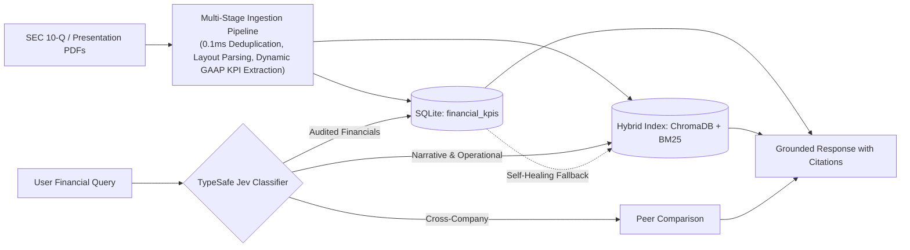

# 🎓 AI Certification — Generative AI Academy

Comprehensive repository containing capstone projects, production implementations, agentic workflows, and hands-on laboratory notebooks for the **Generative AI Academy Certification Program**.

---

## 🏆 Flagship Capstone Projects

### 🤖 [Week 2 Capstone: GenStockFolio — AI Financial Stock Analyst & Copilot](week2-project-stock-ai-analyzer/)

An institutional-grade Financial AI Copilot designed to eliminate financial LLM hallucinations by fusing **Deterministic GAAP SQL**, **Dense + Sparse Hybrid RAG**, and **TypeSafe Jev Intent Routing**, backed by 24 automated backend test suites passing with a 100% success rate.



#### Core Highlights:
* 📑 **Multi-Stage PDF Ingest**: 0.1ms SHA-256 deduplication, layout-aware PDF extraction, GAAP section classification, dynamic Pydantic KPI extraction into SQLite, and layout-preserving semantic chunking.
* 🧭 **TypeSafe Jev Routing**: Real-time semantic query classification routing between SQL, Hybrid RAG, and Peer Comparisons with probability breakdown.
* 📗 **Exact GAAP SQL Engine**: Zero-hallucination querying of 18 audited financial statement metrics with 100% mathematical fidelity.
* 📘 **Fused Hybrid RAG Engine**: ChromaDB dense vectors (`text-embedding-3-small`, 512-dim) + BM25 sparse keywords with Reciprocal Rank Fusion (RRF) & clickable SEC page citations `[Page - X, Section - Y]`.
* 🔄 **Self-Healing Fallback**: Dynamic recovery automatically fetching operational volume metrics (e.g. Energy Storage GWh, vehicle deliveries) from filing text when SQL lacks columns.
* 🔍 **Inspection Artifacts**: Complete transparency with markdown and JSON audit traces for every step in `server/.artifact/`.

#### Quick Links:
* 📁 **[Project Directory & Codebase](week2-project-stock-ai-analyzer/)**
* 📄 **[Full Architecture & Technical Documentation](week2-project-stock-ai-analyzer/docs/WEEK_2_DOCUMENTATION.md)**
* 🧪 **[Testing & Query Playbook (Top 5 SQL + Top 5 RAG)](week2-project-stock-ai-analyzer/TESTING.md)**
* 📑 **[Engineering Work Log](week2-project-stock-ai-analyzer/WORK_LOG.md)**

---

### 📈 [Week 1 Capstone: GenStockFolio — Cross-Platform Stock Portfolio Analyzer](week1-project-stock-analyzer/)

A modern, institutional-grade portfolio tracking and risk analytics application engineered in **Flutter 3.41 / Dart 3.11** for **macOS Desktop, Web (Chrome), and iOS Mobile**, developed under strict **Spec-Driven Development (SDD)** with 46 automated tests passing (100%).

#### Core Highlights:
* 📥 **Multi-Source Ingestion**: Official Plaid Investments API live institution synchronization & CSV drag-and-drop parsing (Fidelity, Schwab, Robinhood, generic).
* 📈 **Live Market Streaming**: Real-time ticker price streaming via Yahoo Finance API (`/v8/finance/chart`) with configurable polling intervals and reactive badge indicators.
* 🥧 **Interactive Allocation**: Radial explosion sector pie charts with bi-directional cross-filtering synced with sortable holdings tables.
* 📊 **Institutional Risk Analytics**: Portfolio equity trajectory vs. S&P 500 across multiple timeframes (1M, 3M, 6M, 1Y, ALL), Portfolio Beta, Sharpe Ratio, and Diversification Index.
* 🤖 **Custom AI Skills ("Superpowers")**: Authored custom agentic skills for environment diagnostics, 7-stage SDD interview gating, and monorepo scaffolding.

#### Quick Links:
* 🌐 **[Live Interactive Web Application](https://tarunkhurana2015.github.io/ai-certification-gen-academy/#/import)**
* 💻 **[Week 1 Project Directory & Codebase](week1-project-stock-analyzer/)**
* 📱 **[iOS Mobile Demo Recording](https://github.com/user-attachments/assets/cd37d596-ceeb-493a-8163-57dfc803d1a6)**
* 🤖 **[Custom AI Skills Repository](https://github.com/tarunkhurana2015/ai-skills)**
* 📄 **[Full Architecture & SDD Specifications](https://drive.google.com/file/d/1b8cUhIP4gyjTowOibQICxLwXWCSI3plz/view?usp=drive_link)**

---

## 📚 Coursework & Laboratory Notebooks

### 🔬 [Week 2: Advanced Retrieval-Augmented Generation (RAG)](week2-rag/)
Hands-on laboratory modules implementing advanced enterprise RAG techniques:
* **`1_rag_pipeline.ipynb`**: End-to-end RAG architecture with LangChain, document loading, recursive character chunking, embedding generation, ChromaDB vector indexing, and grounded prompt synthesis.
* **`2_metadata_filtering.ipynb`**: TypeSafe Jev Decision Classifier, dynamic query intent analysis, and structured metadata filtering (ticker, financial domain) for high-precision retrieval.
* **`3_hybrid_rag.ipynb`**: Fused Hybrid Search combining BM25 sparse lexical search and ChromaDB dense semantic vectors using LangChain's `EnsembleRetriever` with Reciprocal Rank Fusion (RRF).

---

### 🦜 [Week 1: LangChain & Agentic Workflows](week1-langchain/)
Foundational and intermediate agentic programming with LangChain:
* **`01_prompt_template.ipynb`**: Dynamic prompt templates, FewShot templates, and role-based prompt engineering.
* **`02_03_chat_models.ipynb`**: Model configuration, temperature, system messages, and multi-turn chat memory.
* **`04_chaining_with_lcel.ipynb`**: LangChain Expression Language (LCEL), pipe operators (`|`), runnables, and composition.
* **`05_structured_output.ipynb`**: Enforcing structured JSON schemas using Pydantic and LLM function calling.
* **`06_tool_calling.ipynb`**: Custom `@tool` decorators, schema generation, argument validation, and tool execution.
* **`07_create_agent.ipynb`**: Autonomous ReAct agent loops with multi-step reasoning, tool dispatching, and reflection.

---

### 🛠️ [LangChain Basics](langchain-basic/)
Reference implementations for fundamental LLM integration patterns, vector search setups, and utility functions.

---

## 📂 Repository Layout

```text
ai-certification-gen-academy/
├── week2-project-stock-ai-analyzer/   # ⭐ Week 2 Capstone: AI Financial Analyst & Copilot
│   ├── server/                        # FastAPI backend, Ingestion, Jev Classifier, RAG, SQL
│   │   ├── app/                       # Clean 3-tier architecture (Ingestion, Retrieval, Generation)
│   │   ├── tests/                     # 24 automated unit & integration test suites (100% pass)
│   │   └── .artifact/                 # Persistent inspection artifacts (JSON / Markdown)
│   ├── client/                        # Flutter macOS / iOS / Web client with AI Copilot chat
│   ├── docs/                          # Architectural documentation & presentation assets
│   ├── TESTING.md                     # Top 5 SQL & Top 5 RAG verified test queries
│   └── WORK_LOG.md                    # Chronological engineering log across all phases
│
├── week1-project-stock-analyzer/      # ⭐ Week 1 Capstone: Stock Portfolio Analyzer
│   ├── apps/gen_stock_folio/          # Flutter host application (macOS, Web, iOS)
│   ├── packages/                      # Clean Architecture feature packages (portfolio, allocation, analytics)
│   └── specs/                         # 7 formally gated Spec-Driven Development (SDD) specifications
│
├── week2-rag/                         # Week 2 RAG laboratory notebooks (Pipeline, Filtering, Hybrid)
├── week1-langchain/                   # Week 1 LangChain laboratory notebooks (01-07)
└── langchain-basic/                   # Foundational reference implementations
```

---

## 👨‍💻 Author & Acknowledgments

- **Author**: Tarun Khurana
- **Program**: AI Certification — Generative AI Academy
- **Skills Ecosystem**: [`tarunkhurana2015/ai-skills`](https://github.com/tarunkhurana2015/ai-skills)
- **Live Capstone Submissions**: [Google Drive Capstone Folder](https://drive.google.com/drive/u/0/folders/18TS8q2uCfXEB4_dvs2wKp_lfru75KGDE)