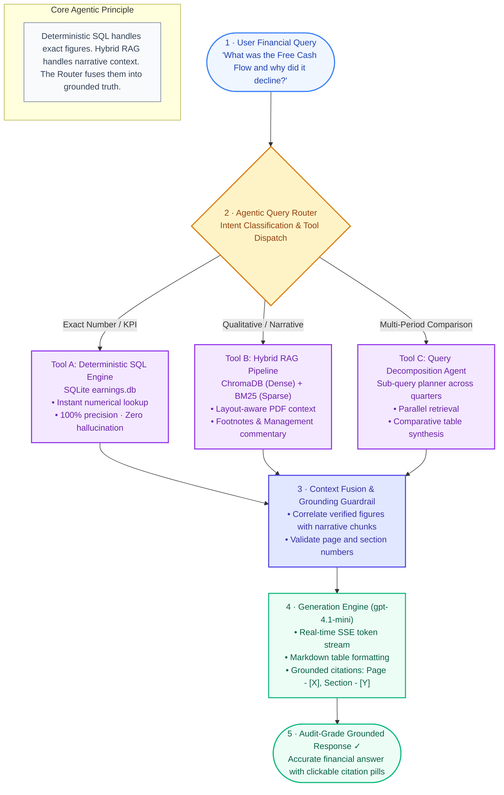
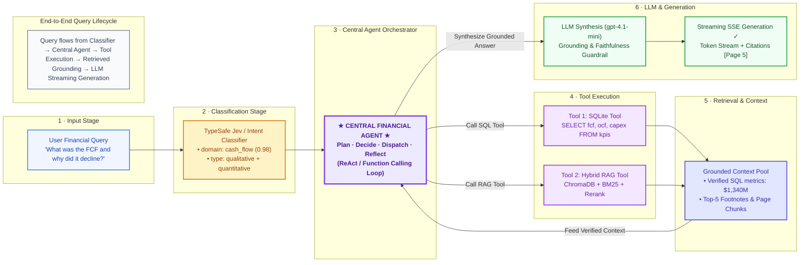
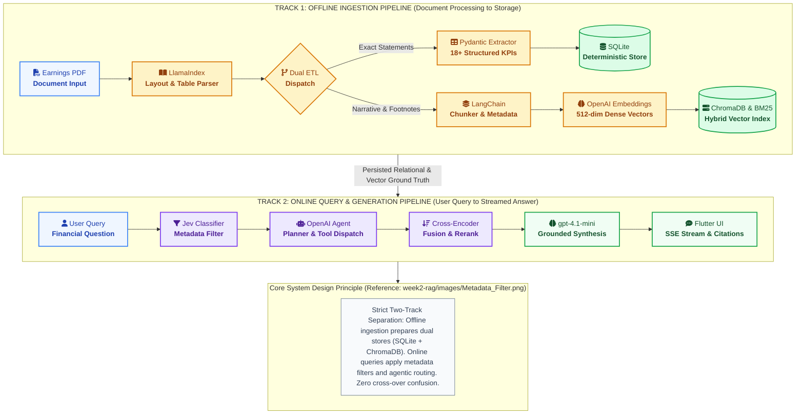
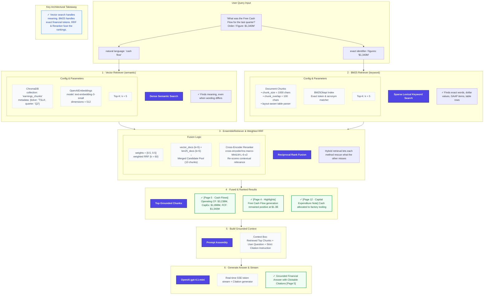
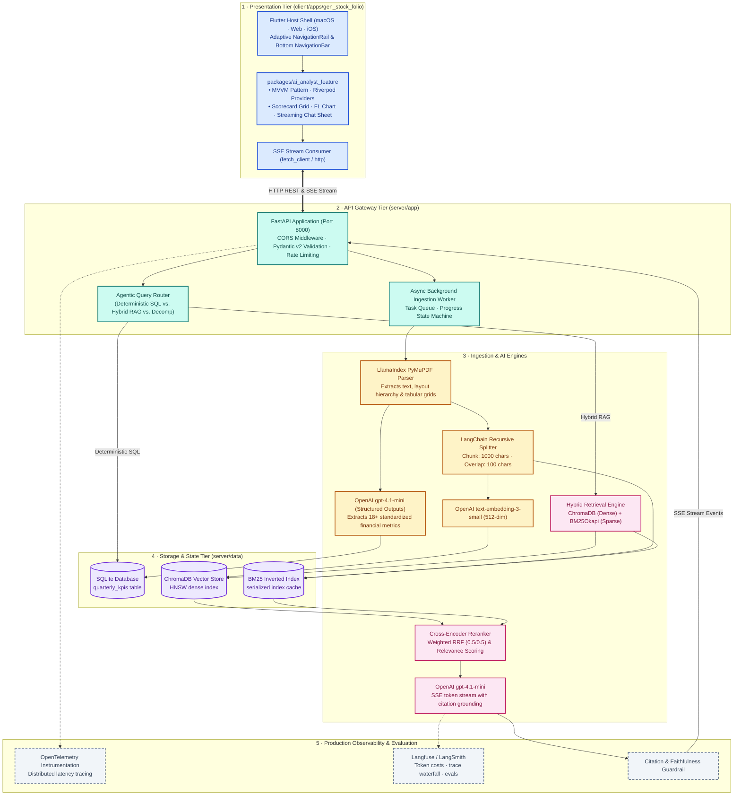
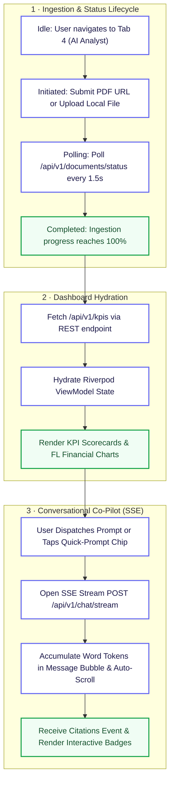
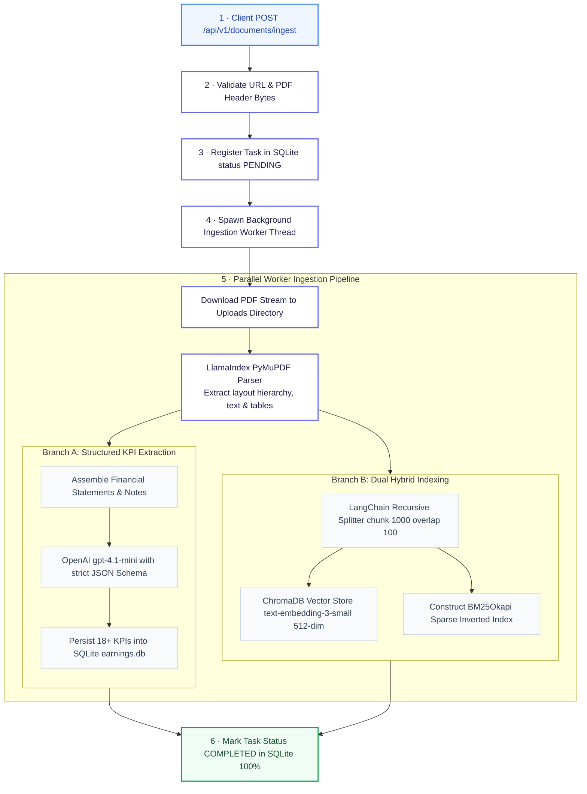
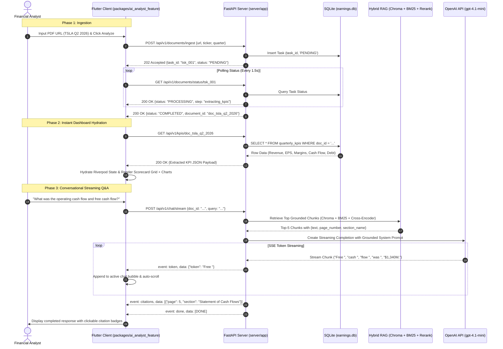
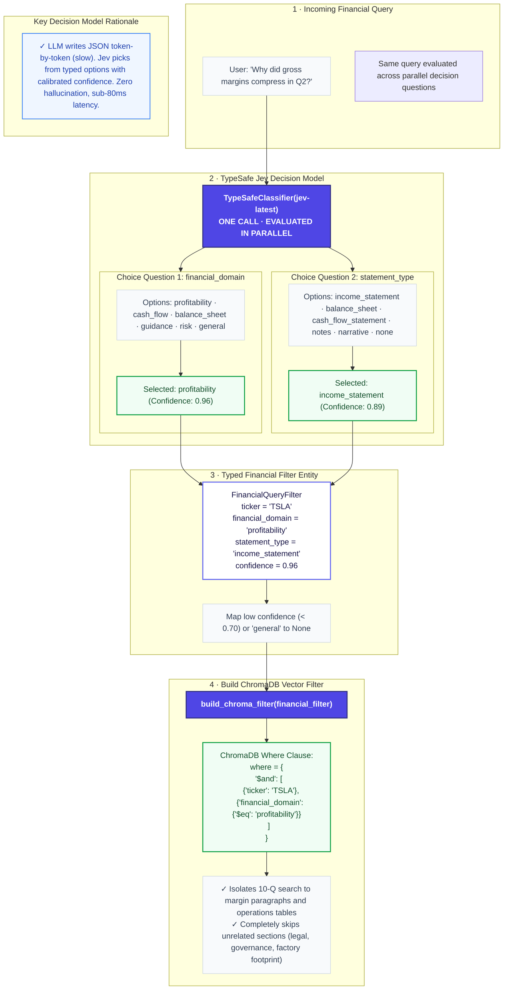
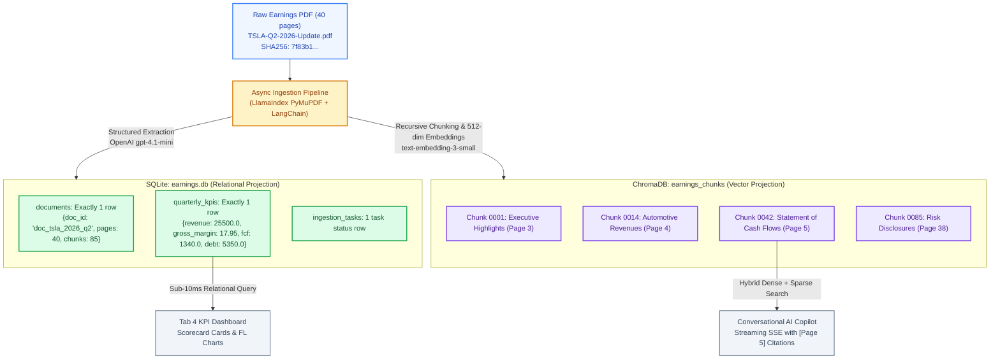

# 🏗️ Technical Architecture Document
## GenStockFolio AI Analyst — Agentic RAG Platform

**Version:** 2.0.0  
**Author:** Principal AI Systems Architect  
**Last Updated:** October 2026  
**Companions:**
- Product Requirements Document: [PRD.md](./PRD.md)
- Original Brainstorming & Idea Seed: [REQUIREMENTS.md](./REQUIREMENTS.md)

---

## 📑 Table of Contents

1. [Agentic RAG Architecture](#1-agentic-rag-architecture)
   - [1.1 Three-Pillar Foundation](#11-three-pillar-foundation)
   - [1.2 Core Agentic RAG Diagram](#12-core-agentic-rag-diagram)
   - [1.3 Query Lifecycle: Central Agent Orchestrator](#13-query-lifecycle-central-agent-orchestrator)
2. [Overall System Design](#2-overall-system-design)
3. [Tech Stack & Tooling Matrix](#3-tech-stack--tooling-matrix)
4. [Architectural Decisions (ADRs)](#4-architectural-decisions-adrs)
   - [4.1 Why FastAPI?](#41-why-fastapi)
   - [4.2 Docker Strategy](#42-docker-strategy)
   - [4.3 GitHub Pages Distribution Model](#43-github-pages-distribution-model)
   - [4.4 Monorepo Folder Structure](#44-monorepo-folder-structure)
   - [4.5 SQLite, Hybrid RAG, BM25 & Observability](#45-sqlite-hybrid-rag-bm25--observability)
   - [4.6 TypeSafe Jev Query Classification](#46-typesafe-jev-query-classification)
5. [Detailed Architecture Diagrams](#5-detailed-architecture-diagrams)
   - [5.1 Hybrid RAG Pipeline Flow](#51-hybrid-rag-pipeline-flow)
   - [5.2 Multi-Tier System Architecture](#52-multi-tier-system-architecture)
   - [5.3 Client State Machine](#53-client-state-machine)
   - [5.4 Server Ingestion Pipeline](#54-server-ingestion-pipeline)
   - [5.5 Client-Server SSE Protocol](#55-client-server-sse-protocol)
   - [5.6 Jev Classification Filter Flow](#56-jev-classification-filter-flow)
6. [API Specifications & Data Contracts](#6-api-specifications--data-contracts)
   - [6.1 Document Ingestion](#61-document-ingestion)
   - [6.2 Status Polling](#62-status-polling)
   - [6.3 KPI Retrieval](#63-kpi-retrieval)
   - [6.4 Streaming Chat (SSE)](#64-streaming-chat-sse)
7. [Database Schemas & Storage Design](#7-database-schemas--storage-design)
   - [7.1 Dual-Representation Pattern (Polyglot Persistence)](#71-dual-representation-pattern-polyglot-persistence)
   - [7.2 SQLite Relational Schema (earnings.db)](#72-sqlite-relational-schema-earningsdb)
   - [7.3 ChromaDB Vector Store Schema (earnings_chunks)](#73-chromadb-vector-store-schema-earnings_chunks)
   - [7.4 Schema Mapping: Single Report Lifecycle](#74-schema-mapping-single-report-lifecycle)
8. [Repository Structure](#8-repository-structure)

---

## 1. Agentic RAG Architecture

### 1.1 Three-Pillar Foundation

```
┌─────────────────────────────────────────────────────────────────────────────────────────┐
│                        AGENTIC RAG THREE-PILLAR FOUNDATION                              │
├────────────────────────────────┬───────────────────────────┬────────────────────────────┤
│ 1. INTELLIGENT QUERY ROUTING   │ 2. QUERY DECOMPOSITION    │ 3. GROUNDING REFLECTION    │
│ Classifies query intent into:  │ Deconstructs complex,     │ Verifies retrieved chunks  │
│ • Deterministic SQL Tool       │ multi-step queries into   │ against citations before   │
│ • Hybrid Semantic/BM25 Tool    │ discrete sub-questions    │ generation; falls back to  │
│ • Comparative Synthesis Tool   │ executed in parallel.     │ HyDE if context is sparse. │
└────────────────────────────────┴───────────────────────────┴────────────────────────────┘
```

**Pillar 1 — Intent-Driven Tool Routing:**
- **Quantitative Lookup Tool**: Queries for exact financial metrics (*"What was the total revenue?"*) route to **SQLite** for deterministic answers with 0% hallucination risk and < 5 ms latency.
- **Hybrid RAG Tool**: Qualitative narrative questions (*"Why did operating margins compress?"*) route to **ChromaDB + BM25 + Cross-Encoder** hybrid retrieval.

**Pillar 2 — Multi-Period Query Decomposition:**
- When asked *"Compare revenue of the last 3 quarters"*, the planner decomposes into 3 parallel sub-queries (`fetch_metrics(ticker, quarter)` × 3), pulls data from SQLite, and generates a structured comparison matrix.

**Pillar 3 — Self-Correction & Citation Verification:**
- The agent inspects retrieved context before generation. If chunks lack sufficient evidence, it rewrites via **HyDE** or transparently informs the user.

---

### 1.2 Core Agentic RAG Diagram



---

### 1.3 Query Lifecycle: Central Agent Orchestrator



---

## 2. Overall System Design

Inspired by the clean two-phase separation of [Metadata_Filter.png](file:///Users/tarunkhurana/Engineering/projects/tarunkhurana2015/ai-certification-gen-academy/week2-rag/images/Metadata_Filter.png), the system topology is organized into **two strictly linear, non-overlapping execution tracks** bridged solely by the persistent storage tier. Nothing crosses over or loops backwards:



---

## 3. Tech Stack & Tooling Matrix

```
┌─────────────────────────────────────────────────────────────────────────────────────────────────────────┐
│                                   GENSTOCKFOLIO AI ANALYST TECH STACK                                   │
├───────────────────┬───────────────────────────────────┬─────────────────────────────────────────────────┤
│ LAYER             │ TECHNOLOGY / TOOL                 │ PURPOSE & ARCHITECTURAL RATIONALE               │
├───────────────────┼───────────────────────────────────┼─────────────────────────────────────────────────┤
│ CLIENT            │ Flutter 3.41.6 & Dart 3.11.4      │ Cross-platform UI shell for macOS, Web, and iOS│
│                   │ Flutter Riverpod 2.6              │ Reactive state management & MVVM architecture   │
│                   │ GoRouter 14.6                     │ Declarative URL routing & StatefulShellRoute    │
│                   │ FL Chart 0.70                     │ Institutional-grade interactive financial charts│
│                   │ fetch_client / http               │ Streaming Server-Sent Events (SSE) token client │
├───────────────────┼───────────────────────────────────┼─────────────────────────────────────────────────┤
│ SERVER            │ Python >=3.11, <3.14              │ AI runtime environment                          │
│                   │ uv (Astral)                       │ Blazing fast Python package & virtualenv manager│
│                   │ FastAPI 0.115                     │ Async ASGI API gateway with native SSE streaming│
│                   │ Uvicorn                           │ Production ASGI web server                      │
│                   │ Pydantic v2                       │ Request validation & strict JSON Schema models  │
├───────────────────┼───────────────────────────────────┼─────────────────────────────────────────────────┤
│ AI & RAG          │ LlamaIndex (PyMuPDFReader)        │ Layout-aware PDF parsing & table preservation   │
│                   │ LangChain Recursive Splitter      │ Text chunking (1000 chars, 100 overlap)         │
│                   │ OpenAI text-embedding-3-small     │ Dense vector embeddings (512 dimensions)        │
│                   │ ChromaDB (Local Persistent)       │ Dense vector store with HNSW index & metadata   │
│                   │ rank-bm25 (BM25Okapi)             │ Sparse lexical keyword inverted index           │
│                   │ Cross-Encoder (FastEmbed / BGE)   │ Reciprocal Rank Fusion (RRF) & chunk reranking  │
│                   │ langchain-typesafe (Jev)          │ TypeSafe "System One" decision model (jev)      │
│                   │ OpenAI gpt-4.1-mini               │ Structured KPI extraction & grounded streaming  │
├───────────────────┼───────────────────────────────────┼─────────────────────────────────────────────────┤
│ STORAGE           │ SQLite 3 (WAL Mode)               │ Deterministic storage for extracted 18+ KPIs    │
│                   │ SQLAlchemy 2.0 / aiosqlite        │ Async database access & schema migrations       │
├───────────────────┼───────────────────────────────────┼─────────────────────────────────────────────────┤
│ OBSERVABILITY     │ OpenTelemetry Python SDK          │ Distributed tracing for ingestion & generation  │
│                   │ Langfuse / LangSmith              │ LLM token cost accounting, latency & eval traces│
├───────────────────┼───────────────────────────────────┼─────────────────────────────────────────────────┤
│ DEVOPS            │ Docker & Docker Compose           │ Containerized reproducible deployment           │
│                   │ GitHub Pages                      │ Static distribution for compiled Flutter Web app│
└───────────────────┴───────────────────────────────────┴─────────────────────────────────────────────────┘
```

---

## 4. Architectural Decisions (ADRs)

### 4.1 Why FastAPI?
> **Verdict: YES — FastAPI is the industry standard for production AI & RAG servers.**

| Criterion | FastAPI | Flask | Django | Streamlit/Gradio | Node.js |
|---|---|---|---|---|---|
| Native async SSE streaming | ✅ Built-in | ❌ Sync WSGI | ❌ Monolithic | ❌ No API mode | ✅ Good async |
| Pydantic v2 schema parity | ✅ Core | ❌ Manual | ❌ Heavy ORM | ❌ N/A | ❌ No Python AI |
| Auto-generated OpenAPI docs | ✅ `/docs` | ❌ Requires plugin | ❌ Requires DRF | ❌ N/A | ❌ Requires setup |
| Python AI ecosystem (LlamaIndex, LangChain, ChromaDB) | ✅ Native | ✅ Native | ✅ Native | ✅ Native | ❌ Missing |

FastAPI's `StreamingResponse(streamer(), media_type="text/event-stream")` enables high-concurrency SSE without blocking the event loop.

### 4.2 Docker Strategy
> **Verdict: Strongly recommended for production; bare-metal for development.**

- **Production**: `docker compose up --build` — encapsulates all C-extensions (`pymupdf`, `chromadb`, `onnxruntime`, `tokenizers`) and persistent volumes.
- **Development**: `uv run uvicorn app.main:app --reload` — sub-second hot-reloading on bare metal.
- **Persistent Storage**: `docker-compose.yml` mounts `./server/data/chroma` and `./server/data/sqlite` for container restart durability.

### 4.3 GitHub Pages Distribution Model
> **Critical: GitHub Pages is a static host ONLY — it cannot run Python or Docker.**

**Distribution Strategy:**
1. **Client**: Flutter Web compiled (`flutter build web --wasm`) → deployed to GitHub Pages.
2. **Server**: Users clone the repo and run `docker compose up` locally (or connect to a hosted cloud URL).
3. **Connection**: Flutter app provides a Backend Connection Settings dialog:
   - Default: `http://localhost:8000` (local Docker/FastAPI).
   - Remote: Hosted URL (e.g., Render, Hugging Face Docker Space).

### 4.4 Monorepo Folder Structure
> **Verdict: 2-folder monorepo (`client/` + `server/`) is the optimal pattern.**

```text
week2-project-stock-ai-analyzer/
├── client/                              # Flutter Cross-Platform Monorepo
│   ├── apps/gen_stock_folio/            # App Shell & Navigation
│   └── packages/                        # Modular Feature Packages
│       ├── portfolio_feature/           # Tab 1: Ingestion & CSV Import
│       ├── allocation_feature/          # Tab 2: Asset Allocation
│       ├── analytics_feature/           # Tab 3: Performance & Risk
│       └── ai_analyst_feature/          # Tab 4: NEW AI Analyst
│
├── server/                              # Python FastAPI Microservice
│   ├── Dockerfile
│   ├── pyproject.toml
│   ├── app/                             # FastAPI application & RAG engine
│   └── data/                            # Persistent volumes (SQLite + Chroma)
│
├── docker-compose.yml                   # Root Orchestrator
├── REQUIREMENTS.md                      # Product Requirements Document
├── ARCHITECTURE.md                      # This document
└── README.md                            # Setup & Run Guide
```

**Benefits**: Independent CI/CD (`flutter test` / `pytest`), no dependency bleed (`pubspec.yaml` ↔ `pyproject.toml`), easy migration of existing code into `client/`.

### 4.5 SQLite, Hybrid RAG, BM25 & Observability

| Decision | Rationale |
|---|---|
| **SQLite for dashboard KPIs** | Sub-millisecond hydration, exact math, multi-quarter comparison. |
| **Metadata filtering** | Two-tier: stamped at ingestion; applied as hard pre-filter in ChromaDB before semantic distance calculation. |
| **Hybrid RAG + BM25 + Reranker** | BM25 catches exact ticker codes and dollar figures; dense ChromaDB catches semantics; Cross-Encoder eliminates noise via RRF. |
| **OpenTelemetry** | Traces latency across ingestion, chunking, retrieval, and TTFT; integrates with Langfuse for cost accounting. |

### 4.6 TypeSafe Jev Query Classification
> **Verdict: YES — Jev solves the missing document facet gap.**

**The Problem**: Without typed metadata facets on PDF chunks, a query classifier has nothing structured to filter against. We resolve this by enriching chunks at ingestion with `financial_domain`, `statement_type`, and `content_format` enum facets.

**Why Jev over Generative LLM for Classification:**

| Approach | Latency | Hallucination Risk | Cost |
|---|---|---|---|
| Generative LLM (`gpt-4.1-mini`) | 300–600 ms | Can hallucinate enum values | Completion tokens consumed |
| TypeSafe Jev (`jev-latest`) | < 80 ms | 0% (picks from predefined choices) | Single logprob evaluation |

Jev evaluates logprobs across predefined choices in a single parallel call, returning calibrated confidence scores (e.g., `profitability: 0.96`, `income_statement: 0.89`). Scores below 0.70 threshold or `general` map to `None` (no filter applied).

---

## 5. Detailed Architecture Diagrams

### 5.1 Hybrid RAG Pipeline Flow



---

### 5.2 Multi-Tier System Architecture



---

### 5.3 Client State Machine



---

### 5.4 Server Ingestion Pipeline



---

### 5.5 Client-Server SSE Protocol



---

### 5.6 Jev Classification Filter Flow



---

## 6. API Specifications & Data Contracts

### 6.1 Document Ingestion
**POST** `/api/v1/documents/ingest`

```json
// Request
{
  "source_type": "url",
  "pdf_url": "https://assets-ir.tesla.com/tesla-contents/IR/TSLA-Q2-2026-Update.pdf",
  "ticker": "TSLA",
  "fiscal_year": 2026,
  "fiscal_quarter": "Q2"
}
```
```json
// Response (202 Accepted)
{
  "task_id": "8f3b6c42-8e12-4c28-98e3-b9c1d0f5e712",
  "status": "PENDING",
  "message": "Ingestion initiated in background."
}
```

### 6.2 Status Polling
**GET** `/api/v1/documents/status/{task_id}`

```json
// Response (200 OK)
{
  "task_id": "8f3b6c42-8e12-4c28-98e3-b9c1d0f5e712",
  "status": "COMPLETED",
  "progress_percentage": 100,
  "current_step": "completed",
  "document_id": "doc_tsla_2026_q2",
  "error_message": null
}
```

### 6.3 KPI Retrieval
**GET** `/api/v1/kpis/{document_id}`

```json
// Response (200 OK)
{
  "document_id": "doc_tsla_2026_q2",
  "ticker": "TSLA",
  "fiscal_period": "Q2 2026",
  "report_date": "2026-07-23",
  "summary": [
    "Total revenue reached $25.50B, reflecting a 2.1% YoY expansion.",
    "Operating margin compressed to 6.3% due to lower ASPs and restructuring.",
    "Balance sheet liquidity remains strong with $30.72B in cash and investments."
  ],
  "profitability": {
    "total_revenue_millions": 25500.0,
    "revenue_growth_yoy_pct": 2.1,
    "gross_profit_millions": 4578.0,
    "gross_margin_pct": 17.95,
    "operating_income_millions": 1605.0,
    "operating_margin_pct": 6.3,
    "net_income_millions": 1478.0,
    "net_margin_pct": 5.8,
    "eps_diluted_gaap": 0.52
  },
  "cash_flow": {
    "operating_cash_flow_millions": 3238.0,
    "capital_expenditures_millions": 1898.0,
    "free_cash_flow_millions": 1340.0
  },
  "balance_sheet": {
    "cash_and_equivalents_millions": 30720.0,
    "total_debt_millions": 5350.0,
    "net_cash_millions": 25370.0,
    "total_assets_millions": 110450.0,
    "total_liabilities_millions": 44820.0,
    "shareholders_equity_millions": 65630.0,
    "debt_to_equity_ratio": 0.082,
    "current_ratio": 1.74
  }
}
```

### 6.4 Streaming Chat (SSE)
**POST** `/api/v1/chat/stream`

```text
event: status
data: {"step": "retrieving_context"}

event: token
data: {"token": "Free "}

event: token
data: {"token": "cash "}

event: token
data: {"token": "flow "}

event: token
data: {"token": "was "}

event: token
data: {"token": "$1,340 "}

event: token
data: {"token": "million."}

event: citations
data: [{"page_number": 5, "section_name": "Statement of Cash Flows", "snippet": "Operating activities cash flow: $3,238M less CapEx: $1,898M equals Free Cash Flow: $1,340M."}]

event: done
data: {"status": "complete", "total_tokens": 145, "latency_ms": 780}
```

---

## 7. Database Schemas & Storage Design

The GenStockFolio AI Analyst employs a **Polyglot Persistence (Dual-Representation)** storage architecture. Instead of forcing unstructured text into relational tables or forcing exact mathematical numbers into vector embeddings, each data type is assigned to its optimal engine:

```
┌────────────────────────────────────────────────────────────────────────────────────────┐
│                        DUAL-REPRESENTATION DATA ARCHITECTURE                           │
├───────────────────────────────────────────┬────────────────────────────────────────────┤
│ 1. SQLite Relational Engine (earnings.db) │ 2. ChromaDB Vector Store (earnings_chunks) │
├───────────────────────────────────────────┼────────────────────────────────────────────┤
│ • Deterministic financial truth           │ • Semantic & contextual similarity search  │
│ • 18+ structured KPIs (Revenue, EPS, FCF) │ • 80-120 layout-aware text & table chunks  │
│ • Sub-10ms instant dashboard hydration    │ • Source citations (Page X, Section Y)     │
│ • Exact time-series & multi-quarter SQL   │ • Qualitative narrative & risk search      │
│ • Ingestion task tracking & state machine │ • BM25 lexical sparse index companion      │
└───────────────────────────────────────────┴────────────────────────────────────────────┘
```

---

### 7.1 SQLite Relational Schema (`data/sqlite/earnings.db`)

The SQLite database stores deterministic, structured financial data and tracks background ingestion tasks. It consists of three normalized tables:

```sql
-- ============================================================================
-- 1. DOCUMENTS TABLE: Ingested filings & report metadata
-- ============================================================================
CREATE TABLE IF NOT EXISTS documents (
    document_id          TEXT PRIMARY KEY,              -- e.g. 'doc_tsla_2026_q2'
    ticker               TEXT NOT NULL,                 -- e.g. 'TSLA'
    company_name         TEXT NOT NULL,                 -- e.g. 'Tesla, Inc.'
    fiscal_year          INTEGER NOT NULL,              -- e.g. 2026
    fiscal_quarter       TEXT NOT NULL,                 -- e.g. 'Q2'
    report_date          TEXT,                          -- ISO-8601: '2026-07-23'
    source_type          TEXT NOT NULL CHECK(source_type IN ('url', 'upload')),
    source_url           TEXT,                          -- Original URL or file path
    sha256_hash          TEXT NOT NULL UNIQUE,          -- Prevents duplicate ingestion
    total_pages          INTEGER NOT NULL,              -- Total page count of PDF
    total_chunks         INTEGER NOT NULL,              -- Count of generated chunks in Chroma
    created_at           TEXT NOT NULL DEFAULT (datetime('now', 'utc')),
    updated_at           TEXT NOT NULL DEFAULT (datetime('now', 'utc'))
);

-- Index for instant report lookup by ticker and fiscal period
CREATE INDEX IF NOT EXISTS idx_docs_ticker_period 
ON documents(ticker, fiscal_year, fiscal_quarter);

-- ============================================================================
-- 2. QUARTERLY_KPIS TABLE: 18+ Standardized Financial Metrics (Deterministic)
-- ============================================================================
CREATE TABLE IF NOT EXISTS quarterly_kpis (
    kpi_id                       INTEGER PRIMARY KEY AUTOINCREMENT,
    document_id                  TEXT NOT NULL UNIQUE REFERENCES documents(document_id) ON DELETE CASCADE,
    ticker                       TEXT NOT NULL,
    fiscal_year                  INTEGER NOT NULL,
    fiscal_quarter               TEXT NOT NULL,
    
    -- Executive Summary Bullets
    summary_bullet_1             TEXT NOT NULL,
    summary_bullet_2             TEXT NOT NULL,
    summary_bullet_3             TEXT NOT NULL,
    
    -- Profitability Metrics (in Millions USD, unless ratio/per-share)
    total_revenue_millions       REAL NOT NULL,         -- e.g. 25500.0
    revenue_growth_yoy_pct       REAL,                  -- e.g. 2.1 (+2.1%)
    gross_profit_millions        REAL NOT NULL,         -- e.g. 4578.0
    gross_margin_pct             REAL NOT NULL,         -- e.g. 17.95
    operating_income_millions    REAL NOT NULL,         -- e.g. 1605.0 (EBIT)
    operating_margin_pct         REAL NOT NULL,         -- e.g. 6.30
    net_income_millions          REAL NOT NULL,         -- e.g. 1478.0
    net_margin_pct               REAL NOT NULL,         -- e.g. 5.80
    eps_diluted_gaap             REAL NOT NULL,         -- e.g. 0.52
    eps_diluted_nongaap          REAL,                  -- e.g. 0.60
    
    -- Cash Flow Metrics (in Millions USD)
    operating_cash_flow_millions REAL NOT NULL,         -- e.g. 3238.0
    capital_expenditures_millions REAL NOT NULL,        -- e.g. 1898.0
    free_cash_flow_millions      REAL NOT NULL,         -- e.g. 1340.0 (OCF - CapEx)
    fcf_conversion_rate_pct      REAL,                  -- e.g. 90.66 (FCF / Net Income)
    
    -- Balance Sheet & Liquidity Metrics (in Millions USD)
    cash_and_equivalents_millions REAL NOT NULL,        -- e.g. 30720.0
    total_debt_millions          REAL NOT NULL,         -- e.g. 5350.0
    net_cash_millions            REAL NOT NULL,         -- e.g. 25370.0 (Cash - Debt)
    total_assets_millions        REAL NOT NULL,         -- e.g. 110450.0
    total_liabilities_millions   REAL NOT NULL,         -- e.g. 44820.0
    shareholders_equity_millions REAL NOT NULL,         -- e.g. 65630.0
    debt_to_equity_ratio         REAL,                  -- e.g. 0.082 (Total Debt / Equity)
    current_ratio                REAL,                  -- e.g. 1.74 (Current Assets / Liab)
    
    -- Extraction Metadata
    extracted_at                 TEXT NOT NULL DEFAULT (datetime('now', 'utc')),
    model_version                TEXT NOT NULL DEFAULT 'gpt-4.1-mini-2026-structured',
    
    -- Unique constraint guarantees exactly one KPI row per ticker quarter
    UNIQUE(ticker, fiscal_year, fiscal_quarter)
);

-- Index for rapid multi-quarter comparative queries (e.g. SELECT ... ORDER BY fiscal_year, fiscal_quarter)
CREATE INDEX IF NOT EXISTS idx_kpis_ticker_time 
ON quarterly_kpis(ticker, fiscal_year, fiscal_quarter);

-- ============================================================================
-- 3. INGESTION_TASKS TABLE: Asynchronous Progress State Machine
-- ============================================================================
CREATE TABLE IF NOT EXISTS ingestion_tasks (
    task_id              TEXT PRIMARY KEY,              -- UUIDv4: '8f3b6c42-8e12-...'
    source_url           TEXT NOT NULL,
    ticker               TEXT NOT NULL,
    fiscal_year          INTEGER NOT NULL,
    fiscal_quarter       TEXT NOT NULL,
    status               TEXT NOT NULL CHECK(status IN ('PENDING', 'PROCESSING', 'COMPLETED', 'FAILED')),
    progress_percentage  INTEGER NOT NULL DEFAULT 0,    -- 0 to 100
    current_step         TEXT NOT NULL,                 -- 'downloading', 'parsing', 'kpis', 'indexing'
    document_id          TEXT REFERENCES documents(document_id) ON DELETE SET NULL,
    error_message        TEXT,
    started_at           TEXT NOT NULL DEFAULT (datetime('now', 'utc')),
    completed_at         TEXT
);

CREATE INDEX IF NOT EXISTS idx_tasks_status 
ON ingestion_tasks(status, started_at);
```

---

### 7.2 ChromaDB Vector Store Schema (`data/chroma/`)

ChromaDB stores layout-aware chunks and dense embeddings to support semantic narrative retrieval, footnote discovery, and citation generation.

#### Collection Configuration:
- **Collection Name**: `earnings_chunks`
- **Embedding Function**: OpenAI `text-embedding-3-small`
- **Vector Dimensions**: `512`
- **Distance Metric**: `cosine` (HNSW indexing algorithm)

#### Collection Record Structure:
Each entry in `earnings_chunks` is composed of four elements:

```json
{
  "id": "doc_tsla_2026_q2_chunk_0042",
  "document": "Consolidated Statement of Cash Flows (in millions)\nOperating activities:\nOperating cash flow: $3,238\nCapital expenditures: $(1,898)\nFree cash flow: $1,340\n\nManagement Commentary: Free cash flow generation remained resilient at $1.3B in Q2 despite ongoing capital expenditures for our Cortex AI supercomputing training cluster.",
  "embedding": [-0.0234, 0.0512, -0.0108, 0.0489, "... 512 total floats ..."],
  "metadata": {
    "chunk_id": "doc_tsla_2026_q2_chunk_0042",
    "document_id": "doc_tsla_2026_q2",
    "ticker": "TSLA",
    "fiscal_year": 2026,
    "fiscal_quarter": "Q2",
    "page_number": 5,
    "section_name": "Consolidated Statements of Cash Flows",
    "financial_domain": "cash_flow",
    "statement_type": "cash_flow_statement",
    "content_format": "table",
    "token_count": 184
  }
}
```

#### ChromaDB Metadata Attributes & Facet Enums:

| Attribute | Type | Allowed Values / Format | Description |
|---|---|---|---|
| `chunk_id` | `string` | `doc_{ticker}_{year}_{qtr}_chunk_{idx:04d}` | Unique identifier for each chunk |
| `document_id` | `string` | `doc_{ticker}_{year}_{qtr}` | Foreign reference to SQLite `documents` table |
| `ticker` | `string` | e.g. `"TSLA"`, `"AAPL"` | Stock ticker for strict query filtering |
| `fiscal_year` | `int` | e.g. `2026` | Fiscal calendar year |
| `fiscal_quarter`| `string` | `"Q1"`, `"Q2"`, `"Q3"`, `"Q4"` | Fiscal quarter |
| `page_number` | `int` | `1` to `100` | Exact PDF page number (used for citation pills) |
| `section_name` | `string` | e.g. `"Cash Flows"`, `"Operations"` | Section title for citation subtitles |
| `financial_domain`| `string` | `profitability` · `cash_flow` · `balance_sheet` · `guidance_outlook` · `risk_factors` · `general` | Ingestion & query classifier focus area |
| `statement_type` | `string` | `income_statement` · `balance_sheet` · `cash_flow_statement` · `financial_notes` · `press_release_narrative` · `other` | Financial context categorization |
| `content_format` | `string` | `table` · `metric_highlight` · `prose` | Format structure of the extracted chunk |
| `token_count` | `int` | `50` to `350` | Word/token length for prompt budgeting |

---

### 7.3 Schema Mapping: Single Report Ingestion Lifecycle

This diagram demonstrates how a single uploaded PDF report (e.g., Tesla Q2 2026 Update, 40 pages) is processed into both database stores without duplicate records:



---

## 8. Repository Structure

```text
week2-project-stock-ai-analyzer/
├── client/                                     # Flutter Cross-Platform Monorepo
│   ├── pubspec.yaml                            # Root workspace pubspec
│   ├── apps/
│   │   └── gen_stock_folio/                    # App Shell (iOS, macOS, Web)
│   │       ├── lib/
│   │       │   ├── app.dart
│   │       │   ├── main.dart
│   │       │   └── core/
│   │       │       ├── router/app_router.dart  # Adds Branch 3: /ai-analyst
│   │       │       └── theme/app_theme.dart    # Dark/light theme tokens
│   │       └── web/                            # Web runner for GitHub Pages
│   └── packages/
│       ├── portfolio_feature/                  # Tab 1: Ingestion
│       ├── allocation_feature/                 # Tab 2: Allocation
│       ├── analytics_feature/                  # Tab 3: Performance
│       └── ai_analyst_feature/                 # Tab 4: AI Analyst Package
│           ├── pubspec.yaml
│           └── lib/
│               ├── ai_analyst_feature.dart
│               ├── domain/                     # Entities & Repository contracts
│               ├── data/                       # API client & SSE stream reader
│               └── presentation/               # MVVM ViewModels, Views & Charts
│
├── server/                                     # Python FastAPI Microservice
│   ├── Dockerfile                              # Multi-stage production container
│   ├── pyproject.toml                          # uv / pip dependency management
│   ├── requirements.txt
│   │
│   ├── app/
│   │   ├── main.py                             # FastAPI factory, lifespan, CORS & router mount
│   │   │
│   │   ├── core/                               # ⚙️ Application Foundation
│   │   │   ├── config.py                       # Pydantic BaseSettings (.env loading, ports, keys)
│   │   │   ├── logging.py                      # Structured logging configuration
│   │   │   ├── telemetry.py                    # OpenTelemetry & Langfuse tracing hooks
│   │   │   └── exceptions.py                   # Domain exceptions & centralized error handlers
│   │   │
│   │   ├── db/                                 # 🗄️ Relational Data Tier (SQLite)
│   │   │   ├── session.py                      # SQLite connection pooling & WAL mode configuration
│   │   │   ├── schema.py                       # DDL table creation (documents, kpis, tasks)
│   │   │   ├── models.py                       # SQLAlchemy ORM models
│   │   │   └── repositories/                   # Repository Pattern (isolated SQL queries)
│   │   │       ├── document_repo.py            # Documents CRUD & task state queries
│   │   │       └── kpi_repo.py                 # Structured KPI queries & multi-quarter time-series
│   │   │
│   │   ├── schemas/                            # 📋 Pydantic Type Contracts & DTOs
│   │   │   ├── common.py                       # Enums: FinancialDomain, StatementType, ContentFormat
│   │   │   ├── ingestion.py                    # IngestRequest, IngestResponse, TaskStatusResponse
│   │   │   ├── kpis.py                         # FinancialKPIsResponse, Profitability, CashFlow schemas
│   │   │   └── chat.py                         # ChatStreamRequest, SSEEvent, CitationPayload
│   │   │
│   │   ├── classifier/                         # 🎯 Query Classification & Filter Builder
│   │   │   ├── jev_classifier.py               # TypeSafe Jev classifier / calibrated confidence engine
│   │   │   ├── intents.py                      # Intent taxonomy (ExactKPI, Narrative, MultiQuarter)
│   │   │   └── filter_builder.py               # Generates ChromaDB & SQL filter payloads from facets
│   │   │
│   │   ├── ingestion/                          # 📑 Document Processing & Extraction Pipeline
│   │   │   ├── downloader.py                   # Secure PDF downloader (URL fetch, SHA-256 deduplication)
│   │   │   ├── parsers/                        # Layout-Aware PDF Extraction
│   │   │   │   ├── base.py                     # Abstract BaseParser interface
│   │   │   │   ├── pymupdf_parser.py           # LlamaIndex PyMuPDF text & page hierarchy extractor
│   │   │   │   └── table_extractor.py          # GAAP financial table extractor (preserves row/col grids)
│   │   │   ├── chunkers/                       # Chunking & Semantic Enrichment
│   │   │   │   ├── recursive_chunker.py        # LangChain text splitter (1000 chars / 100 overlap)
│   │   │   │   └── metadata_enricher.py        # Tags page_number, section_name, financial_domain
│   │   │   ├── extractor/                      # Deterministic KPI Extraction
│   │   │   │   ├── kpi_extractor.py            # OpenAI Structured Output parser for 18+ KPIs
│   │   │   │   └── kpi_validator.py            # Financial math validator (e.g. FCF == OCF - CapEx)
│   │   │   └── pipeline.py                     # IngestionPipeline orchestrator (Download -> Parse -> Extract -> Index)
│   │   │
│   │   ├── indexing/                           # 🧠 Embeddings & Vector Storage
│   │   │   ├── embeddings.py                   # OpenAI text-embedding-3-small (512-dim) wrapper
│   │   │   ├── vector_store.py                 # ChromaDB collection client, HNSW params, upsert logic
│   │   │   └── bm25_index.py                   # In-memory BM25Okapi inverted index per document/ticker
│   │   │
│   │   ├── retrieval/                          # 🔍 Hybrid Search & Reranking
│   │   │   ├── dense_retriever.py              # ChromaDB cosine similarity search with metadata pre-filtering
│   │   │   ├── sparse_retriever.py             # BM25 keyword search for exact numbers and acronyms
│   │   │   ├── hybrid_fusion.py                # Reciprocal Rank Fusion (weighted RRF, k=60)
│   │   │   └── reranker.py                     # Cross-Encoder (ms-marco-MiniLM-L-6-v2) relevance re-scorer
│   │   │
│   │   ├── agent/                              # 🤖 Central Financial Agent Orchestration
│   │   │   ├── orchestrator.py                 # Central Agent state machine & ReAct decision loop
│   │   │   ├── planner.py                      # Multi-quarter query planner & sub-query decomposer
│   │   │   ├── state.py                        # Agent state definition (query, sub_queries, context, citations)
│   │   │   └── tools/                          # Reusable Agent Tools
│   │   │       ├── sql_tool.py                 # Deterministic SQLite query tool (exact numbers, zero hallucination)
│   │   │       ├── rag_tool.py                 # Hybrid RAG retrieval tool (qualitative commentary & footnotes)
│   │   │       └── comparison_tool.py          # Multi-quarter variance & delta percentage calculator
│   │   │
│   │   ├── generation/                         # ✍️ LLM Synthesis, Guardrails & Streaming
│   │   │   ├── prompt_builder.py               # Grounded system prompts with strict citation rules
│   │   │   ├── llm_client.py                   # OpenAI client (gpt-4.1-mini) with streaming support
│   │   │   ├── guardrails.py                   # Grounding validator & hallucination prevention guardrail
│   │   │   ├── citation_engine.py              # Generates [Page - X, Section - Y] citation pills
│   │   │   └── sse_formatter.py                # Server-Sent Events (SSE) token stream formatter
│   │   │
│   │   └── api/v1/                             # 🌐 Thin HTTP Controller Layer (FastAPI Routers)
│   │       ├── router.py                       # Root v1 APIRouter registering all sub-routers
│   │       └── endpoints/
│   │           ├── documents.py                # POST /documents/ingest, GET /documents/status/{id}
│   │           ├── kpis.py                     # GET /kpis/{document_id}, GET /kpis/compare
│   │           ├── chat.py                     # POST /chat/stream (SSE streaming endpoint)
│   │           └── health.py                   # GET /health (liveness/readiness probes)
│   │
│   ├── data/                                   # Persistent local storage (Docker volume targets)
│   │   ├── chroma/                             # ChromaDB persistent vector storage
│   │   ├── sqlite/                             # earnings.db
│   │   └── uploads/                            # Raw PDF cache
│   │
│   └── tests/                                  # 🧪 Comprehensive Test Suite
│       ├── conftest.py                         # Pytest fixtures, mock LLM client, in-memory SQLite/Chroma
│       ├── unit/
│       │   ├── test_classifier.py              # Test Jev intent classification & filter generation
│       │   ├── test_ingestion.py               # Test PyMuPDF parsing, table extraction, and chunking
│       │   ├── test_kpi_extractor.py           # Test 18+ KPI extraction accuracy on benchmark PDFs
│       │   ├── test_retrieval.py               # Test Dense, BM25, RRF fusion, and Cross-Encoder reranker
│       │   ├── test_agent_tools.py             # Test SQL tool and Hybrid RAG tool dispatching
│       │   └── test_guardrails.py              # Test citation extraction and hallucination prevention
│       └── integration/
│           ├── test_documents_flow.py          # End-to-end ingestion and status polling test
│           ├── test_kpis_api.py                # End-to-end SQLite KPI retrieval test
│           └── test_chat_sse_stream.py         # End-to-end SSE chat stream test
│
├── docker-compose.yml                          # Container orchestration
├── REQUIREMENTS.md                             # Original User Brainstorming Notes
├── PRD.md                                      # Product Requirements Document
├── ARCHITECTURE.md                             # This document
└── README.md                                   # End-to-end setup guide
```

---

### Granular Server Domain Breakdown (`server/app/`)

| Domain Package | Single Responsibility | Key Modules |
|---|---|---|
| `app/core/` | Global configuration, logging, OpenTelemetry tracing, exception handling | `config.py`, `logging.py`, `telemetry.py`, `exceptions.py` |
| `app/db/` | SQLite connection pooling, table schemas, and data access repositories | `session.py`, `schema.py`, `repositories/document_repo.py`, `repositories/kpi_repo.py` |
| `app/schemas/` | Pydantic v2 data transfer objects, request/response contracts, and facet enums | `common.py`, `ingestion.py`, `kpis.py`, `chat.py` |
| `app/classifier/` | Sub-80ms Jev query intent classification and metadata filter compilation | `jev_classifier.py`, `intents.py`, `filter_builder.py` |
| `app/ingestion/` | Multi-stage ETL pipeline: download, PyMuPDF parse, table extract, chunk, and 18+ KPI extraction | `downloader.py`, `parsers/`, `chunkers/`, `extractor/`, `pipeline.py` |
| `app/indexing/` | Embeddings generation (`text-embedding-3-small`), ChromaDB collection upserts, and BM25 index build | `embeddings.py`, `vector_store.py`, `bm25_index.py` |
| `app/retrieval/` | Dense ChromaDB search, sparse BM25 search, weighted RRF fusion, and Cross-Encoder reranking | `dense_retriever.py`, `sparse_retriever.py`, `hybrid_fusion.py`, `reranker.py` |
| `app/agent/` | Central Financial Agent orchestration, multi-quarter planning, and tool dispatching | `orchestrator.py`, `planner.py`, `tools/sql_tool.py`, `tools/rag_tool.py` |
| `app/generation/` | Grounded system prompting, OpenAI streaming client, citation pill generator, and SSE formatter | `prompt_builder.py`, `llm_client.py`, `citation_engine.py`, `guardrails.py`, `sse_formatter.py` |
| `app/api/v1/` | Thin FastAPI endpoint controllers with Pydantic validation and HTTP routing | `router.py`, `endpoints/documents.py`, `endpoints/kpis.py`, `endpoints/chat.py` |
