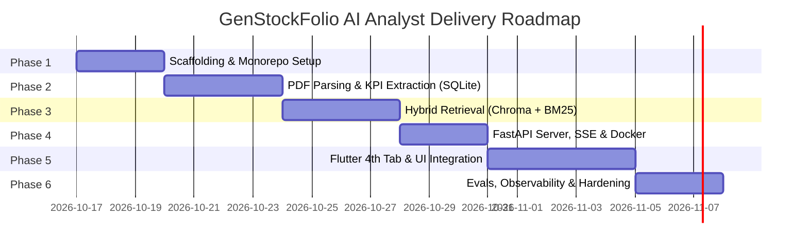

# 📘 Product Requirements Document (PRD)
## Project: GenStockFolio AI Analyst — Agentic RAG Platform for Earnings Reports

**Document Version:** 1.0.0  
**Status:** Approved for Implementation  
**Methodology:** Spec-Driven Development (SDD) & Clean Architecture  
**Companion Documents:**
- Original Brainstorming & Idea Seed: [REQUIREMENTS.md](./REQUIREMENTS.md)
- Technical Architecture & System Design: [ARCHITECTURE.md](./ARCHITECTURE.md)

---

## 📑 Table of Contents

1. [Executive Summary](#1-executive-summary)
2. [Problem Statement & Market Opportunity](#2-problem-statement--market-opportunity)
   - [2.1 The Core Problem](#21-the-core-problem)
   - [2.2 Why Existing Solutions Fail](#22-why-existing-solutions-fail)
   - [2.3 The Solution: AI-Powered Earnings Copilot](#23-the-solution-ai-powered-earnings-copilot)
3. [User Personas](#3-user-personas)
   - [3.1 Persona A: Marcus Vance — Active Retail Investor](#31-persona-a-marcus-vance--active-retail-investor)
   - [3.2 Persona B: Priya Sharma — Junior Buy-Side Equity Analyst](#32-persona-b-priya-sharma--junior-buy-side-equity-analyst)
   - [3.3 Persona C: Daniel Lee — Financial Content Creator & Educator](#33-persona-c-daniel-lee--financial-content-creator--educator)
4. [User Journey & Core Use Cases](#4-user-journey--core-use-cases)
   - [4.1 Use Case UC-1: Instant Ingestion via PDF URL / Upload](#41-use-case-uc-1-instant-ingestion-via-pdf-url--upload)
   - [4.2 Use Case UC-2: Financial Health Scorecard & KPI Dashboard](#42-use-case-uc-2-financial-health-scorecard--kpi-dashboard)
   - [4.3 Use Case UC-3: Conversational Q&A with Audit-Grade Source Citations](#43-use-case-uc-3-conversational-qa-with-audit-grade-source-citations)
   - [4.4 Use Case UC-4: Multi-Quarter Trend Comparison](#44-use-case-uc-4-multi-quarter-trend-comparison)
   - [4.5 Use Case UC-5: Source Evidence Verification (Inspector Sheet)](#45-use-case-uc-5-source-evidence-verification-inspector-sheet)
   - [4.6 Use Case UC-6: Risk Factor & Headwind Discovery](#46-use-case-uc-6-risk-factor--headwind-discovery)
   - [4.7 Use Case UC-7: Offline / Cached Report Review](#47-use-case-uc-7-offline--cached-report-review)
5. [Feature Specifications & Functional Requirements](#5-feature-specifications--functional-requirements)
   - [5.1 Navigation & Layout (Tab 4 Integration)](#51-navigation--layout-tab-4-integration)
   - [5.2 18+ Standardized Financial KPIs](#52-18-standardized-financial-kpis)
   - [5.3 Natural Language Query Engine & Chat Interface](#53-natural-language-query-engine--chat-interface)
   - [5.4 Ingestion Pipeline & Background Progress Feedback](#54-ingestion-pipeline--background-progress-feedback)
6. [Data & Storage Requirements](#6-data--storage-requirements)
   - [6.1 Document & Metadata Ingestion Requirements](#61-document--metadata-ingestion-requirements)
   - [6.2 Deterministic Structured Data Store](#62-deterministic-structured-data-store)
   - [6.3 Semantic Chunk Index Store](#63-semantic-chunk-index-store)
7. [Non-Functional Requirements (NFRs)](#7-non-functional-requirements-nfrs)
   - [7.1 Grounding & Hallucination Elimination](#71-grounding--hallucination-elimination)
   - [7.2 Latency & Performance SLAs](#72-latency--performance-slas)
   - [7.3 Cross-Platform User Experience](#73-cross-platform-user-experience)
   - [7.4 Privacy, Security & Secrets Management](#74-privacy-security--secrets-management)
8. [Acceptance Criteria & Definition of Done](#8-acceptance-criteria--definition-of-done)
9. [Delivery Roadmap](#9-delivery-roadmap)

---

## 1. Executive Summary

GenStockFolio is a modern, cross-platform stock portfolio and market analytics platform built with Flutter. Week 1 established a foundational portfolio tracking app supporting multi-asset management, live charting, and fundamental performance tracking.

The **AI Analyst** feature (Tab 4) introduces an **Agentic Retrieval-Augmented Generation (RAG) copilot** purpose-built for financial analysis. By digesting complex quarterly corporate earnings reports (such as Tesla's Q2 Update PDF, Apple 10-Q, etc.), the system transforms dense, unstructured financial disclosures into:
1. An **interactive KPI dashboard** powered by deterministic structured data (instant load, 0% hallucination risk).
2. A **conversational AI copilot** capable of answering complex quantitative and qualitative questions with **audit-grade citations** (`Page - [X], Section - [Y]`).
3. An **evidence inspector** allowing analysts to click any citation to inspect the underlying PDF source chunk and verification metadata.

---

## 2. Problem Statement & Market Opportunity

### 2.1 The Core Problem
Quarterly earnings reports (10-Q filings, shareholder updates, and earnings decks) are typically 30 to 90 pages of dense legal narrative, complex multi-column GAAP/Non-GAAP tables, and obscure footnote disclosures.

- **Information Overload**: Reading and manually cross-referencing an earnings deck takes an experienced investor 45–90 minutes per company per quarter.
- **Hidden Disclosures**: Critical signals—such as margin compression drivers, accounts receivable spikes, inventory write-downs, or subtle changes in full-year guidance—are frequently buried in footnotes on pages 28–45.
- **Context Fragmentation**: Retail investors and junior analysts struggle to connect narrative statements (e.g., *"We saw improved operational efficiencies"*) with the corresponding financial line items (e.g., Operating Margin declining from 9.6% to 6.3%).

### 2.2 Why Existing Solutions Fail
1. **Generic LLM Chatbots (ChatGPT, Claude web interfaces)**:
   - When uploaded with a 60-page PDF, generic chatbots suffer from attention loss ("lost in the middle").
   - Frequently hallucinate or confuse similar figures (e.g., confusing GAAP Operating Margin with Gross Margin or Non-GAAP EBIT).
   - Provide no clickable source proof or audit trail.
2. **Naive RAG Pipelines**:
   - Standard chunking fragments tables across chunk boundaries, separating column headers from dollar amounts.
   - Vector search maps *"Gross Margin 18.0%"* and *"Operating Margin 6.3%"* into adjacent vector clusters, returning wrong numbers.
   - Incapable of calculating basic delta percentages or synthesizing multi-quarter trends.

### 2.3 The Solution: AI-Powered Earnings Copilot
GenStockFolio AI Analyst bridges this gap through a **hybrid agentic approach**:
- **Deterministic KPI Extraction**: Extracts key financial figures during ingestion into a relational store (SQLite). Numerical lookups are executed via deterministic SQL queries with $< 5\text{ ms}$ latency and zero hallucination.
- **Layout-Aware Hybrid RAG**: Preserves financial table structure and pairs dense semantic search with BM25 keyword matching to retrieve exact financial acronyms, metrics, and commentary.
- **Audit-Grade Citations**: Every single statement generated by the copilot cites exact page numbers, table names, and relevant snippets.

---

## 3. User Personas

### 3.1 Persona A: Marcus Vance — Active Retail Investor
- **Profile**: 34 years old, software engineer, manages an active personal portfolio of $180k across 12 high-growth tech stocks.
- **Goal**: Quickly assess whether an earnings report beat or missed expectations on both revenue and free cash flow within 10 minutes of release.
- **Frustration**: *"I don't have time to read 45 pages of SEC filings after work. I want the core scorecard immediately, and I want to ask targeted questions about why margins dropped without getting hallucinated numbers."*
- **Primary Feature Used**: Tab 4 KPI Scorecard + Quick Prompts (*"Break down operating margin drivers"*).

### 3.2 Persona B: Priya Sharma — Junior Buy-Side Equity Analyst
- **Profile**: 26 years old, works at a boutique asset management fund, covers automotive and clean energy.
- **Goal**: Synthesize quarterly performance, audit management guidance against actuals, and trace citations for client pitch decks.
- **Frustration**: *"If an AI tool gives me a figure, I cannot put it in my report unless I can verify the exact table and page it came from. Non-verifiable AI is useless to me."*
- **Primary Feature Used**: Source Evidence Inspector + Multi-Quarter Trend Analysis.

### 3.3 Persona C: Daniel Lee — Financial Content Creator & Educator
- **Profile**: 29 years old, publishes weekly market breakdowns to 40,000 newsletter subscribers and YouTube followers.
- **Goal**: Generate clean visual comparisons of company financial health and pull direct executive quotes.
- **Frustration**: *"I spend hours copying numbers from PDFs into spreadsheets just to plot 3 quarters of CapEx vs FCF."*
- **Primary Feature Used**: FL Chart Financial Visualizations + Comparative Synthesis.

---

## 4. User Journey & Core Use Cases

### 4.1 Use Case UC-1: Instant Ingestion via PDF URL / Upload
- **Actor**: Any authenticated/active user.
- **Preconditions**: User has navigated to Tab 4 ("AI Analyst").
- **Trigger**: User pastes a public earnings report URL (e.g., `https://assets-ir.tesla.com/.../TSLA-Q2-2026-Update.pdf`) or drops a local PDF file.
- **Flow**:
  1. User enters PDF URL or uploads file, selects Ticker (e.g., `TSLA`) and Period (`Q2 2026`).
  2. System initiates asynchronous background ingestion (`POST /api/v1/documents/ingest`).
  3. UI displays a multi-stage animated progress card:
     - Stage 1: Downloading & Parsing layout-aware document.
     - Stage 2: Extracting 18+ structured financial KPIs into SQLite.
     - Stage 3: Indexing semantic and sparse chunks in ChromaDB & BM25.
  4. Ingestion completes in $< 15\text{ seconds}$. Dashboard immediately transitions to the active analysis view.
- **Postconditions**: Document is indexed in vector/lexical stores; KPIs are stored in SQLite; report appears in the report selector dropdown.

### 4.2 Use Case UC-2: Financial Health Scorecard & KPI Dashboard
- **Actor**: Marcus Vance (Retail Investor).
- **Preconditions**: Document is ingested.
- **Trigger**: User opens or selects the ingested earnings report.
- **Flow**:
  1. System queries local SQLite store (`GET /api/v1/kpis/{document_id}`) and hydrates the dashboard in $< 10\text{ ms}$.
  2. User reviews the **Executive Summary**: 3 bullet points highlighting primary achievements, headwinds, and cash updates.
  3. User views the **Scorecard Grid**:
     - *Profitability*: Revenue ($25.50B, +2.1% YoY), Gross Margin (17.95%), Operating Margin (6.3%), Diluted EPS ($0.52).
     - *Cash Flow*: Operating Cash Flow ($3.24B), CapEx ($1.90B), Free Cash Flow ($1.34B).
     - *Balance Sheet*: Cash & Equivalents ($30.72B), Total Debt ($5.35B), Net Cash ($25.37B), Debt-to-Equity (0.082).
  4. User inspects interactive FL Chart visualizations displaying quarterly margin trends and FCF breakdown.

### 4.3 Use Case UC-3: Conversational Q&A with Audit-Grade Source Citations
- **Actor**: Priya Sharma (Equity Analyst).
- **Preconditions**: Earnings report is active on Tab 4.
- **Trigger**: User types a natural language question or clicks a pre-built prompt (e.g., *"What caused the gross margin to compress this quarter?"*).
- **Flow**:
  1. User submits query.
  2. Query Router classifies query intent into qualitative narrative.
  3. Hybrid RAG retrieves top-5 chunks from ChromaDB and BM25, reranked by Cross-Encoder.
  4. Server streams the LLM response in real time via Server-Sent Events (SSE).
  5. UI streams tokens progressively into the chat bubble (TTFT $< 800\text{ ms}$).
  6. Response concludes with grounded citation pills: `Page - 4, Section - Operations Overview`, `Page - 18, Note 3 - Restructuring Costs`.

### 4.4 Use Case UC-4: Multi-Quarter Trend Comparison
- **Actor**: Daniel Lee (Content Creator).
- **Preconditions**: At least 2 quarterly reports for the same ticker have been ingested.
- **Trigger**: User submits a comparative query: *"Compare Tesla's Free Cash Flow between Q1 and Q2 2026."*
- **Flow**:
  1. Agentic Planner detects multi-quarter intent.
  2. System queries SQLite for both quarters deterministically.
  3. Copilot returns a formatted Markdown comparative table with absolute dollar differences and percentage variations.
  4. Dashboard updates chart overlays comparing the periods.

### 4.5 Use Case UC-5: Source Evidence Verification (Inspector Sheet)
- **Actor**: Priya Sharma (Equity Analyst).
- **Preconditions**: Copilot has rendered a response containing citation pills.
- **Trigger**: User taps or clicks a citation badge (e.g., `[Page 5 · Cash Flows]`).
- **Flow**:
  1. A modal bottom sheet or side inspector drawer opens.
  2. The inspector displays:
     - Exact Page Number & Section Heading.
     - Statement Type (e.g., Consolidated Statement of Cash Flows).
     - Raw extracted text chunk including tabular lines.
     - Cross-Encoder relevance score.
  3. User confirms the data directly without needing to open the full PDF.

### 4.6 Use Case UC-6: Risk Factor & Headwind Discovery
- **Actor**: Marcus Vance (Retail Investor).
- **Preconditions**: Ingested document.
- **Trigger**: User selects quick prompt: *"What are the primary risk factors and headwinds mentioned by management?"*
- **Flow**:
  1. Hybrid retriever filters by domain `risk_factors` and retrieves management commentary.
  2. Copilot lists categorized headwinds (e.g., supply chain costs, tariff exposure, regulatory timelines) with page citations.

### 4.7 Use Case UC-7: Offline / Cached Report Review
- **Actor**: Any user traveling or without active server connectivity.
- **Preconditions**: Document was previously ingested on the user's client device.
- **Flow**:
  1. Client app caches the extracted KPI payload locally.
  2. Tab 4 loads the complete financial scorecard, summary, and charts instantly without network requests.
  3. Chat input gracefully notifies user if the local Python server is unreachable, while retaining all historical messages.

---

## 5. Feature Specifications & Functional Requirements

### 5.1 Navigation & Layout (Tab 4 Integration)
- **FR-1.1**: The application shell MUST provide a 4th top-level navigation destination titled **AI Analyst** using the `psychology` icon.
  - On macOS / Desktop viewports ($\ge 800\text{ px}$ width): Rendered within the persistent `NavigationRail`.
  - On iOS / Mobile viewports ($< 800\text{ px}$ width): Rendered within the `NavigationBar`.
- **FR-1.2**: Desktop layout MUST provide a dual-pane interface:
  - Left Pane (60% width): Document selector, executive summary, KPI scorecard cards, and FL Chart visualizations.
  - Right Pane (40% width): Conversational AI Copilot, message history, suggested prompts, and citation inspector.
- **FR-1.3**: Mobile layout MUST provide a responsive stacked interface:
  - Top Section: Compact KPI summary carousel and key ratio badges.
  - Bottom / Expandable Drawer: Draggable chat sheet for conversational queries.

### 5.2 18+ Standardized Financial KPIs
During document ingestion, the system MUST extract and validate the following 18 financial metrics:

| Category | Metric Name | Unit | Display Format |
|---|---|---|---|
| **Executive Summary** | 3-Bullet Summary | Text | Bullet points |
| **Profitability** | Total Revenue | Millions USD | `$XX,XXX M` |
| | YoY Revenue Growth | Percentage | `+X.X%` or `-X.X%` |
| | Gross Profit | Millions USD | `$XX,XXX M` |
| | Gross Margin | Percentage | `XX.X%` |
| | Operating Income (EBIT) | Millions USD | `$X,XXX M` |
| | Operating Margin | Percentage | `X.X%` |
| | Net Income | Millions USD | `$X,XXX M` |
| | Net Margin | Percentage | `X.X%` |
| | Diluted EPS (GAAP) | USD / share | `$X.XX` |
| | Diluted EPS (Non-GAAP) | USD / share | `$X.XX` |
| **Cash Flow** | Operating Cash Flow | Millions USD | `$X,XXX M` |
| | Capital Expenditures (CapEx)| Millions USD | `$X,XXX M` |
| | Free Cash Flow (FCF) | Millions USD | `$X,XXX M` |
| | FCF Conversion Rate | Percentage | `XX.X%` (FCF / Net Income)|
| **Balance Sheet** | Cash & Cash Equivalents | Millions USD | `$XX,XXX M` |
| | Total Debt | Millions USD | `$X,XXX M` |
| | Net Cash / (Debt) | Millions USD | `$XX,XXX M` |
| | Total Assets | Millions USD | `$XXX,XXX M` |
| | Total Liabilities | Millions USD | `$XX,XXX M` |
| | Shareholders' Equity | Millions USD | `$XX,XXX M` |
| | Debt-to-Equity Ratio | Decimal | `0.XX` |
| | Current Ratio | Decimal | `X.XX` |

### 5.3 Natural Language Query Engine & Chat Interface
- **FR-2.1 Real-Time Streaming**: Responses MUST stream token-by-token using Server-Sent Events (SSE) with Time-to-First-Token $< 800\text{ ms}$.
- **FR-2.2 Suggested Quick Prompts**: When the chat interface is opened, the UI MUST display 4 actionable starter pills:
  1. *"What was the revenue and how did it change YoY?"*
  2. *"Break down operating margin drivers."*
  3. *"What is the current cash vs. debt position?"*
  4. *"What future guidance did management provide?"*
- **FR-2.3 Audit-Grade Citations**: Every factual statement generated from document retrieval MUST include one or more interactive citation tags adhering to the format: `[Page - X, Section - Name]`.
- **FR-2.4 Evidence Inspector**: Clicking a citation tag MUST open a dedicated inspector panel showing the exact extracted text chunk and source metadata.

### 5.4 Ingestion Pipeline & Background Progress Feedback
- **FR-3.1 Flexible Input**: Users MUST be able to ingest documents via either:
  1. Public HTTPS URL pointing to a PDF.
  2. Local PDF file upload.
- **FR-3.2 Progress State Machine**: Ingestion status MUST be trackable via polling (`GET /api/v1/documents/status/{task_id}`) with distinct steps:
  - `DOWNLOADING` (15%)
  - `PARSING_LAYOUT` (40%)
  - `EXTRACTING_KPIS` (70%)
  - `INDEXING_VECTORS` (90%)
  - `COMPLETED` (100%)
  - `FAILED` (with user-readable error explanation)

---

## 6. Data & Storage Requirements

### 6.1 Document & Metadata Ingestion Requirements
- Ingested files MUST be stored with SHA-256 content hashes to prevent duplicate parsing of the same report.
- Supported file size: up to 50 MB (typical 10-K / 10-Q reports).
- Supported page count: up to 100 pages per report.

### 6.2 Deterministic Structured Data Store
- All extracted 18+ KPIs MUST be stored in a local relational database (`SQLite` file: `data/sqlite/earnings.db`).
- Table Schema: `quarterly_kpis` keyed by `document_id`, `ticker`, `fiscal_year`, and `fiscal_quarter`.
- Query access latency MUST be $< 5\text{ ms}$.

### 6.3 Semantic Chunk Index Store
- All document text and table chunks MUST be stored in `ChromaDB` (`data/chroma/`) with 512-dimensional embeddings (`text-embedding-3-small`).
- Each chunk MUST be tagged with the typed metadata schema defined in Architecture ADR 4.6 (`financial_domain`, `statement_type`, `content_format`, `page_number`, `section_name`).
- A complementary in-memory `BM25Okapi` index MUST be maintained per document for exact keyword/figure matching.

> [!NOTE]
> For the complete DDL table statements, indexes, collection definitions, and lifecycle diagrams, see **[ARCHITECTURE.md Section 7: Database Schemas & Storage Design](./ARCHITECTURE.md#7-database-schemas--storage-design)**.

---

## 7. Non-Functional Requirements (NFRs)

### 7.1 Grounding & Hallucination Elimination
- **NFR-1.1 Zero Hallucination for Exact Metrics**: All numerical lookups (revenue, cash, EPS) MUST query the deterministic SQLite store.
- **NFR-1.2 Strict Citation Grounding**: The LLM prompt MUST enforce strict citation constraints: if a metric or statement is not directly supported by retrieved chunks, the model MUST explicitly state: *"This metric is not disclosed in the provided earnings report."*
- **NFR-1.3 Citation Integrity**: 100% of generated citations MUST reference valid pages within the ingested document.

### 7.2 Latency & Performance SLAs
- **NFR-2.1 Ingestion SLA**: Standard 40-page earnings report MUST ingest in $< 15\text{ seconds}$.
- **NFR-2.2 Dashboard Load SLA**: Scorecard and KPI visualizer MUST hydrate in $< 50\text{ ms}$ on client launch.
- **NFR-2.3 Streaming Latency SLA**: Time-to-First-Token (TTFT) for conversational Q&A MUST be $< 800\text{ ms}$.

### 7.3 Cross-Platform User Experience
- **NFR-3.1 Target Platforms**: The client MUST run seamlessly on macOS Desktop, iOS Mobile, and Web (CanvasKit/Wasm).
- **NFR-3.2 Theme Adaptation**: Full support for both Dark Mode and Light Mode adhering to existing GenStockFolio brand tokens.
- **NFR-3.3 Responsive Breakpoints**: Smooth layout transitions at $800\text{ px}$ (Mobile vs Desktop/Tablet).

### 7.4 Privacy, Security & Secrets Management
- **NFR-4.1 API Key Hygiene**: OpenAI API keys MUST be loaded exclusively from local `.env` files and never committed to version control.
- **NFR-4.2 Local Storage Security**: Ingested PDFs, SQLite databases, and ChromaDB vector stores reside strictly on the user's local machine or private container.

---

## 8. Acceptance Criteria & Definition of Done

A user story or requirement is considered **Done** only when all of the following criteria are met:

1. **Unit & Integration Test Coverage**:
   - Client: `flutter test` passes with $\ge 85\%$ coverage on `packages/ai_analyst_feature`.
   - Server: `pytest` passes with 100% test success on ingestion, KPI extraction, hybrid retrieval, and SSE endpoints.
2. **Benchmark Document Validation**:
   - The Tesla Q2 2026 Earnings Update PDF (`TSLA-Q2-2026-Update.pdf`) must be successfully ingested.
   - All 18 KPIs extracted must match reported figures exactly (Total Revenue: $25.50B, Gross Margin: 17.95%, FCF: $1.34B).
3. **Citation Verification**:
   - Every response generated by the hybrid RAG pipeline displays clickable citation tags.
   - Clicking a citation opens the inspector sheet showing the exact matching PDF text.
4. **Clean Code & Monorepo Architecture**:
   - Zero Flutter analyzer warnings or lint errors.
   - Zero Python lint errors (Ruff/Flake8 compliant).

---

## 9. Delivery Roadmap

| Phase | Milestone | Deliverable |
|---|---|---|
| **Phase 1** | Monorepo Scaffolding | `client/` and `server/` trees initialized; `ai_analyst_feature` package created. |
| **Phase 2** | PDF Ingestion & KPIs | Layout-aware parser, OpenAI structured extraction, SQLite schema & unit tests. |
| **Phase 3** | Hybrid RAG Engine | ChromaDB dense index, BM25 sparse index, Cross-Encoder reranker, citation engine. |
| **Phase 4** | FastAPI Backend | REST endpoints for ingest/status/KPIs, SSE stream for chat, Docker Compose setup. |
| **Phase 5** | Flutter UI Integration | Tab 4 navigation, Scorecard Grid, FL Chart graphs, streaming chat view & inspector. |
| **Phase 6** | Evals & Hardening | Ragas evaluation harness, latency optimizations, complete end-to-end user testing. |
