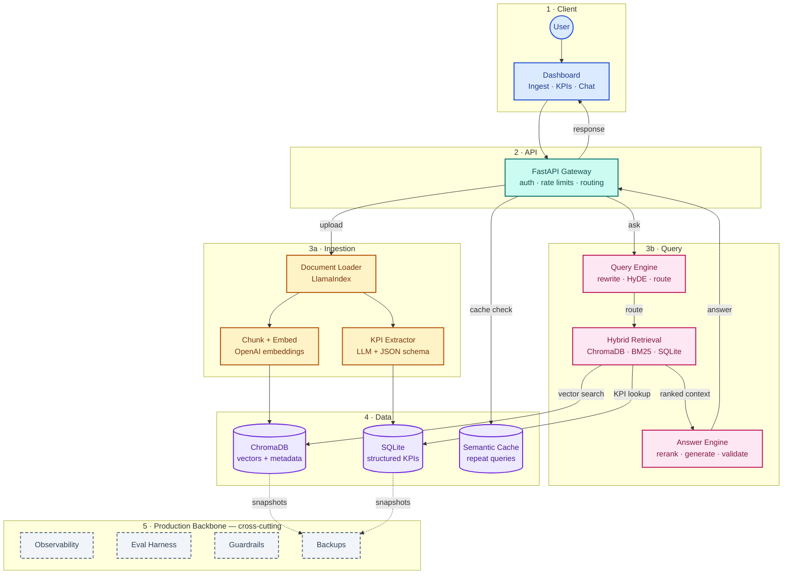

# Brainstorming AI Analyser feature for the Stock Analyzer app

You are the best App feature brainstormer and a product manager. You have to think from a product perspective and come up with the best possible ideas for the new feature. You should also consider the technical feasibility of the feature and come up with a plan to implement it. You should also consider the user experience of the feature and come up with a plan to implement it. You should also consider the business value of the feature and come up with a plan to implement it.

## Goal

The goal is to add a new feature to the stock analyzer app called the AI analyzer. This feature will be a RAG-based platform that will help investors and analysts quickly understand the financial health and performance of a company by analyzing their quarterly earnings reports. The app will have its own dashboard with a set of KPIs extracted from the earnings reports.  

## Context

I am a Flutter developer with expertise in building cross-platform applications. I have experience with Flutter, Dart, and other related technologies. I am looking to add a new feature to my stock analyzer app called the AI analyzer. This feature will be a RAG-based platform that will help investors and analysts quickly understand the financial health and performance of a company by analyzing their quarterly earnings reports. The app will have its own dashboard with a set of KPIs extracted from the earnings reports.

## Requirements

1. Add a 4th tab called the AI analyzer (AI powered RAG based platform to help investors and analysts quickly understand the financial health and performance of a company by analyzing ) and it should have it's own dashboard with it's set of the KPI's extracted out for the a Quaterly earning report for a stock that is available on the compoant's website, example https://assets-ir.tesla.com/tesla-contents/IR/TSLA-Q2-2026-Update.pdf.

2. The platform should transfors the PDF content into a structured format of key information that can be consumed by the app to display in a dashboard and charts. This should include - 

    - Summary
    - Key Financial Highlights
    - Earnings per Share (EPS)
    - Revenue
    - Operating Income
    - Net Income
    - Gross Margin
    - Operating Margin
    - Net Margin
    - Cash Flow from Operations
    - Free Cash Flow
    - Balance Sheet Highlights
    - Debt
    - Cash and Cash Equivalents
    - Total Assets
    - Total Liabilities
    - Shareholders' Equity
    - Other Key Metrics

3. I want to use this project to build a production-grade RAG pipeline and app, which will help me in getting a job in the AI industry as a AIEngineer.

4. The AI Analyser should also have an option to ask a question based on the PDF content and the AI should answer the question based on the PDF content. A smart CHATgpt like interface should be available in the AI Analyser tab. It should have a functionality to stream the response from the LLM to the UI. 

Sample query could be

    What was the revenue for the last quarter?
    How much cash the company has?
    What are the key financial highlights of the company?
    Compare revenue of last 3 quarters
    What is the free cash flow of the company?
    What is the net income of the company?
    What is the operating income of the company?
    What is the gross margin of the company?
    What is the operating margin of the company?
    What is the net margin of the company?
    What is the earnings per share (EPS) for the last quarter?
    What is the revenue growth rate year-over-year for the last quarter?
    What is the operating cash flow for the last quarter?
    What is the free cash flow for the last quarter?
    What is the debt-to-equity ratio for the company?
    What is the current ratio for the company?
    What is the quick ratio for the company?
    What is the inventory turnover ratio for the company?
    What is the days sales outstanding (DSO) for the company?
    What is the days payable outstanding (DPO) for the company?
    What is the cash conversion cycle for the company?
    What is the return on assets (ROA) for the company?
    What is the return on equity (ROE) for the company?
    What is the return on invested capital (ROIC) for the company?
    What is the interest coverage ratio for the company?
    What is the debt-to-asset ratio for the company?
    What is the total debt for the company?
    What is the total equity for the company?
    What is the total assets for the company?
    What is the total liabilities for the company?
    What is the total revenue for the company?
    What is the total operating income for the company?
    What is the total net income for the company?
    What is the total gross margin for the company?
    What is the total operating margin for the company?
    What is the total net margin for the company?

5. The architecture should be production-grade, with proper separation of concerns and modular design. It should be scalable and maintainable. It should be well-documented and easy to understand. It should follow the best practices of software engineering and AI engineering. The code should be clean, well-structured, and easy to read. It should follow the principles of SOLID and DRY. It should be well-tested and follow the best practices of testing. It should follow the best practices of CI/CD. It should be well-documented and easy to understand.

6. I want to build a complete RAG pipeline

    Data Ingestion:
    - PDF Parser using LamaIndex

    Chunking:
    - Chunking using https://docs.langchain.com/oss/python/integrations/splitters with overlap of 100 characters and chunk size of 1000 characters

    Embedding:
    - Embedding using OpenAIEmbeddings(model="text-embedding-3-small", dimensions=512)

    Vector Store:
    - Vector Store using ChromaDB

    Retriever:
    - Retriever using ChromaDB

    Generation:
    - Using OpenAI LLM (model="gpt-4.1-mini")   

    Citations: The response should have the citations to the document sections from which the answer is derived. 
    For exmaple, if the question is "What was the revenue for the last quarter?", the response should have the 
    citation to the page number and section from the document from where the answer is derived. The format for the 
    citation should be as follows - Page - [Page Number], Section - [Section Name]. The response should be 
    a well-formatted response with proper markdown formatting.
    The response should be streamed from the LLM and should be displayed in the UI as the response is being generated.
    The response should be displayed in a chat interface where the user can ask questions and the AI can answer
    questions based on the document content.    

Here's an inspiration architecture diagram, modify it and come up with the best possible architecture for the app. It can be improved, add something extra that is needed to make it production-grade.

7. The Server should be locally served to the app. lay down the compplete architecture for the same. Create a FastAPI server ? or anything else ? and create the server in a way that it can be containerized using docker. and serve the app. I should be able to run the server using Docker and also serve the app using docker-compose.

## Questions
1. should we add a local DB like SQLite to store the processed data to handle the dashboard data? It would be faster and efficient.

2. should we do the metadata filtering in the pipeline or in the retriever ?

3. should we build a hybrid Rag , Vector Retriever (semantic) and BM25 (sparse) and use the reranker to rerank the results ?

4. should we use Observability tools like OpenTelemetry to monitor the app ?   

5. Does Agentic Rag makes sense here ?  

# Expected Output 
   
   Understand the complete requirement and come up with detailed PRD broken into pieces/ phase of execution. Add architecture diagrams for client flow, server flow, ai flow, client server interactions, etc. Add assumptions, strategies, etc. 

   Do not write any code in the output.

   
    
        

