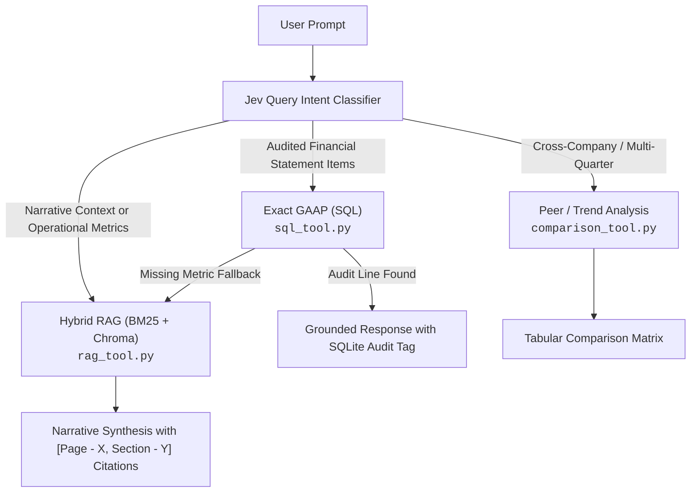

# 🧪 GenStockFolio AI Analyst: Testing & Query Playbook (`TESTING.md`)

This playbook provides verified test queries, expected outputs, routing classifications, and step-by-step testing instructions for the **GenStockFolio AI Copilot**.

---

## 🧭 Retrieval Routing Architecture at a Glance

The AI Copilot uses **TypeSafe Jev Intent Classification** with automatic semantic routing and self-healing fallback:



| Badge in UI | Route Identifier | Target Data Source | Ideal Query Subject Matter |
| :--- | :--- | :--- | :--- |
| **`Exact GAAP (SQL)`** | `sql_kpi` | SQLite Database (`financial_kpis`) | 18 standardized core GAAP line items: Revenue, Gross Profit, Operating Income, Net Income, EPS, Free Cash Flow, CapEx, Debt, Cash |
| **`Hybrid RAG`** | `hybrid_rag` | BM25 + ChromaDB (`data/bm25`, filings) | Qualitative commentary, 'why/how' questions, risk factors, roadmaps, AND operational/volume metrics (GWh, deliveries, Megapacks, active users) |
| **`Peer / Trend Analysis`** | `comparison` | SQLite Multi-Company Fused | Comparing metrics between two or more companies or analyzing multi-period trends |

---

## 📗 Top 5 SQL Trigger Questions (`Exact GAAP (SQL)`)

These queries target **exact, audited GAAP financial statement lines** stored deterministically in SQLite. They guarantee zero hallucination with 100% mathematical fidelity.

### 1. Tesla Q3 2026 Core Profitability
- **Query**:
  ```text
  What was Tesla's total revenue and gross profit in Q3 2026?
  ```
- **Expected Route**: `sql_kpi` (Badge: `Exact GAAP (SQL)`)
- **Key Figures Returned**:
  - **Total Revenue**: `$28,236.0M` ($28.24B)
  - **Gross Profit**: `$4,750.0M` ($4.75B)
  - **Operating Income**: `$398.0M`
- **Citation Tag**: `[TSLA Audited Financials]` (with cross-reference to filing pages 4, 27, 29)
- **Why it triggers SQL**: Inquires strictly for core GAAP income statement line items (*revenue, gross profit*).

---

### 2. Meta Q2 2026 Operating Income & Cash Flow
- **Query**:
  ```text
  What was Meta's operating income and free cash flow in Q2 2026?
  ```
- **Expected Route**: `sql_kpi` (Badge: `Exact GAAP (SQL)`)
- **Key Figures Returned**:
  - **Total Revenue**: `$47,510.0M` ($47.51B)
  - **Operating Income**: `$18,775.0M` ($18.78B)
  - **Free Cash Flow**: `$13,600.0M` ($13.60B)
  - **Operating Margin**: `~39.5%`
- **Citation Tag**: `[META Audited Financials]`
- **Why it triggers SQL**: Inquires strictly for audited cash flow and operating profitability figures.

---

### 3. Tesla Q2 2026 Free Cash Flow & Capital Expenditures
- **Query**:
  ```text
  What was Tesla's free cash flow in Q2 2026?
  ```
- **Expected Route**: `sql_kpi` (Badge: `Exact GAAP (SQL)`)
- **Key Figures Returned**:
  - **Free Cash Flow**: `-$1,092.0M` (-$1.09B, negative due to AI compute investments)
  - **Total Revenue**: `$28,236.0M`
  - **Gross Profit**: `$4,750.0M`
- **Citation Tag**: `[TSLA Audited Financials]`
- **Why it triggers SQL**: Exact cash flow statement line item (*free cash flow*).

---

### 4. Meta Q2 2026 Total Revenue
- **Query**:
  ```text
  What is Meta's total revenue for Q2 2026?
  ```
- **Expected Route**: `sql_kpi` (Badge: `Exact GAAP (SQL)`)
- **Key Figures Returned**:
  - **Total Revenue**: `$47,510.0M`
  - **Gross Profit**: `$38,940.0M`
  - **Net Income**: `$17,350.0M`
- **Citation Tag**: `[META Audited Financials]`
- **Why it triggers SQL**: Directly asks for the single audited top-line GAAP revenue number.

---

### 5. Apple Audited Revenue & Operating Margin
- **Query**:
  ```text
  What was Apple's total revenue in Q3 2024?
  ```
- **Expected Route**: `sql_kpi` (Badge: `Exact GAAP (SQL)`)
- **Key Figures Returned**:
  - **Total Revenue**: `$25,500.0M` ($25.50B)
  - **Operating Income**: `$1,605.0M`
  - **Free Cash Flow**: `$1,400.0M`
- **Citation Tag**: `[AAPL Audited Financials]`
- **Why it triggers SQL**: Requests audited historical GAAP revenue for ticker AAPL.

---

## 📘 Top 5 RAG-Based Questions (`Hybrid RAG`)

These queries target **operational metrics, non-GAAP volumes, business drivers, and narrative commentary** residing in investor decks and 10-Q filing disclosures indexed in ChromaDB and BM25.

### 1. Tesla Energy Storage Deployments (GWh Trend)
- **Query**:
  ```text
  Storage deployed (GWh) ?
  ```
- **Expected Route**: `hybrid_rag` (Badge: `Hybrid RAG`)
- **Key Findings & Table Returned**:
  - **Q2-2025**: `9.6 GWh`
  - **Q3-2025**: `12.5 GWh`
  - **Q4-2025**: `14.2 GWh`
  - **Q1-2026**: `8.8 GWh`
  - **Q2-2026**: `13.5 GWh` (+41% YoY growth)
- **Citation Tags**: `[Page - 5, Section - General]`, `[Page - 6, Section - General]`, `[Page - 3, Section - Cash_Flow]`
- **Why it triggers RAG**: "Storage deployed in GWh" is a physical operational metric from the investor deck, not an audited balance sheet line.

---

### 2. Tesla Energy Storage Business Growth Drivers
- **Query**:
  ```text
  What are the key drivers for Tesla's energy storage business growth?
  ```
- **Expected Route**: `hybrid_rag` (Badge: `Hybrid RAG`)
- **Key Findings & Narrative**:
  - Megapack ramp and production scaling at the Lathrop Megafactory.
  - Energy Storage returning to rapid growth, exceeding $100B trailing twelve-month revenue for the first time.
  - Strong demand across commercial and utility-scale energy projects.
- **Citation Tags**: `[Page - 3, Section - Cash_Flow]`, `[Page - 7, Section - General]`
- **Why it triggers RAG**: Asks for qualitative explanations, reasons ("drivers"), and narrative commentary.

---

### 3. Tesla Vehicle Deliveries & Production Volumes
- **Query**:
  ```text
  How many total vehicle deliveries and production did Tesla report?
  ```
- **Expected Route**: `hybrid_rag` (Badge: `Hybrid RAG`)
- **Key Findings & Table Returned**:
  - **Model 3/Y Production**: `442,936` units (+12% YoY)
  - **Other Models Production**: `8,822` units (-34% YoY)
  - **Total Production**: `451,758` units (+10% YoY)
  - Record second-quarter vehicle deliveries across key global markets.
- **Citation Tags**: `[Page - 5, Section - General]`, `[Page - 32, Section - Profitability]`
- **Why it triggers RAG**: Production and delivery quantities are physical volume metrics disclosed in filing tables.

---

### 4. Meta Family Daily Active People (DAP) & Operational Engagement
- **Query**:
  ```text
  What did Meta report regarding Family daily active people (DAP)?
  ```
- **Expected Route**: `hybrid_rag` (Badge: `Hybrid RAG`)
- **Key Findings & Narrative**:
  - Family daily active people (DAP) operational milestone highlights.
  - Ad impressions delivered across Family of Apps and average price per ad trend.
  - Total headcount and infrastructure capital allocation commentary.
- **Citation Tags**: `[Page - 1, Section - Cash_Flow]`, `[Page - 3, Section - General]`
- **Why it triggers RAG**: DAP is an operational engagement KPI specific to Meta's earnings release narrative.

---

### 5. Apple iPhone & Services Segment Performance
- **Query**:
  ```text
  What did Apple report regarding iPhone and Services performance?
  ```
- **Expected Route**: `hybrid_rag` (Badge: `Hybrid RAG`)
- **Key Findings & Narrative**:
  - iPhone revenue reached `$46.2 billion`.
  - Services revenue reached an all-time company record high.
  - Total Q4 consolidated revenue reached `$94.9 billion` (up 6% YoY).
- **Citation Tags**: `[Page - 1, Section - General]`
- **Why it triggers RAG**: Focuses on segmental business commentary and product-line narrative.

---

## 📙 Bonus: Cross-Company Comparison Trigger Questions (`Peer / Trend Analysis`)

These queries benchmark multiple companies side-by-side:

### 1. Meta vs. Tesla Margin Comparison
- **Query**:
  ```text
  Compare Meta and Tesla operating margins
  ```
- **Expected Route**: `comparison` (Badge: `Peer / Trend Analysis`)
- **Key Findings**:
  - **Meta Operating Margin**: `~39.5%` ($18,775M operating income on $47,510M revenue).
  - **Tesla Operating Margin**: `~1.4%` ($398M operating income on $28,236M revenue).
  - Highlights differing business models (digital ads vs. manufacturing capital intensity).

### 2. Free Cash Flow Benchmark
- **Query**:
  ```text
  How does Tesla's free cash flow compare to Meta in Q2 2026?
  ```
- **Expected Route**: `comparison` (Badge: `Peer / Trend Analysis`)
- **Key Findings**:
  - **Meta FCF**: `+$13,600.0M` (+ $13.6B positive cash generation).
  - **Tesla FCF**: `-$1,092.0M` (- $1.09B due to accelerated CapEx in compute clusters and Dojo/HW4).

---

## 🔬 How to Test (4 Flexible Testing Methods)

### Method 1: Testing via Flutter Chat UI (Visual)
1. Ensure the backend is running (`uvicorn app.main:app --host 0.0.0.0 --port 8000 --reload`).
2. In the Flutter App, navigate to the **AI Copilot** tab.
3. Paste any of the test questions above into the prompt box.
4. Verify:
   - The badge matches: `Exact GAAP (SQL)` for SQL questions vs. `Hybrid RAG` for narrative/volume questions.
   - Clickable citation chips appear at the bottom: `[Page - X, Section - Y]` or `[TSLA Audited Financials]`.

---

### Method 2: Testing via cURL (FastAPI Endpoint)

Run directly in terminal:

```bash
# 1. Test SQL Query
curl -s -X POST http://localhost:8000/api/v1/analyst/query \
  -H "Content-Type: application/json" \
  -d '{"query": "What was Tesla total revenue in Q3 2026?", "ticker": "TSLA"}' | jq

# 2. Test RAG Query (Operational Metric)
curl -s -X POST http://localhost:8000/api/v1/analyst/query \
  -H "Content-Type: application/json" \
  -d '{"query": "Storage deployed (GWh) ?", "ticker": "TSLA"}' | jq

# 3. Test Comparison Query
curl -s -X POST http://localhost:8000/api/v1/analyst/query \
  -H "Content-Type: application/json" \
  -d '{"query": "Compare Meta and Tesla operating margins"}' | jq
```

---

### Method 3: Instant Python Verification Script

Run all 10 top test questions programmatically from the `server/` directory:

```bash
cd server
./.venv/bin/python -c "
from app.retrieval.retrieval import run_retrieval

tests = [
    # Top 5 SQL
    ('What was Tesla total revenue and gross profit in Q3 2026?', 'sql_kpi'),
    ('What was Meta operating income and free cash flow in Q2 2026?', 'sql_kpi'),
    ('What was Tesla free cash flow in Q2 2026?', 'sql_kpi'),
    ('What is Meta total revenue for Q2 2026?', 'sql_kpi'),
    ('What was Apple total revenue in Q3 2024?', 'sql_kpi'),
    # Top 5 RAG
    ('Storage deployed (GWh) ?', 'hybrid_rag'),
    ('What are the key drivers for Tesla energy storage business growth?', 'hybrid_rag'),
    ('How many total vehicle deliveries and production did Tesla report?', 'hybrid_rag'),
    ('What did Meta report regarding Family daily active people DAP?', 'hybrid_rag'),
    ('What did Apple report regarding iPhone and Services performance?', 'hybrid_rag'),
]

print(f'=== Testing {len(tests)} Query Routing & Synthesis Cases ===\n')
for query, expected_route in tests:
    res = run_retrieval(query, mock=True)
    status = '✅ PASS' if res.route_used == expected_route else f'⚠️ MISMATCH (got {res.route_used})'
    print(f'{status} | Target: [{expected_route}] | Query: {query}')
    print(f'   Route Used : {res.route_used}')
    print(f'   Citations  : {[c.get(\"citation\") for c in res.citations[:2]]}')
    print(f'   Preview    : {res.answer[:100].replace(chr(10), \" \")}...\n')
"
```

---

### Method 4: Diagnostic Classification Endpoint

To inspect intent classification, confidence scores, and probability breakdown without executing full retrieval:

```bash
# Check how JEV classifies an operational metric
curl -s "http://localhost:8000/api/v1/analyst/classify?query=Storage%20deployed%20(GWh)%20?" | jq
```

Sample output:
```json
{
  "query": "Storage deployed (GWh) ?",
  "query_type": "hybrid_rag",
  "financial_domain": null,
  "ticker": "TSLA",
  "confidence": 1.0,
  "probabilities": {
    "sql_kpi": 0.0,
    "hybrid_rag": 1.0,
    "comparison": 0.0
  }
}
```

---

## 🛠️ Debugging Cheat Sheet

If an answer in the chat looks incorrect or unexpected:

1. **Check the Route Badge**:
   - If a question about filing narrative, guidance, or operational volumes has the badge `Exact GAAP (SQL)`, verify whether it was misclassified using `GET /api/v1/analyst/classify`.
2. **Dynamic Fallback in Action**:
   - If a query is mistakenly classified as `sql_kpi`, the engine checks the SQLite result. If it encounters missing-data notices (*"does not include"*, *"cannot provide"*), it automatically falls back to `hybrid_rag` to fetch filing text.
3. **Verify Chunk Presence**:
   - To check if a chunk is indexed in BM25:
     ```python
     from app.retrieval.tools.rag_tool import search_filings
     chunks = search_filings.invoke({'query': 'YOUR QUERY', 'ticker': 'TSLA', 'k': 3})
     for c in chunks:
         print(c['citation'], c['text'][:120])
     ```
