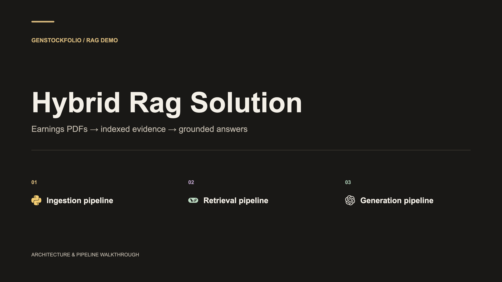

# Hybrid Rag Solution

[](assets/presentation/hybrid-rag-solution.svg)

The presentation opens with **Hybrid Rag Solution**, followed by a full-page section heading for **Ingestion pipeline**, **Retrieval pipeline**, and **Generation pipeline**. Each title page has a page break before its diagrams. The combined PDF has **1 cover + 3 section pages + 8 diagram pages**; each pipeline PDF starts with its own section page.

These documents and slides trace the implemented earnings-PDF RAG demo, reviewed against the working-tree code on October 18, 2026.

The ingestion overview spans two slides: PDF processing, then the response/indexing fork. The fork and indexing detail show the **proposed background-indexing orchestration**: return the persisted report/KPIs while indexing continues independently. They are labeled as proposed because the current server indexes inline before returning.

| Pipeline | Documentation | PDF slides |
|---|---|---|
| Ingestion, parsing, extraction, chunking, and indexing | [Ingestion pipeline](ingestion.md) | [5 pages](assets/ingestion/ingestion-slides.pdf) |
| Classification, tool routing, and hybrid retrieval | [Retrieval pipeline](retrieval.md) | [3 pages](assets/retrieval/retrieval-slides.pdf) |
| Evidence-based answer synthesis and formatting | [Generation pipeline](generation.md) | [3 pages](assets/generation/generation-slides.pdf) |

**[Open the combined 12-page presentation](assets/rag-pipeline-slides.pdf).** Each document also links its 4K PNGs and standalone SVGs. All slides use 16:9 dimensions, technology logos, a warm charcoal palette, and labeled component boundaries.

The ingestion flow is connected to the Flutter upload UI. Retrieval and generation are implemented as backend Python / CLI flows; the current Flutter chat widget uses local responses.

## Regenerating the presentation

Rebuild the twelve SVGs using Python's standard library:

```sh
python3 week2-project-stock-ai-analyzer/docs/assets/build_pipeline_slides.py
```

To render 3840 × 2160 PNGs, per-pipeline PDFs, and the combined PDF, run the renderer with an available Puppeteer installation and Chrome:

```sh
node week2-project-stock-ai-analyzer/docs/assets/render_pipeline_slides.mjs
```

If Puppeteer is installed elsewhere, pass `--puppeteer-module /absolute/path/to/puppeteer.js`. To select a Chrome executable, pass `--chrome /absolute/path/to/chrome`. The renderer checks slide/card label bounds and reports overflow. Rendering reads local SVGs and makes no model API calls.

The ingestion layout and shared drawing helpers are in [ingestion/build_diagrams.py](assets/ingestion/build_diagrams.py). Retrieval/generation layouts are in [build_pipeline_slides.py](assets/build_pipeline_slides.py). The export order is recorded in [slides.json](assets/slides.json).

## Icon provenance

Original technology marks, standard symbols, source URLs, licenses, and SHA-256 checksums are retained in [the shared icon folder](assets/ingestion/logos/manifest.json). Chroma's favicon is pinned to its official repository revision. TypeSafe's mark is extracted from the official site's home-link SVG; its original color-variable definition is resolved to a visible foreground only in composed artwork. Vendor marks identify the actual technologies used in code.
