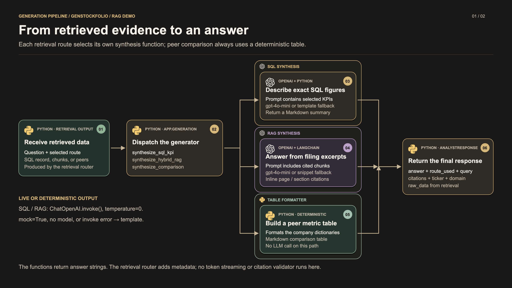
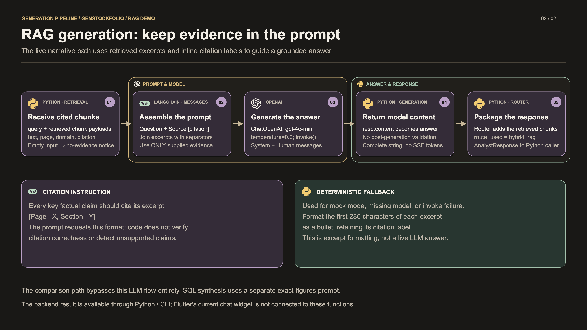

# Generation pipeline

Generation converts retrieved evidence into an answer string. The backend has three dedicated functions: **SQL KPI synthesis**, **filing-excerpt synthesis**, and **peer-comparison formatting**. This document follows the working-tree code reviewed on October 18, 2026.

Demo sequence: [Ingestion and indexing](ingestion.md) → [Retrieval](retrieval.md) → **Generation**.

## Presentation graphics

Use the **3840 × 2160 PNGs** in presentation slides, the SVGs for scalable artwork, or the [two-slide generation PDF](assets/generation/generation-slides.pdf). The [combined PDF](assets/rag-pipeline-slides.pdf) contains all eight pipeline slides.

| Slide | PNG | SVG |
|---|---|---|
| Route-specific answer generation | [Download PNG](assets/generation/generation-overview.png) | [Open SVG](assets/generation/generation-overview.svg) |
| Grounded RAG prompt and fallback | [Download PNG](assets/generation/generation-grounded.png) | [Open SVG](assets/generation/generation-grounded.svg) |

## 1. Choose the matching generator

The [retrieval router](../server/app/retrieval/retrieval.py) calls the matching function in [generation.py](../server/app/generation/generation.py). Each function returns a string; the router then adds citation metadata and the other response fields.

| Function | Input evidence | Live behavior | Fallback or empty-data behavior |
|---|---|---|---|
| `synthesize_sql_kpi` | A ticker and KPI dictionary. | Builds a prompt from selected numeric fields and asks `gpt-4o-mini` to use only those figures. | Formats a deterministic financial summary when mock mode/model unavailability/invoke failure selects fallback. An error dictionary returns a data notice. |
| `synthesize_hybrid_rag` | Retrieved chunk dictionaries with text and citation labels. | Builds a prompt from the question and cited excerpts, requesting inline source citations. | Formats excerpt bullets when fallback is selected. Empty chunks return a no-relevant-sections notice. |
| `synthesize_comparison` | A fiscal period and company-to-metrics dictionaries. | Builds a Markdown comparison table directly in Python. | Returns a no-comparison-data notice when no companies are present. This function never calls an LLM; its `query` and `mock` arguments do not change table construction. |

For SQL and RAG live synthesis, `_get_llm()` creates **LangChain `ChatOpenAI(model="gpt-4o-mini", temperature=0.0)`** when an OpenAI key is available. Both paths use synchronous **`llm.invoke()`** with `SystemMessage` and `HumanMessage`. `mock=True` bypasses model initialization; missing model availability and caught live errors select the template path.

**Suggested narration:** “Generation receives evidence rather than searching on its own. Numeric questions get a summary of selected SQLite figures. Narrative questions get an answer based on cited filing excerpts. Peer comparisons are formatted directly as a Markdown table. Each route can produce a useful output without adding an autonomous planning loop.”

## 2. Grounded RAG generation

The live narrative path is:

1. Receive the original question and retrieved chunks. If the list is empty, return the no-evidence notice immediately.
2. Turn each chunk into `Source [Page - X, Section - Y]:` followed by its text. Separate excerpts with `---`.
3. Add instructions to answer only from the supplied excerpts and cite every key factual claim inline using the exact page/section format.
4. Invoke the model with analyst-role system instructions and the evidence-bearing human message.
5. Return `resp.content` to the router. The router adds `route_used="hybrid_rag"`, the retrieved chunks as `citations`, and response metadata.

The fallback formats the **first 280 characters** of each chunk as a bullet and retains its citation label. It does not make a live model call.

The current grounding mechanism is **prompt instructions plus source labels**. There is no post-generation citation validator, claim verification pass, reflection loop, reretrieval loop, or citation-click UI integration in this code path.

## 3. Answer and response are separate outputs

| Layer | Output |
|---|---|
| Generator function | An answer string: model prose, deterministic summary, excerpt bullets, table, or data notice. |
| Retrieval router | `AnalystResponse` / `RetrievalResponse`: `query`, `route_used`, `answer`, `citations`, ticker, domain, and `raw_data`. |
| Current presentation interface | Python / CLI invocation and optional analyst Markdown artifacts. |

For SQL answers, the router builds its separate citation list from persisted `source_pages`; `synthesize_sql_kpi` does not add page labels to its numeric prompt. For comparison answers, the router currently leaves `citations` empty. For RAG answers, the prompt includes the chunk labels and the router also retains those chunks in the response.

## 4. Details to keep accurate during the demo

- **Output arrives as a complete string.** The functions use `invoke()`, not a streaming method. The current API exposes no chat/SSE route, and Flutter chat still produces local responses.
- **Templates expect usable numeric values.** The deterministic SQL formatter is not a comprehensive null-value validator; incomplete KPI records can still cause formatting errors. Its million-unit and percentage formatting should not be presented as general currency/unit conversion.
- **The comparison table uses a fixed metric list.** It formats revenue, gross/operating margin, net income, free cash flow, and cash for the companies in the payload; the current formatter renders falsy numeric values as `N/A`.
- **Prompt labels do not certify data.** The code uses the word “audited” in prompts and templates, but generation does not independently audit the underlying filing or verify model claims.
- **Upstream extraction can supply synthetic figures.** The current ingestion extractor creates fixed demo KPIs when its structured-model invoke fails. Generation receives those records through the same evidence interface; it does not identify their provenance as live versus fallback extraction.

Artwork sources and rebuild commands are in the [presentation guide](README.md#regenerating-the-presentation).
