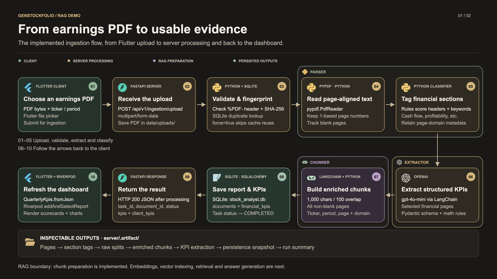
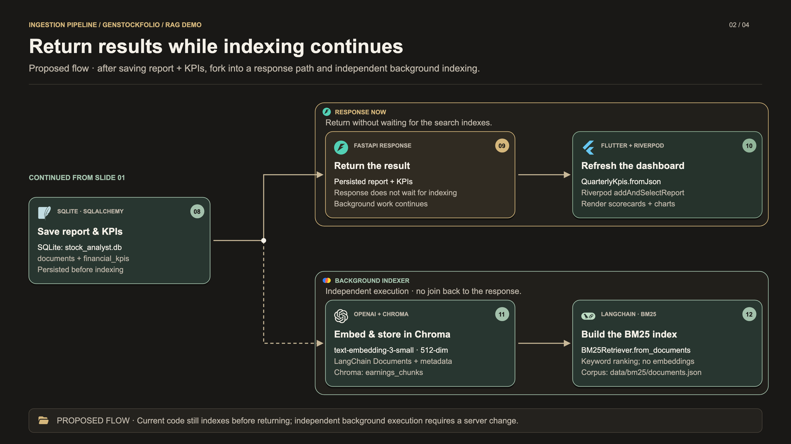
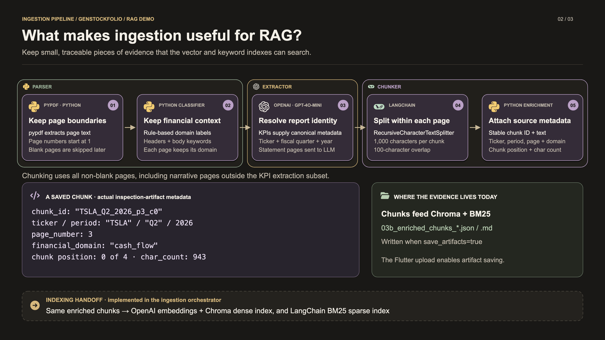
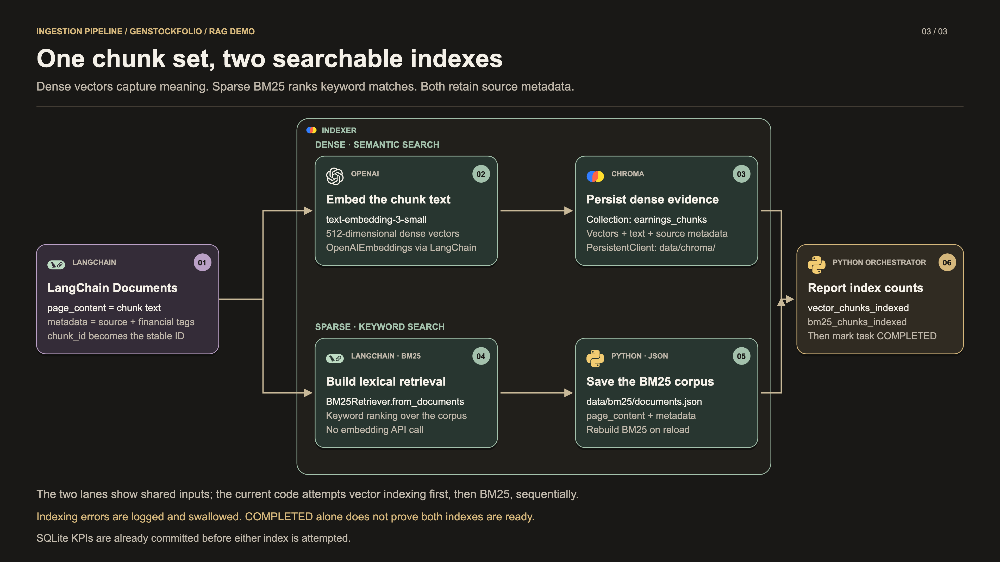

# Hybrid Rag Solution

## Ingestion pipeline

The implemented pipeline accepts an earnings PDF from Flutter, extracts structured financial KPIs, prepares chunks with source metadata, indexes those chunks in **Chroma and BM25**, and returns a report to the dashboard. This document follows the working-tree code reviewed on October 18, 2026.

**Presentation update:** the overview is split into **PDF processing** and **response/background indexing** so each slide has room for readable cards and clear connectors. The second slide and indexing detail show the **proposed background-indexing flow**: after report/KPI persistence, the response and indexing paths proceed independently. The current server still performs indexing inline before returning; the diagrams describe the intended orchestration change, not an implemented background worker.

Follow the complete demo: **Ingestion → [Retrieval](retrieval.md) → [Generation](generation.md)**. The [combined presentation](assets/rag-pipeline-slides.pdf) contains 12 pages: the solution cover, three pipeline section pages, and eight diagrams.

### Presentation graphics

The PDF starts with a dedicated **Ingestion pipeline** title page in large type, followed by a page break before the diagrams. Diagram numbering excludes this section page.

The four visuals use a **16:9 slide layout**, real technology marks, and labeled component boundaries. Insert the **3840 × 2160 PNGs** into PowerPoint, Keynote, or Google Slides. Use the SVGs for scalable artwork, or open the [five-page ingestion PDF](assets/ingestion/ingestion-slides.pdf).

| Slide | PNG for presentations | Scalable SVG |
|---|---|---|
| Section title · Ingestion pipeline | [Download PNG](assets/ingestion/ingestion-section.png) | [Open SVG](assets/ingestion/ingestion-section.svg) |
| 01 · PDF → saved report | [Download PNG](assets/ingestion/ingestion-overview.png) | [Open SVG](assets/ingestion/ingestion-overview.svg) |
| 02 · Response and background indexing | [Download PNG](assets/ingestion/ingestion-response-indexing.png) | [Open SVG](assets/ingestion/ingestion-response-indexing.svg) |
| Preparing evidence for RAG | [Download PNG](assets/ingestion/ingestion-rag-preparation.png) | [Open SVG](assets/ingestion/ingestion-rag-preparation.svg) |
| Vector embedding and BM25 indexing | [Download PNG](assets/ingestion/ingestion-indexing.png) | [Open SVG](assets/ingestion/ingestion-indexing.svg) |

### 1. Client-to-server ingestion flow

[](assets/ingestion/ingestion-overview.svg)

The first slide follows a three-row path: **01–03 left to right**, **04–06 right to left**, then **07a → 07b → 08 left to right**. Wider cards and open connector gutters keep each component within one row without crossing lines.

The second slide repeats **08 · Save report & KPIs** as the handoff and gives the two branches separate horizontal lanes:

[](assets/ingestion/ingestion-response-indexing.svg)

- **Immediate response:** **09 · Return the result → 10 · Refresh the dashboard**. This path does not wait for index completion.
- **Background indexing:** **11 · Embed & store in Chroma → 12 · Build the BM25 index**. The dashed connector denotes independent background execution; this path does not rejoin the response path.

Labeled bounding boxes identify **Parser**, **Extractor**, **Chunker**, and **Background Indexer**. Vector and BM25 operations can still execute sequentially within the background worker. The parallelism here is between **returning the saved report** and **preparing retrieval indexes**.

Within the **Chunker** boundary, **07a · Recursive Chunker → 07b · Metadata Enrichment** separates text splitting from attaching financial and source metadata.

The table maps each displayed stage to its existing code. Background dispatch, an early HTTP return, and separate index-readiness tracking remain proposed changes.

| Step | Responsibility and current implementation | Source |
|---|---|---|
| 01 · Choose PDF | Flutter's file picker reads PDF bytes. The panel submits the ticker, selected fiscal quarter, and year with the file. | [ReportIngestionPanel](../client/packages/ai_analyst_feature/lib/presentation/views/widgets/report_ingestion_panel.dart) |
| 02 · Upload | `RemoteKpiDataSource` sends multipart `POST /api/v1/ingestion/upload`. FastAPI checks the `.pdf` extension and saves the file under `server/data/uploads/`. | [Client HTTP request](../client/packages/ai_analyst_feature/lib/data/datasources/remote_kpi_datasource.dart), [upload endpoint](../server/app/api/v1/endpoints/documents.py) |
| 03 · Validate | The pipeline creates a tracking task, checks for a non-empty file and `%PDF-` header, hashes the file using SHA-256, and looks for a matching document in SQLite. | [Pipeline](../server/app/ingestion/pipeline.py), [validator](../server/app/ingestion/validator.py) |
| 04 · Extract text | `pypdf.PdfReader` extracts each page's text. `ExtractedPage` retains its **1-based page number**, character count, and blank-page flag. | [PDF extractor](../server/app/ingestion/parsers/pdf_extractor.py) |
| 05 · Classify | Python rules score page headers and body keywords to assign financial domains, confidence scores, and matched signals. | [Section classifier](../server/app/ingestion/parsers/section_classifier.py) |
| 06 · Extract KPIs | LangChain `ChatOpenAI(model="gpt-4o-mini", temperature=0.0)` receives selected statement pages and uses `with_structured_output(FinancialReportKPIs)`. Python then normalizes CapEx signs and derives missing FCF and margins where inputs are available. The extracted ticker and period become the canonical chunk metadata. | [KPI extractor](../server/app/ingestion/extractor/kpi_extractor.py), [prompt](../server/app/ingestion/extractor/llm_extraction_prompts.py), [math reconciliation](../server/app/ingestion/extractor/kpi_validator.py) |
| 07a · Recursive Chunker | LangChain splits **all non-blank pages** within their page boundaries: **1,000 characters**, **100-character overlap**. | [Recursive chunker](../server/app/ingestion/chunkers/recursive_chunker.py), [pipeline orchestration](../server/app/ingestion/pipeline.py) |
| 07b · Metadata Enrichment | Python attaches ticker, fiscal quarter/year, page number, financial domain, chunk position, and a deterministic chunk ID to each text split. | [Metadata enrichment](../server/app/ingestion/chunkers/metadata_enricher.py) |
| 08 · Persist | SQLAlchemy saves or updates `documents` and `financial_kpis` in SQLite, with the default database at `server/data/stock_analyst.db`. `ingestion_tasks` records progress throughout. When enabled, inspection artifacts are written after processing. | [Database configuration](../server/app/db/session.py), [models](../server/app/db/models.py), [pipeline](../server/app/ingestion/pipeline.py) |
| 09 · Return result | **Proposed:** return the persisted report and KPIs without waiting for indexing. **Current:** the pipeline completes both indexing attempts before the endpoint returns `task_id`, `document_id`, `status`, `kpis`, and `client_kpis`. | [Pipeline](../server/app/ingestion/pipeline.py), [response schema](../server/app/schemas/ingestion.py), [endpoint](../server/app/api/v1/endpoints/documents.py) |
| 10 · Update dashboard | Flutter decodes `client_kpis` with `QuarterlyKpis.fromJson`. The panel callback calls Riverpod's `addAndSelectReport`, replacing or adding the report and selecting it for display. | [Dashboard callback](../client/packages/ai_analyst_feature/lib/presentation/views/kpi_dashboard_view.dart), [ViewModel](../client/packages/ai_analyst_feature/lib/presentation/viewmodel/kpi_dashboard_viewmodel.dart) |
| 11 · Embed and persist vectors | `VectorIndex.add_chunks()` converts chunks into LangChain `Document` objects. `OpenAIEmbeddings(model="text-embedding-3-small", dimensions=512)` supplies embeddings; Chroma persists text, vectors, and metadata in `earnings_chunks`. Moving this existing work to the background is proposed. | [Vector index](../server/app/ingestion/indexing/vector_index.py) |
| 12 · Build BM25 | The same chunks become a lexical corpus. `BM25Retriever.from_documents()` builds ranking, and `data/bm25/documents.json` stores text and metadata for reconstruction on reload. Moving this existing work to the background is proposed. | [BM25 index](../server/app/ingestion/indexing/bm25_index.py) |

**Suggested narration for the proposed flow:** “After parsing, extraction, and chunk preparation, we save the report and KPIs in SQLite. The flow then splits: one path returns the saved result so the dashboard can load, while the other builds the Chroma and BM25 indexes in the background. The report can be available before RAG search is ready.”

### 2. Preparing evidence for RAG

[](assets/ingestion/ingestion-rag-preparation.svg)

The two kinds of output serve different purposes:

| Output | What it contains | Why it matters |
|---|---|---|
| Structured KPIs | Financial figures, ticker, fiscal period, and report-level `source_pages`; persisted in SQLite. | Supports dashboard rendering and structured numeric lookups. |
| Enriched chunks | Text, `chunk_id`, ticker, quarter, year, page number, financial domain, character count, and chunk position. | Prepares evidence for later retrieval filters and page-level citations. |

KPI extraction selects pages classified as profitability, balance sheet, or cash flow. If none qualify, it falls back to the first six non-blank pages. **Chunking still covers every non-blank page**, preserving narrative material that may help answer later questions.

Each chunk receives a deterministic ID:

```text
{TICKER}_{QUARTER}_{YEAR}_p{PAGE}_c{ZERO_BASED_CHUNK_INDEX}
```

The third slide uses metadata previously captured from `03b_enriched_chunks_tsla_q2_2026_update.json`: `TSLA_Q2_2026_p3_c0`, financial domain `cash_flow`, 943 characters, and chunk index 0 among four chunks on that page. Inspection artifacts are generated outputs and may be regenerated or removed between demo runs.

The orchestrator now passes those enriched chunks into both index implementations. Artifacts remain useful for inspecting each stage; the persistent indexes serve the later retrieval pipeline.

### 3. Vector embedding and BM25 indexing

[](assets/ingestion/ingestion-indexing.svg)

The two lanes show **two consumers of the same chunks inside the proposed background worker**. They can remain sequential there: vector indexing first, then BM25. The response path does not depend on their completion.

In that design, report persistence and index readiness need separate status tracking. Index failures should affect retrieval readiness without reversing the already-persisted report or delaying its response. The current implementation still runs both index operations within `pipeline.run()` and returns afterward.

| Detail | Dense vector index | Sparse keyword index |
|---|---|---|
| Implementation | `VectorIndex`, `OpenAIEmbeddings`, LangChain `Chroma` | `BM25Index`, LangChain `BM25Retriever` |
| Representation | `text-embedding-3-small`, **512 dimensions** | BM25 lexical ranking; no embedding call |
| Default storage | `server/data/chroma/`, collection `earnings_chunks` | `server/data/bm25/documents.json` |
| Preserved metadata | `chunk_id`, ticker, fiscal quarter/year, page number, financial domain | Same six fields |
| Identity | `chunk_id` supplies Chroma IDs | Corpus deduplicates by `chunk_id` |
| Reload | Persistent Chroma collection | Load saved Documents and rebuild BM25 |
| Inspection output | `.artifact/idx_02_vector_store_sample.md` | `.artifact/idx_03_bm25_sample.md` |

The input is a standard LangChain `Document`: `page_content` holds the text, while `metadata` holds its source and financial tags. The index adapters carry the six fields above; enriched-chunk diagnostics such as character counts are retained in artifacts rather than copied into these index metadata dictionaries.

### 4. Details to keep accurate during the demo

- **One request completes the work.** The upload endpoint calls `pipeline.run()` directly and returns HTTP 200 after processing. The panel does not start a background job or poll task progress. Its progress bar uses locally assigned milestones; task-status records and a status endpoint exist separately.
- **The current panel forces reprocessing.** It sends `force=true`. Each index deletes existing chunks for the canonical **ticker**, including other periods, before adding the current report. With `force=false`, an existing document with KPIs returns early, before indexing; this shortcut does not rebuild missing indexes.
- **Completion and index readiness differ.** Index initialization and write failures are caught, so the SQL-backed run can finish with zero vector or BM25 chunks indexed. Check `vector_chunks_indexed` and `bm25_chunks_indexed` on the pipeline result or run-summary artifact. The upload response schema currently does not expose these counters.
- **Artifacts are inspection outputs.** The Flutter request sends `save_artifacts=true`. Files under `server/.artifact/` capture extracted pages, classifications, raw splits, enriched chunks, extracted KPIs, persisted KPIs, and the pipeline summary. They are not a vector database.
- **The offline fallback is simulated.** If remote ingestion throws, `ReportIngestionPanel` generates hard-coded demo financial values. Its fallback messages mention embeddings and indexing, but that branch does not perform them. Use a reachable backend and a real PDF when presenting the implemented server flow.
- **The server extractor also has demo fallback values.** The current `kpi_extractor.py` catches a structured-model invoke failure and creates a fixed KPI payload, using ticker/period hints or defaults. It still attaches the selected page numbers and applies math reconciliation. Those numbers are synthetic; source-page metadata and reconciliation do not make them filing-extracted figures. Check the extraction log before describing a successful run as live extraction.
- **Check the result, not only the HTTP status.** Pipeline failures are represented by `status="FAILED"` in the result. The upload endpoint currently wraps that result in its normal response; non-PDF extensions are rejected separately with HTTP 400.

### Artwork and editing

The graphics embed actual Flutter, FastAPI, Python, OpenAI, LangChain, SQLite, Chroma, and TypeSafe technology marks. Chroma's mark comes from its official repository, and TypeSafe's from its official home page. Simple Icons 14.15.0 supplies the other technology marks; Font Awesome Free 7.3.1 supplies standard file and code symbols. Original files, attribution licenses, provenance, and SHA-256 checksums are retained in [logos](assets/ingestion/logos/manifest.json). These shared assets also serve the retrieval and generation slides.

The SVGs are self-contained and require no network access to display. To edit the labels or layout, update [build_diagrams.py](assets/ingestion/build_diagrams.py), then regenerate the SVGs:

```sh
python3 week2-project-stock-ai-analyzer/docs/assets/ingestion/build_diagrams.py
```

To rebuild the full slide set and render matching PNG/PDF exports, follow [presentation build instructions](README.md#regenerating-the-presentation).
