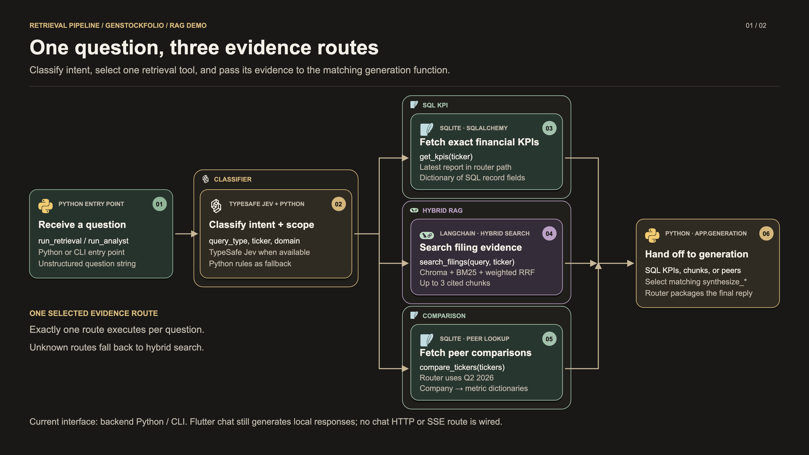
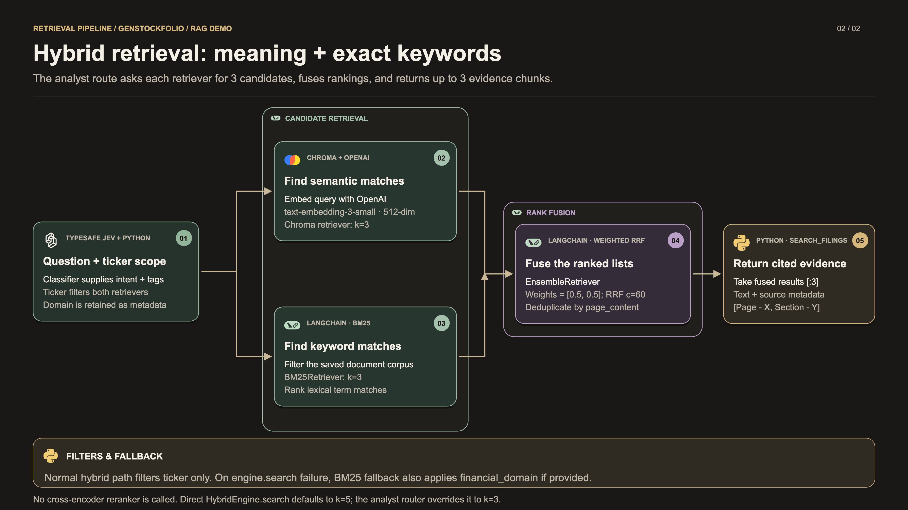

# Retrieval pipeline

Retrieval turns a financial question into the evidence needed to answer it. The current backend classifies the question, selects **SQL KPI**, **hybrid RAG**, or **peer comparison**, and delegates answer writing to [generation](generation.md). This document follows the working-tree implementation reviewed on October 18, 2026.

Demo sequence: [Ingestion and indexing](ingestion.md) → **Retrieval** → [Generation](generation.md).

## Presentation graphics

Use the **3840 × 2160 PNGs** in presentation slides, the SVGs for scalable artwork, or the [two-slide retrieval PDF](assets/retrieval/retrieval-slides.pdf). The [combined PDF](assets/rag-pipeline-slides.pdf) contains all eight pipeline slides.

| Slide | PNG | SVG |
|---|---|---|
| Intent classification and evidence routing | [Download PNG](assets/retrieval/retrieval-overview.png) | [Open SVG](assets/retrieval/retrieval-overview.svg) |
| Dense + sparse retrieval and rank fusion | [Download PNG](assets/retrieval/retrieval-hybrid.png) | [Open SVG](assets/retrieval/retrieval-hybrid.svg) |

## 1. Select the evidence route

The backend entry point is `run_retrieval(query, mock=False)`, an alias for `run_analyst`. It performs one classification, executes one matching tool, calls the matching generation function, and returns an `AnalystResponse`. The route diagram separates the evidence lookup from the generation handoff for presentation clarity; both occur within this function call.

| Component | Implemented behavior | Source |
|---|---|---|
| Classifier | TypeSafe Jev evaluates `query_type`, `financial_domain`, and ticker choices. Missing key/package, mock mode, or a live invoke failure selects deterministic Python rules. | [Jev classifier](../server/app/retrieval/classifier/jev_classifier.py) |
| SQL KPI route | `get_kpis` queries SQLite. The router passes only the ticker, so this path selects the latest available report. A missing ticker defaults to `TSLA`. | [SQL tools](../server/app/retrieval/tools/sql_tool.py), [router](../server/app/retrieval/retrieval.py) |
| Hybrid RAG route | `search_filings` receives the question, normalized ticker, domain, and **k=3**. It returns text and citation metadata for up to three fused results. | [RAG tool](../server/app/retrieval/tools/rag_tool.py) |
| Comparison route | `compare_tickers` fetches a same-period peer comparison from SQLite. The router currently passes **Q2 2026** and defaults multiple/unspecified tickers to `META` and `TSLA`. | [Comparison tool](../server/app/retrieval/tools/comparison_tool.py), [router](../server/app/retrieval/retrieval.py) |
| Generation handoff | Selects `synthesize_sql_kpi`, `synthesize_hybrid_rag`, or `synthesize_comparison`, then packages the answer with route and evidence metadata. An unknown route falls back to hybrid search. | [Router](../server/app/retrieval/retrieval.py), [generation](generation.md) |

**Suggested narration:** “The question tells us which evidence to retrieve. Exact numbers come from SQLite. Explanations use hybrid search over the indexed filing chunks. Comparisons fetch peer records for the configured period. We pass the chosen evidence into the matching answer generator.”

## 2. Hybrid retrieval in detail

1. Normalize the ticker and financial-domain inputs in `search_filings`.
2. Build a Chroma retriever using OpenAI query embeddings, the saved collection, a ticker filter, and `k=3` in the analyst path.
3. Filter the saved document corpus by the same ticker and build a BM25 retriever, also with `k=3`.
4. Use LangChain `EnsembleRetriever` with weights **[0.5, 0.5]** to apply weighted reciprocal rank fusion. Its installed default is **c=60**, and the code leaves `id_key` unset, so fusion deduplicates by **page content**.
5. Slice the fused ranking to `[:3]` and format each result as a dictionary containing text, chunk ID, ticker, fiscal period, page number, financial domain, and a citation label.

The weighted score is `sum(weight / (60 + rank))` across the retriever lists, with ranks starting at 1. This combines rankings rather than averaging embedding similarity with BM25 scores.

The engine exposes larger defaults for direct callers: `HybridEngine.search()` defaults to **k=5**. The analyst router explicitly requests **k=3**. `show_hybrid()` can also expose the component and fused lists for inspection.

| Detail | What the current code does |
|---|---|
| Normal filtering | `HybridEngine` filters both retrievers by **ticker only**. The classifier's Chroma/domain filter helper is not used in this normal tool path. |
| Sparse fallback | If `engine.search()` raises after engine initialization, `search_filings` tries BM25 with ticker **and financial domain**, when provided. Engine construction itself occurs outside this fallback block. |
| Reranking | The returned order comes from weighted RRF; no cross-encoder reranker runs. |
| Period scope | The hybrid path does not apply quarter or year filters. Period metadata remains in returned chunks. |
| Mock mode | `mock=True` changes classification and generation. Retrieval tools still access their real stores; it is not an offline guarantee for hybrid search. |
| Inspection | Direct engine search saves `idx_04_hybrid_retrieval_sample.md` by default. The router's RAG tool disables that automatic write; the CLI can separately save the analyst summary. |

## 3. Evidence passed to generation

| Selected route | Evidence | Citation handling |
|---|---|---|
| `sql_kpi` | The selected KPI record dictionary, or an error dictionary. | The router parses persisted `source_pages` into response citation metadata when available. |
| `hybrid_rag` | Chunk dictionaries with `text` and source metadata. | Labels use `[Page - X, Section - Y]`; the returned chunks also become response `citations`. |
| `comparison` | `fiscal_period`, company-to-KPI dictionaries, and missing tickers. | The current router leaves the separate response citation list empty. |

For the hybrid path, `raw_data` in the final response contains the retrieved-chunk count; the text-bearing evidence is in `citations`. The final response also includes `query`, `route_used`, `answer`, ticker, and domain.

## 4. Current demo interface

The implemented entry point is **Python / CLI**. The [API router](../server/app/api/v1/router.py) exposes ingestion, document, health, and KPI endpoints. The current [Flutter chat widget](../client/packages/ai_analyst_feature/lib/presentation/views/widgets/ai_analyst_chat_window.dart) generates responses locally and does not call this retrieval router or an SSE endpoint.

The router also does not parse requested periods or dispatch the existing `get_time_series` tool. Present its actual latest-report SQL, configured-period comparison, and hybrid-search behavior rather than claiming general multi-quarter planning.

Artwork sources and rebuild commands are in the [presentation guide](README.md#regenerating-the-presentation).
