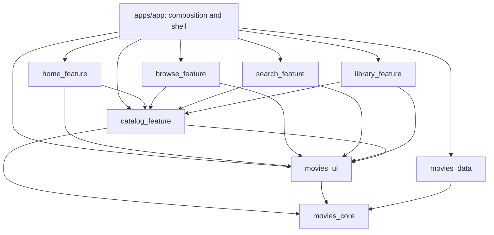
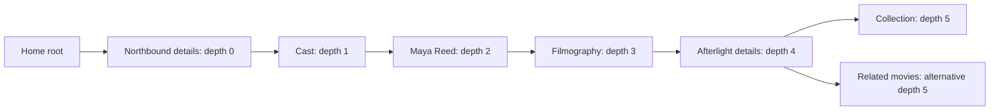

# Stage 3: Movies — Architecture and Monorepo

Status: Approved by the developer.
Approval recorded: October 31, 2026 (America/Chicago), from the developer reply “approved”.
Date: October 31, 2026 (America/Chicago).
Prerequisites: [Stage 1 scope](01_product_scope.md) and [Stage 2 acceptance criteria](02_user_journeys_and_features.md), both approved.
Target: Local iOS Simulator; no backend or device-cloud dependency.

## 1. Architecture decisions and provenance

| Decision | Basis |
| --- | --- |
| Apps/packages monorepo | Required by the selected Flutter scaffolding and SDD skills. |
| MVVM presentation with Riverpod Notifier/AsyncNotifier and immutable state | Required skill architecture. |
| GoRouter with package-owned route factories | Required skill architecture. |
| Package-level localization, documentation, and isolated tests | Required skill architecture. |
| Freezed domain models with JSON serialization and generated code | Required by the selected SDD skill. |
| Drift/SQLite for local favorites | Explicit developer Stage 3 discovery response. |
| Dio for TMDB networking | Explicit developer Stage 3 discovery response. |
| Separate Home, Browse, Search, and Library feature packages, plus shared catalog screens | Explicit developer Stage 3 discovery response. |
| Standard Flutter CLI, Flutter 3.41.6 and Dart 3.11.4 | Verified Stage 0 environment and approved scope; no SDK upgrade or FVM installation assumed. |
| Stateful tab navigation, generation-checked async results, app-scoped favorites, and explicit storage acknowledgements | Architecture accepted through Stage 3 approval to satisfy approved Stage 2 behavior. |

The document specifies module boundaries, routing, state lifetime, persistence coordination, and dependency pins. It does not implement the app or replace the later design, API-contract, testing-strategy, and implementation-plan stages.

## 2. Approaches considered

| Approach | Benefits | Tradeoffs | Decision |
| --- | --- | --- | --- |
| Separate tab features plus shared catalog feature | Independent tab ownership, isolated ViewModels/tests, reuse of movie/person screens across all tabs. | More package manifests and localization delegates. | Selected by the developer. |
| One discovery feature combining Home, Browse, and Search | Fewer packages and simpler early wiring. | Broader ownership and tighter coupling of independent tab state. | Not selected. |

Both options retain the required monorepo. An arbitrary single-app structure is outside the selected skills' architecture.

## 3. Workspace layout and package ownership

The workspace root is `week3-project-automated-testing/client`. The user-facing name is Movies; the executable Dart package is `movies`, located in `apps/app`.

```text
client/
  pubspec.yaml
  pubspec.lock
  analysis_options.yaml
  README.md
  specs/
  config/
  apps/
    app/
      pubspec.yaml
      ios/
      lib/
        main.dart
        app.dart
        bootstrap/
        core/router/
        core/theme/
        l10n/
      test/
      integration_test/
  packages/
    movies_core/
    movies_data/
    movies_ui/
    catalog_feature/
    home_feature/
    browse_feature/
    search_feature/
    library_feature/
```

| Package | Owns | Does not own |
| --- | --- | --- |
| `apps/app` | Bootstrap, live/fixture configuration, repository bindings, root ProviderScope, application lifecycle, MaterialApp, four-branch router, global theme configuration, aggregated localizations, external-link adapter, simulator runner, and host integration tests. | Movie API parsing, favorite SQL, or feature business state. |
| `movies_core` | Shared canonical Freezed entities, repository contracts, typed failures, request identities, clock contracts, and pure-Dart navigation destination/name conventions. Models live under `lib/domain/`. | Flutter widgets, Riverpod containers, Dio, Drift, or native platform calls. |
| `movies_data` | Dio TMDB adapter, provider DTOs and domain mapping, bounded in-memory response cache, Drift database/DAOs, repository implementations, and injected fake implementations for controlled tests. | Flutter screen navigation or rendered UI state. |
| `movies_ui` | Shared artwork/card primitives, section/loading/error/empty widgets, accessibility helpers, theme-consumption utilities, thin GoRouter navigation helpers, and common UI strings. | Provider API calls, SQL, concrete feature screens, or its own canonical favorites list. |
| `catalog_feature` | Movie details, cast/credits, person details, filmography, collection/related listings, images/review presentation, branch-aware catalog route factories, shared repository providers, and the app-scoped favorites ViewModel/Undo state. | Any tab root, concrete TMDB/SQLite implementation, or host bootstrap. |
| `home_feature` | Carousel, discovery shelves, recommendation presentation, Home listing state, and Home root route factory. | Browse/Search state or a second favorites source of truth. |
| `browse_feature` | Category selection, category results/pagination, and Browse root route factory. | Search queries or catalog screen implementations. |
| `search_feature` | Query editing/debounce, query/result identity, search continuations, and Search root route factory. | Global request state shared with unrelated tabs. |
| `library_feature` | Library presentation, empty/read-error state, ordering projection, and Library root route factory. Reads and dispatches through the shared favorites ViewModel. | Duplicate persistent favorites or a separate Undo queue. |

All feature packages contain `lib/presentation/router/router.config.dart`, `state/`, `viewmodel/`, `views/`, local `domain/` use cases when needed, `l10n.yaml`, `.arb` resources, `docs/`, `test/`, and a public barrel file. Feature-local models are Freezed when they are domain entities; canonical shared entities remain in `movies_core` to avoid duplicated Movie or Person definitions.

Infrastructure packages do not need dummy presentation or localization layers. UI primitives accept explicit content or shared domain values rather than import feature packages.

### Allowed dependency graph



All features may depend directly on `movies_core`. Tab features do not import each other. `catalog_feature` never imports tab features. Presentation packages never import `movies_data`; the host supplies implementations through repository provider overrides. Only public package barrels or explicitly documented public libraries are imported across package boundaries; private `lib/src/` imports are prohibited.

### Native Pub workspace

Use one `client/pubspec.yaml` with explicit workspace member paths and `resolution: workspace` in each member. Internal dependencies use relative path references, matching the scaffolding skill. Members are private, version `0.1.0`, and not published. Commit the single root `client/pubspec.lock`; do not maintain competing member lockfiles.

Native workspaces are available in the installed Dart version; workspaces use shared dependency resolution. Explicit membership keeps the first-release package graph auditable. [Dart workspace documentation](https://dart.dev/tools/pub/workspaces)

## 4. Layering and dependency injection

The normal read path is View → ViewModel → repository contract → repository implementation → TMDB or SQLite → mapped immutable data → ViewModel state → View. Views render state and dispatch actions; they do not perform networking, persistence, timers, or data mapping.

The host composes one application-scoped Dio client, cache, database lifecycle owner, repository set, router, clock, and external-link gateway. `catalog_feature` declares the abstract repository providers consumed by shared and tab ViewModels. The host overrides those providers with `movies_data` instances. This one-way dependency prevents data/presentation cycles.

Create repository/database handles without blocking `runApp` on a successful favorites read. A local database failure must produce Library's storage-error state while navigation and available catalog browsing remain usable. Configuration failures similarly leave shell navigation and local Library functionality available.

Live mode binds the real TMDB adapter. Controlled tests bind fake repository responses and storage outcomes explicitly; the app must never silently swap a failed live API call for fictional movies. No server directory, Python service, MCP server, or model-provider connection is required to launch this client.

## 5. MVVM state and lifetime

Use Riverpod `Notifier<State>` for feature controllers that coordinate mixed loading/data/error state. `AsyncNotifier<State>` is permitted for genuinely single-resource asynchronous state. Do not reduce a whole screen to one loading/error enum when different sections can succeed or fail independently.

State is immutable. Shared domain entities use Freezed with `copyWith`, equality, and JSON factories; transport DTOs are kept separate and mapped in `movies_data`. Generated serialization does not permit provider JSON field names or storage rows to leak into presentation. Exact fields and payload schemas belong to Stage 5.

| State owner | Lifetime | Responsibilities |
| --- | --- | --- |
| Bootstrap/config/repositories | Application scope | One configured dependency set and predictable resource cleanup. |
| Shared favorites ViewModel in `catalog_feature` | Application scope | Confirmed favorites, pending intents, local read/write failures, current Undo offer, and recommendation seed. |
| Home/Browse/Search/Library root ViewModels | Retained for each mounted tab | Preserve selected category/query, loaded pages, and prior successful data when switching tabs. |
| Catalog screen ViewModel | One pushed page entry | Movie/person/resource context, section state, and page-specific loading/error state. |
| Scroll and carousel controllers | Owning mounted view/page | Restore useful position while that branch/page remains mounted; dispose on final removal. |
| Network cancellation/timers | Owning request/controller | Cancel or invalidate on query replacement, explicit reset, or owner disposal. |

Catalog page state is keyed by branch, page-entry identity, and entity identity. Do not key every MovieDetails screen only by movie ID: visiting the same movie twice may share repository data but must preserve two distinct navigation/page contexts. Unbounded permanently alive provider families are prohibited; popped page scopes are released. Retained tabs and existing back-stack entries must not be disposed merely because another tab is selected. [Riverpod lifecycle guidance](https://riverpod.dev/docs/concepts2/auto_dispose)

Typed section state distinguishes requested identity, displayed identity, prior successful data, loading/continuation flags, error, and continuation availability. Search can therefore retain Northbound results visibly attributed to Northbound while an Ember request fails. The meaning and ownership of each state is fixed here; field-level schemas are Stage 5 work.

## 6. Four independent navigation branches

Use `StatefulShellRoute.indexedStack` with Home, Browse, Search, and Library as distinct `StatefulShellBranch` navigators. Keep the tab bar accessible during catalog exploration. Do not put every catalog screen on a root navigator above the tab shell, which would obscure tab switching and weaken branch preservation.

The host owns the stable navigator keys and composes each tab's root route with a new branch-specific catalog route list. Every feature publishes its own `router.config.dart`; the shared catalog factory receives a branch identity so route names and keys are unique. The approved SDK-compatible GoRouter version includes stateful-shell support. [GoRouter API](https://pub.dev/documentation/go_router/latest/go_router/StatefulShellRoute-class.html), [pinned-version source](https://github.com/flutter/packages/blob/go_router-v17.5.0/packages/go_router/lib/src/route.dart)

| Branch | Root | Example catalog destinations in that branch |
| --- | --- | --- |
| Home | `/home` | `/home/movie/:movieId`, `/home/movie/:movieId/cast`, `/home/person/:personId`, `/home/person/:personId/filmography` |
| Browse | `/browse` | `/browse/movie/:movieId`, `/browse/person/:personId`, `/browse/collection/:collectionId` |
| Search | `/search` | `/search/movie/:movieId`, `/search/person/:personId`, `/search/movie/:movieId/related` |
| Library | `/library` | `/library/movie/:movieId`, `/library/person/:personId`, `/library/collection/:collectionId` |

All four branches receive the same applicable movie, cast, person, filmography, collection, related, images, and review route patterns. The table shows representative paths, not a restriction to those examples. Home also owns its discovery-listing and About/Credits destinations.

Use branch switching to select a retained tab and `push`/`pushNamed` to follow user-selected entities within the active branch. A cross-entity selection must not reset the stack with a replacing `go` call. Catalog URLs identify the target resource; the actual imperative page stack records the user's traversal. IDs are required route inputs; a previously loaded model may be optional display context but must not be the only way to construct a page.

Route names are namespaced by branch, such as `home.movie` and `search.movie`, and each push receives a distinct page key. Invalid IDs produce a navigable error state without a provider request for a malformed ID. Back/pop and iOS back gestures operate on the active branch's visited stack. Selecting another tab restores its stack without resetting it, including when the same movie appears repeatedly.



These are pushes on Home's navigator in this example; equivalent journeys are supported from other branches. The app does not encode an ever-growing chain of every visited entity into one URL or fabricate nested route levels. Navigation restoration after process termination is not required; favorite persistence is required.

## 7. Async requests, stale results, and pagination

- Each logical request has a normalized resource identity: entity/query/category/seed, language/region, relevant filters, and page. A ViewModel also maintains its current request generation.
- Search uses the approved 350 ms debounce. Query replacement or Clear cancels old work where possible and invalidates its generation. Cancellation alone is insufficient: all success and failure completions check identity and generation before affecting current state.
- Explicit keyboard submit consumes the pending debounce and avoids a duplicate identical in-flight request.
- A new query/category result replaces the relevant collection; a continuation appends only to the same identity and expected page. A per-identity continuation guard prevents duplicate page loading; advance the cursor only after success and deduplicate movie IDs while preserving supplied order.
- A failed continuation preserves existing cards and its unadvanced cursor. A successful exhausted result stops continuation requests. Empty successful results, failures, and end-of-results are separate states.
- Requests for supplementary cast, reviews, images, or related content have separate section state. Their failure cannot discard successful core details.
- A refresh error retains already loaded content only under its original displayed identity. A late response for an old entity/category/query/seed cannot populate the current one or trigger navigation.
- Bound network timeouts and retry attempts. Retry only appropriate idempotent reads, respect rate-limit guidance, and avoid retrying authentication or malformed-request failures automatically. Explicit retries create a fresh attempt with the same intended resource identity. Stage 5 specifies the exact timeout/backoff contract.

The repository may reuse an in-flight read or a bounded memory-cache result for identical resource keys. Cache eviction must not erase an active page's already rendered state. Cached data is an optimization, not a substitute for explicit error states or a promise of a complete offline catalog.

## 8. Drift favorites and optimistic mutation coordination

`movies_data` owns the SQLite database, schema, DAOs, and migrations. Use Drift's Flutter integration for an application-private database and inject an in-memory database or fake repository for tests. Keep saved movie identity, required Library display metadata, and ordering information sufficient for offline identification and Undo restoration. Stage 5 defines the exact schema.

The shared favorites ViewModel is the only presentation source of truth. It projects confirmed persisted state plus ordered pending user intents. Home seed selection, Library rows, and favorite controls on every occurrence of a movie read this projection rather than maintain local competing sets.

### Mutation protocol

1. Assign a monotonically increasing local intent revision; record the affected movie's prior state and ordering context.
2. Immediately project the user action into UI state. Removal creates the approved five-second Undo offer for that movie.
3. Serialize persistence operations through a repository-owned write queue. Use transactions where multiple affected values must commit atomically, and acknowledge an intent only after its write succeeds.
4. On success, advance confirmed state for that intent. Older acknowledgements cannot replace a newer projection.
5. On failure, remove only the failed intent from the pending sequence, preserve unrelated changes, and recompute the affected movie from its last confirmed state plus still-valid later intents. Expose an actionable storage error; do not imply a failed write was saved.
6. Undo is a new restore intent with the removed movie's snapshot and ordering context. Validate the current Undo token/revision before accepting it. An obsolete offer must not reverse a later explicit add/remove.
7. A newer removal replaces the single current Undo offer. Backgrounding, termination, expiry, or superseding same-movie intent ends that offer without silently restoring the movie.

Only completed, acknowledged writes are guaranteed to survive restart. Do not delay actual removal until the Undo timer expires: a successful removal must already persist. A successfully saved Undo persists its restoration. A pending write at process termination is not reported as durable.

Until the initial favorites read or its retry establishes a confirmed baseline, favorite mutation controls show a loading/unavailable state and do not accept mutations based on an assumed empty Library. Catalog browsing remains available, and Home may show explicitly labeled general picks. An authoritative reload waits for a quiescent write queue; read generations and mutation revisions prevent an old read from replacing newer user intent. These are assistant-selected coordination rules within the approved non-destructive storage behavior.

Initial read or migration failure is a storage-error state, not an empty Library and not permission to recreate/delete the database. Recovery retries preserve existing saved data. New schema versions require explicit migrations, exported schema history, and validation before release. [Drift transaction behavior](https://drift.simonbinder.eu/dart_api/transactions/)

## 9. Configuration, native boundaries, and observability

- Inject configuration from the host. Real credentials stay in uncommitted local input; commit only a credential-free example. Avoid adding a dotenv dependency unless a later contract requires one.
- Live mode uses TMDB's application-read authentication. Missing/rejected configuration has a typed catalog failure and does not prompt movie browsers to provide a secret.
- Build-time configuration keeps a token out of Git but does not make an embedded client credential unrecoverable. This is a local noncommercial client; a protected backend proxy would be a separate future scope decision.
- Dio failures map to typed network, timeout, authentication, rate-limit, not-found, invalid-data, and storage categories with resource context. Never log authorization values or raw credential-bearing request details.
- External trailers use an injected gateway implemented with `url_launcher` in the host. Provider URLs are validated according to Stage 5's allowed destinations, and launch failure preserves the current movie screen.
- Use Flutter's normal image-loading and memory-cache facilities behind `movies_ui` artwork widgets initially. Provide intentional placeholders; a broken image cannot remove the movie title or opening action. No extra disk-image-cache dependency is required for this release.
- Diagnostics record request identity, result category, timing, route context, and local operation revision as needed for debugging. Product screens show useful user messages rather than implementation details. An OpenTelemetry backend or AI trace service is not required for this client.
- Keep the iOS runner and native plugin configuration only in `apps/app`. Only the selected simulator is a delivery target. Use the generated deployment settings with a floor compatible with the selected plugins; exact native build compatibility is verified during scaffolding, not inferred from metadata.

## 10. Localization, theming, and automation boundaries

Each feature package owns its English `.arb` resources, generated localization class, `l10n.yaml`, and public localization delegate. `movies_ui` owns reusable strings; `apps/app` aggregates all required delegates and supported locales. Generate into package-owned source directories, not an implicit shared synthetic localization package. No extra language is promised in this release.

The host provides Material 3 themes; reusable UI components consume theme tokens rather than hardcode their own palette. Stage 4 fixes color, typography, artwork treatment, motion, and large-text layout behavior.

Give important widgets stable Flutter keys and native semantics identifiers as distinct contracts. Public automation identities include stable screen role, entity identity where applicable, and section context; internal page-entry keys additionally distinguish repeated navigation instances. Human-readable labels identify the action and current favorite/selection state. Do not put random page-entry values into the only public identifier an agent can use across runs.

A later agent may attach through Flutter MCP, Appium, or another adapter. This architecture does not commit the client to a particular agent runtime or embed model credentials. Controlled test repositories remain a separate explicit binding from the real catalog.

## 11. Exact dependency baseline

These are approved direct baseline pins for the observed Flutter 3.41.6 / Dart 3.11.4 environment. Version metadata and installed SDK constraints were inspected on October 31, 2026. **Dependency resolution, code generation, and simulator compilation have not been run.** This is a metadata-compatible candidate graph, not a build-proven lockfile.

Use the same exact direct version wherever a package is declared. Keep SDK packages sourced from the installed Flutter SDK. Members should declare a Dart range including 3.11.4 and exclude unsupported major versions; the workspace and delivery documentation record Flutter 3.41.6 as the selected toolchain.

| Dependency | Exact pin | Owners / purpose |
| --- | --- | --- |
| `flutter`, `flutter_localizations`, `flutter_test`, `integration_test` | Flutter SDK 3.41.6 | Host/features and relevant test packages; only declare where used. |
| `flutter_riverpod` | [3.3.2](https://pub.dev/packages/flutter_riverpod/versions/3.3.2) | Host, features, and shared presentation ownership. |
| `go_router` | [17.5.0](https://pub.dev/packages/go_router/versions/17.5.0) | Host, feature route factories, thin shared navigation helpers. |
| `intl` | [0.20.2](https://pub.dev/packages/intl/versions/0.20.2) | Matches the installed Flutter localization pin. |
| `freezed_annotation` | [3.1.0](https://pub.dev/packages/freezed_annotation/versions/3.1.0) | Immutable model declarations. |
| `json_annotation` | [4.12.0](https://pub.dev/packages/json_annotation/versions/4.12.0) | Domain/DTO JSON serialization declarations. |
| `freezed` | [3.2.5](https://pub.dev/packages/freezed/versions/3.2.5) | Development dependency in packages owning Freezed definitions. |
| `json_serializable` | [6.14.1](https://pub.dev/packages/json_serializable/versions/6.14.1) | Development dependency in packages owning JSON-generated models. |
| `build_runner` | [2.15.1](https://pub.dev/packages/build_runner/versions/2.15.1) | Development dependency in each package owning generated model/database code. |
| `dio` | [5.11.1](https://pub.dev/packages/dio/versions/5.11.1) | `movies_data` networking. |
| `drift` | [2.34.4](https://pub.dev/packages/drift/versions/2.34.4) | `movies_data` database runtime. |
| `drift_dev` | [2.34.0](https://pub.dev/packages/drift_dev/versions/2.34.0) | `movies_data` database generation. |
| `drift_flutter` | [0.3.1](https://pub.dev/packages/drift_flutter/versions/0.3.1) | Flutter/native database opening. |
| `url_launcher` | [6.3.3](https://pub.dev/packages/url_launcher/versions/6.3.3) | Host external-link adapter. |
| `flutter_lints` | [6.0.0](https://pub.dev/packages/flutter_lints/versions/6.0.0) | Flutter members' development lint baseline. |
| `test` | [1.30.0](https://pub.dev/packages/test/versions/1.30.0) | Pure-Dart core tests; matches Flutter's test_api constraint. |

`drift_flutter` already supplies its required SQLite/path dependencies. Do not add `sqlite3_flutter_libs`, whose current package is obsolete. Add direct `path_provider` 2.1.6, `path` 1.9.1, or `sqlite3` 3.8.0 only if implementation imports those APIs directly; they are not mandatory extra direct dependencies. [Drift setup](https://drift.simonbinder.eu/setup/), [SQLite package](https://pub.dev/packages/sqlite3), [obsolete package notice](https://pub.dev/packages/sqlite3_flutter_libs)

### Compatibility constraints that shaped these pins

- Newer Riverpod 3.4.3 and GoRouter 18.1.2 require Dart 3.12; GoRouter also raises its Flutter floor. Freezed 4.0.3 requires Dart 3.13. Do not upgrade the SDK or blindly use those latest releases while scaffolding this baseline.
- Freezed 3.2.5 constrains analyzer to versions below 11. The selected `drift_dev` and `build_runner` versions retain an overlapping generator range; newer releases can require analyzer 13 or later.
- Installed `flutter_test` pins `meta` 1.17.0 and `test_api` 0.7.10. Metadata inspection found an example shared constraint intersection using analyzer 10.0.1, build 4.0.7, source_gen 4.2.4, dart_style 3.1.7, and test 1.30.0. These are compatibility witnesses, not arbitrary direct application dependencies.
- Do not resolve conflicts by overriding Flutter SDK pins or adding broad dependency overrides. At the scaffolding stage, run the actual resolver, inspect any conflict, select a supported compatible patch/version adjustment if needed, record the change, and retain the architecture unless evidence warrants revisiting it.

Sources include [Freezed metadata](https://pub.dev/api/packages/freezed/versions/3.2.5), [build_runner metadata](https://pub.dev/api/packages/build_runner/versions/2.15.1), [Drift generator metadata](https://pub.dev/api/packages/drift_dev/versions/2.34.0), and the installed Flutter SDK's localization/test manifests. Package pages above provide browsable version references when metadata endpoints are not rendered by a browser.

## 12. Generation, documentation, and validation ownership

Run Freezed/JSON/Drift generation from each owning package rather than assume a build_runner invocation at an otherwise empty workspace root generates every member. Generate each feature's localizations before host compilation. Commit package-owned generated source alongside its source declarations for reproducible review, and later CI checks that regeneration leaves no unexplained changes. Do not hand-edit generated files.

Every feature documents its public route factory, ViewModel responsibilities, repository dependencies, localization delegate, and relevant Stage 2 scenario families. `movies_data` documents its provider adapters, failure mapping, local database/migration policy, and test injection boundaries. The host README documents the simulator run path and uncommitted credential configuration.

Validation after all specification gates includes a real workspace resolution, generation for every owning member, analyzer checks across all members, isolated package tests, host navigation/state tests, and an actual build/run on the selected iOS simulator. Detailed coverage thresholds and scenario-to-test allocation belong to Stage 6; implementation milestone ordering belongs to Stage 7.

## 13. Architectural traceability to approved behavior

| Stage 2 acceptance | Architecture response |
| --- | --- |
| MOV-SHELL-002/003 and MOV-DEEP-001/002/005 | Independent retained branch navigators, unique pushed page entries, and no navigation from background completion. |
| MOV-SEARCH-001 through MOV-SEARCH-009 | Debounce owner, explicit submit deduplication, distinct displayed/requested query identities, cancellation plus generation checks, and keyed continuation guards. |
| MOV-HOME-006/008 and MOV-DETAIL-003/004 | Per-section resource state and seed/entity request isolation. |
| MOV-BROWSE-002 through MOV-BROWSE-006 | Category-scoped pagination, success-only cursor advancement, identity deduplication, and distinct empty/end/failure states. |
| MOV-LIBRARY-001 through MOV-LIBRARY-013 | Shared app-scoped favorites projection, transactional queued writes, revision-aware Undo, explicit persistence acknowledgements, rollback, and non-destructive storage recovery. |
| MOV-RECOVERY-001 through MOV-RECOVERY-006 | Typed errors, correctly attributed retained content, local saved metadata, bounded read retries, and no silent fake-data fallback. |
| MOV-EXTERNAL-001/002 | Validated external-link gateway with failure preserving the current page. |
| MOV-A11Y-001/002 and MOV-ABOUT-001 | Distinct widget/semantics identities, accessible shared UI, package localization, host theming, and reachable attribution. |

## 14. Stage 3 approval record

The developer reviewed this document and replied “approved” on October 31, 2026. Approval covers the eight-package layout, dependency directions, shared favorites ownership, branch-preserving catalog navigation, async/write coordination, and exact candidate dependency baseline. Actual dependency resolution, generation, and iOS build verification remain pending as stated above.

Stage 4 design-system discovery may now proceed. Later specifications, scaffolding, and application implementation remain gated by the selected Flutter SDD workflow. Prior approvals remain intact; this record does not imply approval of specifications that have not yet been written.
