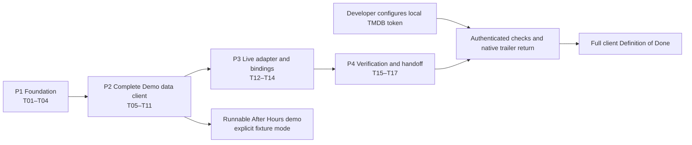

# Movies Implementation Plan

> **For agentic workers:** Use `superpowers:executing-plans` for the developer-selected implementation in this session. Work task by task using the checkboxes below; use independent reviews. Do not switch to delegated implementation without a later developer preference change. Read the approved specifications alongside this plan.

**Goal:** Build the complete After Hours Movies client for iOS Simulator, delivering an explicit Demo data navigation milestone first and then real TMDB integration with recorded verification.

**Architecture:** One native Dart workspace contains `apps/app` and the eight approved packages. MVVM/Riverpod features consume pure-Dart contracts, the host injects fixture/live infrastructure, and GoRouter retains four independent tab branches. Drift supplies one application-wide favorites projection with acknowledged, revision-aware persistence and Undo.

**Tech stack:** Flutter 3.41.6, Dart 3.11.4, Material 3, Riverpod, GoRouter, Freezed/JSON generation, Dio, Drift/SQLite, SDK tests, and GitHub Actions, using Stage 3's exact dependency baseline.

**Specifications:** [Scope](01_product_scope.md), [acceptance criteria](02_user_journeys_and_features.md), [architecture](03_architecture_and_monorepo.md), [design](04_design_system_and_responsive.md), [data/API contracts](05_api_and_data_contracts.md), and [testing strategy](06_testing_strategy.md).

Status: Approved by the developer.
Approval recorded: November 1, 2026 (America/Chicago), from the developer reply “approved”.
Date: November 1, 2026 (America/Chicago).
Prerequisites: Stages 1–6 approved. No Movies app has been scaffolded or tested yet.
Canonical plan location: `client/specs/07_implementation_plan.md`, following the explicitly selected Flutter SDD workflow rather than maintaining a duplicate plan elsewhere.

## 1. Execution decisions

| Decision | Basis |
| --- | --- |
| After Hours UI and deep navigation with explicit Demo data first; then live TMDB | Explicit Stage 7 discovery response. |
| Implement in this session, with independent reviews | Explicit Stage 7 discovery response; implementation remains with the primary agent. Research and independent review can run in parallel. |
| No TMDB token yet; continue fixtures until the developer configures it locally | Explicit Stage 7 discovery response. Do not request the token in chat or read unrelated environment files. |
| Definition of Done includes fast CI, local Simulator evidence, and authenticated smoke | Inherited from approved Stage 6. Missing credentials delay the live evidence, not the fixture app or implementation of the real adapter. |
| Manual workflow from `flutter-scaffold-project` | The bundled helper does not match the approved layout, pins, or package naming. The skill explicitly provides a manual alternative. |

The considered delivery orders were a complete fixture-driven client before live integration, or live discovery before the rich client. The developer selected the first to prioritize visible Flutter progress while the API credential is unavailable. Live remains the normal application mode; each Demo data run is deliberately selected. There is no automatic live-error fallback.

This plan is the final specification stage. Approval unlocks the full specification audit and scaffold execution; it does not declare the future milestones already complete. Dates below are approval provenance, not implementation estimates or promised delivery dates.

## 2. Global constraints

- First release: **iOS Simulator only**. Use the existing verified Flutter 3.41.6/Dart 3.11.4 toolchain; no FVM, SDK upgrade, Android/Web/macOS runner, signing, or physical-device delivery is assumed.
- App Dart package `movies`, display name **Movies**, at `apps/app`. Use local Simulator bundle identifier `com.example.movies`; public distribution identity is outside this release.
- Exactly eight packages: `movies_core`, `movies_data`, `movies_ui`, `catalog_feature`, `home_feature`, `browse_feature`, `search_feature`, `library_feature`. One root workspace lockfile; explicit members, `resolution: workspace`, relative local dependencies, private version `0.1.0`.
- Use Stage 3's exact candidate pins. Run the real resolver/generators/build before claiming compatibility. Diagnose and record supported adjustments; do not override SDK pins or silently use latest packages.
- `movies_core` stays pure Dart. Presentation never imports `movies_data`; tab features never import each other; catalog never imports a tab. Feature route factories/localizations/docs/tests remain package-owned.
- Home, Browse, Search, Library stay reachable through deep navigation. Each branch retains its actual stack, content identity, query/category, and useful scroll. A repeated movie uses a new internal page entry while sharing favorites by movie ID.
- Search debounce **350 ms**; immediate submit consumes the pending equivalent search. Undo lasts **five active seconds**; tab changes preserve its deadline; background/termination ends it.
- No favorites mutations before a successful baseline read. Only committed writes are durable. Revision-aware failures never overwrite unrelated or newer user intent.
- After Hours dark launch theme, companion light definition, English UI, native iOS font, 48-unit targets, responsive/large-text behavior, and stable automation identities follow Stages 4 and 6.
- Catalog defaults `en-US`/`US`, adult-flag exclusion, real source labels, documented pagination, bounded networking, and provider-null handling follow Stage 5. Trending has no undocumented continuation; cast/filmography/images/collection arrays are complete resources.
- Demo catalog uses Northbound/Maya Reed/Afterlight, local artwork, separate fixture SQLite storage, and simulated external links. Synthetic IDs and keys never reach live providers. Normal databases are never reset on launch for testing.
- Coverage is at least **85%** of handwritten business logic per owning member and combined, with all **62 scenario definitions / 64 baseline examples** mapped. Fast CI and native/live evidence are separate gates.
- Preserve existing specs, reference assets, `.gitignore`, and unrelated repository changes. No real token, preview access key, runtime state, or developer database enters source control/artifacts.
- The testing agent, MCP, LangGraph, memory infrastructure, Jev, backend/server, Docker, HeadSpin, and paid device services remain deferred. Do not expand this client plan into those systems.

## 3. Review focus

These failure classes must have explicit tests in their owning tasks, beyond generic happy paths:

| Focus | Expected behavior | Owning tasks |
| --- | --- | --- |
| R1: repeated entity with obsolete failure on another page/branch | Distinct page context, correct source labels, shared favorite identity, no navigation or stale-state takeover | T07, T09–T11, T16 |
| R2: remove highest-order favorite, add another, Undo while writes complete/fail | No reused order, correct restore position, affected-intent rollback, unrelated/newer intent survives | T05–T06 |
| R3: filtered/duplicate-only recommendation page with more results | Advance the correct provider cursor, keep seed/Load more; fallback only when the eligible source is empty and exhausted | T09–T10, T13 |
| R4: missing/rejected config or live network failure with local saved movies | Navigable local Library, truthful catalog error, no Demo substitution or token-entry product flow | T01, T06, T12–T14, T17 |
| R5: fake restart/launcher/semantics mistaken for native proof | Record real process/lifecycle/browser evidence separately; VoiceOver speech remains unverified under Simulator-only scope | T15–T17 |

## 4. Files, boundaries, and handoff interfaces

All paths below are relative to `client`, except the repository-level workflow path. Named source files are planned, not existing. Split model/DTO files by responsibility; public signatures and filenames below establish ownership while the full field tables in Stage 5 remain authoritative.

| Area | Main planned files | Responsibility |
| --- | --- | --- |
| Workspace | `pubspec.yaml`, `pubspec.lock`, `analysis_options.yaml`, `.gitignore`, `README.md`, `config/dev.example.json` | Nine members, pins, tooling/config instructions, ignored local inputs/artifacts. |
| Host | `apps/app/lib/main.dart`, `app.dart`, `bootstrap/app_config.dart`, `bootstrap/bootstrap.dart`, `bootstrap/dependency_bindings.dart` | Startup, mode parsing, lifetime, concrete overrides without moving business state into the host. |
| Host native/navigation/theme | `apps/app/ios/`, `lib/core/router/app_router.dart`, `lib/core/theme/app_theme.dart`, `lib/platform/external_link_gateway.dart`, package `l10n/` | iOS runner, four retained branches, theme, validated launcher, delegates. |
| Core | `packages/movies_core/lib/domain/models/`, `contracts/`, `failures/`, `request/`; `lib/movies_core.dart` | Canonical Freezed entities, six repository/gateway contracts, identity, clock and cancellation/read options. |
| Data | `packages/movies_data/lib/src/fixtures/`, `tmdb/`, `cache/`, `database/`, `repositories/`; `lib/movies_data.dart` | Explicit fixtures, endpoint DTOs/mappers, HTTP/caching, Drift and repository implementations. |
| Shared UI | `packages/movies_ui/lib/src/artwork/`, `cards/`, `feedback/`, `accessibility/`, `responsive/`, `lib/l10n/`; `lib/movies_ui.dart` | Reusable rendering, semantic/identifier helpers, token consumption. |
| Every feature | `lib/presentation/router/router.config.dart`, `state/`, `viewmodel/`, `views/`, `lib/l10n/`, `l10n.yaml`, `docs/`, `test/`, public package barrel | Modular MVVM/routes/localization with isolated tests. No dummy presentation layer is added to core/data. |
| Shared catalog state | `packages/catalog_feature/lib/presentation/providers/repository_providers.dart`, `state/favorites_state.dart`, `viewmodel/favorites_viewmodel.dart` | Abstract repository providers and sole app-scoped favorite/Undo projection. |
| Quality | `tool/quality.dart`, `tool/check_coverage.dart`, `tool/check_acceptance.dart`, `tool/coverage_scope.json`, `tool/acceptance_manifest.json`, `tool/test/` | Fixed member runner, LCOV/acceptance enforcement, tooling checks, structured results. |
| Host verification | `apps/app/test/`, `apps/app/integration_test/client_journeys_test.dart`, `docs/verification/` | Host wiring, five integration anchors, native/live evidence. |
| CI | Repository `.github/workflows/movies-client-quality.yml` | Linux fast gates scoped to this client and its workflow. |

The tooling lives in the existing workspace root, not an additional application package. Add the approved `test` 1.30.0 as a root development dependency only to run `tool/test/`; this reuses the pinned shared test graph. No new version or global coverage tool is introduced.

Public interfaces used across tasks:

- Stage 5's `DiscoveryRepository`, `MovieRepository`, `PersonRepository`, `ArtworkConfigurationRepository`, `FavoritesRepository`, and `ExternalLinkGateway` keep their documented method names/result types. Async operations return `Future<Outcome<T>>`.
- `CatalogReadOptions` carries `cacheFirst` or `refresh`, a normalized request context, and an owner cancellation handle. Clock and scheduling abstractions permit controlled tests; they do not expose Dio, Flutter, or Riverpod types from core.
- `FavoritesRepository.readBaseline()` returns `Future<Outcome<FavoritesBaseline>>`; `apply(FavoriteWriteCommand)` returns `Future<Outcome<PersistenceAck>>`. Snapshot/order/revision fields are exactly Stage 5's.
- `FavoritesViewModel` exposes `void addFavorite(MovieSummary movie)`, `void removeFavorite(int movieId)`, `void undoRemoval(String offerToken)`, `Future<void> retryRead()`, and `void onBackgrounded()`. These dispatch to the one shared state; persistence acknowledgements arrive through that state. `FavoritesState` exposes readiness, projected entries, pending intents, failures, and current optional Undo offer. Only meaningful current-token actions are accepted.
- Each tab exports `buildHomeRoutes()`, `buildBrowseRoutes()`, `buildSearchRoutes()`, or `buildLibraryRoutes()`. Catalog exports `buildCatalogRoutes({required String branch})`; these return package-owned `List<RouteBase>` values. The host composes each tab root and its branch-specific catalog routes under `StatefulShellRoute.indexedStack`.
- `GoRouter createAppRouter({String initialLocation = '/home'})` composes the four branches; a test bootstrap can inject its start location without changing product navigation. Catalog IDs remain sufficient route inputs; optional preloaded models are never required.
- `Widget bootstrap(AppConfig config, AppDependencies dependencies)` returns the scoped Movies app without awaiting a successful favorites read. `AppDependencies createDependencies(AppConfig config)` creates the normal lifetime-owned repository/storage/gateway/clock set with lazy resource opening. Tests supply the same dependency type with explicit overrides and test-owned databases, not a different architecture.
- The quality runner's `main(List<String> args)` executes `fast` gates and records exit codes. `check_coverage.dart` and `check_acceptance.dart` accept workspace-relative report/manifest inputs; a failure returns nonzero rather than reporting an empty pass. Detailed CLI argument parsing is a builder choice within these inputs/outputs.

## 5. Milestones and dependencies

| Milestone | Observable result | Gate |
| --- | --- | --- |
| M1 — foundation | Correct workspace resolves; shell builds/launches on Simulator; themes/localizations/contracts/fixtures are testable | T01–T04 focused checks; no claim of complete discovery yet. |
| M2 — complete Demo client | Four tabs, After Hours, five-level traversal, all rich supplied sections, Search and durable Library/Undo work in clearly selected Demo data mode | T05–T11 tests and a fixture walkthrough. This is the first complete working product demo. |
| M3 — live-capable implementation | Real endpoint adapters, HTTP/cache/retry policy, image configuration, mode/launcher wiring; missing config stays honest | T12–T14 adapter and host tests. Without a token, authenticated behavior remains unverified. |
| M4 — verified client | Fast gates, five Simulator integration anchors, native N1–N4 evidence, authenticated consumed-endpoint smoke, docs/artifacts | T15–T17 plus the complete checklist below. |

All tasks follow dependency order. The primary agent implements them; independent reviews examine milestone changes and the full client. Do not add a new user-approval gate after every task. Report progress and make authorized reversible fixes; ask only when a genuine scope/input decision cannot be resolved from the approved documents.

## 6. Task execution convention

For code-bearing tasks, first add the specified behavioral tests, run them to observe the intended failure, implement the smallest complete behavior, then rerun focused checks. Expected outcomes below describe future evidence, not current results. Generation/manifests/docs need the applicable structural/build validation rather than artificial tests that merely mirror text.

Each task ends with a scoped change review, package documentation update, and a local commit/checkpoint of its intended files after validation when safe. Inspect the working tree before staging; never sweep unrelated work or ignored inputs into a commit. No push, merge, publication, or App Store operation is part of this plan. Check a task box only against recorded evidence.

### T01 — Safe workspace and executable shell

**Depends on:** explicit Stage 7 approval and the complete seven-spec audit.
**Files:** workspace manifests/lock/analysis/README/ignore/config example; nine member manifests; `apps/app/ios/`; host main/app/bootstrap/router/theme/localizations; feature barrels/router stubs and package docs/tests.
**Interfaces:** produces the package graph, `AppConfig`, `createAppRouter`, and tab route factories used by later tasks. Typed dependency/bootstrap wiring is filled as T02 contracts, T04 catalog bindings, and T06 persistence become available; do not introduce competing placeholder repository interfaces. Temporary roots are visibly incomplete foundation views, not fabricated live catalog data.

- [ ] Inspect current repository/worktree and existing client files. Establish safe execution isolation according to the worktree skill when needed. Specs/reference assets are currently untracked and must be explicitly preserved/carried into any execution checkout; do not assume a fresh worktree contains them or copy ignored secrets/runtime state.
- [ ] Recheck selected SDK/Simulator readiness, run the full spec audit, then follow the scaffolding skill's manual workflow. From the client root create only `apps/app` with `flutter create --no-pub --platforms=ios --project-name=movies --org=com.example apps/app`; author root/member manifests with exact approved pins before resolving once at the root. Identify starter counter/test files for replacement in the next step.
- [ ] Add `foundation_shell_test.dart` and `app_config_test.dart`: correct four tabs, Home initial, locale/theme configuration, explicit Demo badge, default live mode, invalid mode/missing token leaves shell/local navigation available. Observe the intended failure, then implement the Movies foundation in place of the starter counter. Add workspace checks for exactly nine members, dependency directions, pure-Dart core, one lockfile, and preserved specs/assets.
- [ ] Resolve/generate only actual owners, run foundation tests and per-member analysis, then build/install/launch the shell on an available iPhone Simulator. Record real resolver/native compatibility adjustments and the observed iOS deployment floor; do not infer build success from Stage 0. Document the exact fixture run command.

Do not run `scaffold_starter.sh` unchanged: it couples path/name (`apps/app` versus Dart `movies`), generates counter/Settings modules, lacks the required native workspace, uses broad/newer dependency selections, and applies other theme/localization defaults. The manual workflow is part of the selected skill; no shared skill edit or extra design approval is needed.

### T02 — Canonical models, contracts, and controlled time

**Depends on:** T01.
**Files:** `packages/movies_core/lib/domain/models/`, `contracts/`, `request/`, `failures/`; `lib/movies_core.dart`; `test/domain_contracts_test.dart`, `request_identity_test.dart`, `value_conversion_test.dart`.
**Interfaces:** produces every Stage 5 entity/repository signature plus `CatalogReadOptions`, framework-neutral cancellation and clock/scheduler seams. DTOs/SQL/framework types remain outside core.

- [ ] Write contract tests for valid/invalid calendar dates, UTC instant/URI conversion, positive IDs, title/rating invariants, nullable fields, and identity separation by mode/source/query/seed/page. Assert query trimming preserves case/internal spaces and an empty query has no valid read request.
- [ ] Run the pure-Dart focused tests to verify the intended missing-contract failures, then implement the immutable Freezed models/JSON factories and typed outcomes/failures according to Stage 5. Use the same names/types consumed later.
- [ ] Generate from `packages/movies_core` using `dart run build_runner build --delete-conflicting-outputs`; run `dart test` for the three named files and `dart analyze --fatal-infos`. Expected: meaningful contract assertions pass without Flutter imports or live services.

### T03 — After Hours theme and reusable UI

**Depends on:** T01–T02.
**Files:** host `lib/core/theme/app_theme.dart`; `packages/movies_ui/lib/src/artwork/`, `cards/`, `feedback/`, `responsive/`, `accessibility/`, localization resources; `test/movie_card_test.dart`, `resource_states_test.dart`, `responsive_actions_test.dart`.
**Interfaces:** produces reusable cards/artwork/section feedback and identifier helpers consumed by all features. Inputs are domain values, explicit resource state, and callbacks; no repository calls from a view.

- [ ] Add widget assertions for title plus independent Open/Favorite actions, loading/first failure/retained failure/empty differences, failed artwork preserving identity, 48-unit targets, large text wrapping, keyboard-safe message space, and reduced motion.
- [ ] Implement Stage 4's exact palettes/type/spacing/corners and native font derivation, dark launch mode, companion light definition, reusable responsive widgets and localization. Never use the browser screenshot as a fixed-size canvas or ship preview artwork as real movie data.
- [ ] Run the three focused `flutter test` files and theme/layout checks at Stage 6's compact/landscape/breakpoint sizes. Expected: no overflow/framework exceptions, readable reachable actions, separate semantic controls. Review rendered Simulator appearance as screens become available; native-font pixel goldens are not a Linux pass gate.

### T04 — Explicit fixture catalog and local artwork

**Depends on:** T02; uses T01 bootstrap bindings.
**Files:** `packages/movies_data/lib/src/fixtures/fixture_catalog.dart`, fixture repositories/JSON records/local artwork and attribution; `test/fixture_catalog_test.dart`, `fixture_isolation_test.dart`; host fixture binding.
**Interfaces:** implements the four catalog/configuration repository contracts with Stage 5's complete graph and controllable outcomes. Does not replace real persistent favorites with a reset-on-launch in-memory list.

- [ ] Add tests traversing movie 900001 → cast/person 910001 → filmography/movie 900002 → collection 920001 with member 900003; verify Quiet Harbor/Ember variants, section emptiness/failure, configurable completions, and paged/complete resource distinctions.
- [ ] Implement synthetic fixture responses and local artwork, a January 15, 2026 catalogue date and independently advancing elapsed clock. Bind explicit fixture mode to these adapters and the visibly simulated external gateway; fail any unexpected live API/CDN/browser access.
- [ ] Run both focused data tests and host fixture-binding tests. Expected: data graph is complete, no live network calls, Demo label is visible, synthetic IDs/keys remain isolated, and fixture storage uses the separate selected database.

### T05 — Real Drift repository and durable order

**Depends on:** T02.
**Files:** `packages/movies_data/lib/src/database/movies_database.dart`, table/DAO files, schema export; `repositories/drift_favorites_repository.dart`; `test/favorites_repository_test.dart`, `favorites_persistence_test.dart`.
**Interfaces:** implements `readBaseline()` and queued `apply(FavoriteWriteCommand)` with `FavoritesBaseline`/`PersistenceAck` exactly as specified. Allows in-memory and owned file-database injection.

- [ ] Add real SQLite assertions for schema v1, unique movie/order, atomic row/high-water update, FIFO acknowledgements, baseline queue barrier, read/migration failure without reset, and file close/reopen persistence. Include R2: remove highest order, add another, restore old snapshot; no collision and correct order after reopening.
- [ ] Implement database opening, non-destructive metadata handling, desired-state transactions, and serialized writes. Acknowledgements follow commit; removal never waits for the Undo timer. Do not enrich Library rows by a network call or recreate an existing corrupt database.
- [ ] Generate Drift/JSON owners and run both focused tests plus data analysis. Expected: acknowledged writes survive file reopen, failed transactions leave a valid prior state, high-water order is never reused, and test-owned files/connections are cleaned up. This is not yet actual app-relaunch evidence.

### T06 — Shared favorites, Undo, and Library

**Depends on:** T03–T05.
**Files:** catalog shared providers/state/ViewModel; `library_feature` MVVM/routes/localizations; host lifecycle wiring; `catalog_feature/test/viewmodel/favorites_viewmodel_test.dart`, `library_feature/test/views/library_view_test.dart`.
**Interfaces:** produces the single `FavoritesViewModel` API/state above. All controls and Home seed selection consume its projection; Library does not create another source of truth.

- [ ] Add controlled-time/revision tests for unavailable mutation before baseline, optimistic add/remove, pending remove→Undo, five-second expiry, tab navigation retaining its original deadline, immediate background invalidation, superseded tokens, failed add/remove/restore, and affected-item rebase preserving unrelated/later intents. Pin R2 ordering together with the real repository tests.
- [ ] Implement confirmed-plus-pending projection, FIFO command coordination, one global Undo surface, persistent actionable errors, newest-first Library and empty/read-error/retry states. No durable Saved claim before acknowledgement. Wire lifecycle input without moving favorite ownership into the host.
- [ ] Run focused controller/widget tests for all thirteen Library IDs and N1/N2 supporting cases; verify cross-surface state in a host harness. Expected: consistent favorite states, correct five-second boundary, useful Library while catalog configuration fails, reachable Remove/Undo/Retry at large text. Native relaunch/background checks remain T16.

### T07 — Movie, cast, person, and filmography navigation

**Depends on:** T02–T04, T06.
**Files:** catalog MVVM files for movie/cast/person/filmography; `presentation/router/router.config.dart`; host route composition; `catalog_feature/test/views/core_catalog_views_test.dart`, `apps/app/test/catalog_navigation_test.dart`.
**Interfaces:** produces branch-aware catalog route factories and per-page state. Consumes canonical repositories/shared favorite projection and branch/entity route inputs.

- [ ] Add router/widget assertions for movie→cast→person→filmography→another movie, actual Back stack, tab retention, R1 repeated movie with independent page keys/shared favorite ID, malformed route ID without HTTP, and old entity success/failure never populating a new page.
- [ ] Implement core rich details/person information and complete-resource cast/filmography views using per-entry ViewModels, distinct section state, title/context, honest missing fields, readable TMDB rating provenance, and stable public identities.
- [ ] Run the two focused suites and Catalog analysis. Expected: actual pushes/pops follow the visited path, offstage pages cannot steal navigation or expose actionable semantics, repeated IDs do not collapse to one page, and empty cast/filmography remains navigable.

### T08 — Collections, related titles, images, reviews, trailers

**Depends on:** T07.
**Files:** catalog MVVM views/routes for collection/related/images/reviews; trailer presentation; host simulated gateway; `catalog_feature/test/views/rich_catalog_views_test.dart`, `apps/app/test/external_link_binding_test.dart`.
**Interfaces:** completes `buildCatalogRoutes` with rich destinations; consumes Stage 5 collection/gallery/review/trailer contracts. No new TV/playback/streaming feature.

- [ ] Add assertions for depth-five collection or related destination, collection-null alternative, optional-section failure preserving core content, image/review parent context, complete-versus-paged lists, unsupported/missing trailer, and simulated link action with preserved route.
- [ ] Implement the connected screens and Retry/empty/error states. Trailer selection is YouTube/Trailer only with validated eleven-character key and constructed allowed URI; reviews render plain text. Fixture mode never opens a synthetic destination.
- [ ] Run both focused suites and the five-step route harness. Expected: depth five is genuine navigation, no fabricated relationship or dead control, separate source identities, supported trailer intent, and readable long review/biography content. Native live browser return is T17.

### T09 — Home discovery and About/Credits

**Depends on:** T03–T04, T06–T08.
**Files:** Home MVVM/router/localizations, carousel/shelves/listings/About; `test/viewmodel/home_viewmodel_test.dart`, `test/views/home_view_test.dart`, `test/views/about_view_test.dart`.
**Interfaces:** consumes DiscoveryRepository and shared projected favorites; produces source-tagged Home/See all state and About destination inside the Home branch.

- [ ] Add tests for five featured eligible Trending movies, shelf ordering/limits, general versus favorite-seed labels, rollback reseeding, independent shelf failure, and old-seed success/failure. Pin R3: filtered-empty with further pages retains source/Load more; exhausted empty seed permits explicitly labeled Popular fallback; failure never silently falls back.
- [ ] Implement user-controlled hero, five approved shelves, each source's listing, current projected most-recent favorite seed, accurate retained identity, and reachable TMDB logo/source/exact notice from Stage 1. No auto-advance, AI personalization, or in-app movie playback label.
- [ ] Run the three focused Home suites and host Home-route check. Expected: all eight Home IDs and About pass deterministic assertions, a supplied movie opens rich catalog, and content/error labels describe the actual source.

### T10 — Browse categories and safe continuation

**Depends on:** T03–T04, T07.
**Files:** Browse MVVM/router/localizations; `test/viewmodel/browse_viewmodel_test.dart`, `test/views/browse_view_test.dart`.
**Interfaces:** consumes paged discovery repositories; produces category/source-specific results and guarded continuation state.

- [ ] Add assertions for default Now Playing, distinct Upcoming, expected page/dedup/cursor advance, failure/footer Retry, exhaustion/page-500 cap, old category success/failure, and R3 filtered/duplicate-only pages. No automatic unbounded draining and no false “all results empty” from one filtered page.
- [ ] Implement category selection, source-tagged retained content, adaptive grid/list, continuation guard and Load more/Retry/end states while preserving useful scroll.
- [ ] Run both Browse suites and the related host navigation check. Expected: all six Browse IDs and contract cases pass; no old category content is relabeled or appended into a different category.

### T11 — Search and complete fixture walkthrough

**Depends on:** T03–T04, T07–T10.
**Files:** Search MVVM/router/localizations; `test/viewmodel/search_viewmodel_test.dart`, `test/views/search_view_test.dart`; host `test/fixture_walkthrough_test.dart`.
**Interfaces:** consumes `MovieRepository.searchMovies`; produces requested/displayed query state and guarded continuation using existing `CatalogReadOptions` and clock/scheduler.

- [ ] Add controlled tests for 349/350 ms boundary, edit resets, whitespace-only Clear, immediate submit consuming debounce, both stale-response outline rows, late continuation success/failure, explicit old-query labeling under a new failure, and Back/tab preservation.
- [ ] Implement labeled search/clear/keyboard action, adaptive results and all loading/empty/failure/continuation states. Cancellation plus generation/identity checks prevent late state changes; a keyboard event never creates a duplicate equivalent request.
- [ ] Run both Search suites and the host walkthrough: Home→movie→cast→person→filmography→movie→collection/related, tab switches, Search return, and favorite/Library/Undo. Build/launch explicit fixture mode on Simulator and capture After Hours Home/details/depth-five/Library. Expected: M2 is a working complete Demo client; live verification is still pending.

### T12 — Bounded TMDB transport and cache

**Depends on:** T02 and T11 (M2 complete), preserving the selected Demo-first delivery order.
**Files:** data `tmdb/tmdb_client.dart`, request/failure mapping, `cache/catalog_cache.dart`; `test/tmdb_transport_test.dart`, `catalog_cache_test.dart`.
**Interfaces:** produces an internal typed read/validation seam implementing Stage 5 options/outcomes, used only by concrete repositories. Public contracts do not expose Dio. Inject clock, delay, jitter, and transport.

- [ ] Add transport/cache tests for token host boundary/no redirect, safe error mapping, four-active-read limit, cancelled queued work, absolute 25-second deadline including backoff/streaming, permitted single retry with 300–800 ms jitter, 429 Retry-After variants/default 30-second cooldown, TTL/128-entry LRU, refresh bypass, and identity/mode isolation.
- [ ] Implement five-second connect/send, ten-second receive limits and logical deadline, bounded retry/cooldown/concurrency, silent cancellation, successful-resource caching, and safe diagnostics. Pin R4: missing/rejected live config never becomes fixture content; local Library remains independent.
- [ ] Run both focused suites with fake raw HTTP responses and controlled time. Expected: no real network, no uncontrolled retry/wait, no successful empty cache entry for error, correct cancellation ownership, and explicit failure categories.

### T13 — Live discovery, search, configuration, and images

**Depends on:** T02, T09–T12.
**Files:** data TMDB list/search/config/genre DTOs/mappers; concrete DiscoveryRepository/ArtworkConfigurationRepository and movie-search adapter; `test/tmdb_discovery_contract_test.dart`, `tmdb_search_contract_test.dart`, `artwork_configuration_test.dart`.
**Interfaces:** implements the exact public discovery/search/configuration methods. Shares T12's transport/cache rather than introducing feature-owned HTTP.

- [ ] Add raw-response tests for the four regional feeds, unpaged weekly Trending, Search parameters/empty-query rejection, configuration/genre mapping, optional field/title/rating/date handling, adult filtering, malformed arrays/metadata, documented page boundaries, and R3 continuation/source behavior.
- [ ] Implement endpoint-specific DTOs and mappers, documented query parameters only, validated image URL sizing, separate config/genre failure behavior, and provider-window provenance. Do not infer exact U.S. theatrical dates from primary date fields or treat Trending totals as supported paging.
- [ ] Generate DTO owners and run the three focused suites. Expected: fixture/raw-response contract tests pass with no credentials or HTTP, all owned endpoints map to typed domains, and image failure cannot discard text. Real authenticated compatibility remains T17.

### T14 — Live catalog/people/collection adapters and native bindings

**Depends on:** T08, T12–T13.
**Files:** remaining movie/person/credit/image/review/video/collection DTOs/mappers and repository implementations; host `dependency_bindings.dart`/validated external gateway; `test/tmdb_catalog_contract_test.dart`, `tmdb_people_collection_contract_test.dart`; host `test/live_mode_binding_test.dart`.
**Interfaces:** completes MovieRepository and PersonRepository, plus live/simulated `ExternalLinkGateway` and shared lifetime-owned dependency set. Live is the default; fixture remains explicit and isolated.

- [ ] Add endpoint-family assertions for core versus supplemental failure, nullable details, title/name collection forms, credit/role deduplication, filmography/collection order, plain-text review fields, YouTube candidate selection, direct adult exclusion, unsupported links, invalid/absent token, and R1/R4 source isolation across bindings.
- [ ] Implement remaining documented GET adapters and mappings in endpoint-family increments. Wire live config/headers, normal image configuration, real launcher validation, application-private Drift lifecycle, and fixture overrides. Keep saved Library metadata independent of the network and retain no competing favorite projection.
- [ ] Run both data suites and host live-binding tests, then build both configuration paths. Expected: the app is live-capable; absent token shows a truthful navigable unavailable state with local Library, and explicit Demo mode still works. Record authenticated checks as not run until a token is configured.

### T15 — Complete quality runner, traceability, and fast CI

**Depends on:** implemented T01–T14; earlier tasks already own their focused tests.
**Files:** root `tool/` files listed above and `tool/test/quality_contracts_test.dart`; repository `.github/workflows/movies-client-quality.yml`; README quality instructions.
**Interfaces:** produces `dart run tool/quality.dart fast`, LCOV/acceptance checker entrypoints, structured ignored result bundles, and the complete acceptance/scope manifests. Root `test` development pin remains 1.30.0.

- [ ] Add meaningful checker tests for source-path normalization/duplicate hits, missing executable source/report, generated exclusions, zero-hit lines, 84.99/85% threshold boundaries, all 62 IDs and both outline expansions, unknown/missing IDs, skipped/solo obligations, and exit-code propagation. Pin R5: no native/live test is marked passed by fixture/CI evidence.
- [ ] Implement fixed-member formatting/generation/analysis/test/coverage orchestration and manifests; run Dart core and Flutter member commands per Stage 6. Configure Linux CI, scoped triggers, result/artifact capture, and no live secret dependency. Tool checks run with `dart test tool/test` and `dart analyze --fatal-infos tool` from the root; do not count tooling as application business-logic coverage.
- [ ] Run `dart test tool/test`, the full fast runner, generation-cleanliness checks, and the same workflow commands locally. Expected: no unexplained generated/lock changes, no required skip/solo or missing suite, every eligible member and combined coverage at least 85%, all accepted examples traced, and nonzero failures remain nonzero.

### T16 — Simulator journeys, visual/native checks, and fixes

**Depends on:** T15; does not require a live token for fixture journeys/N1/N2/N4.
**Files:** `apps/app/integration_test/client_journeys_test.dart`, any focused regression tests/implementation fixes, `docs/verification/simulator-checklist.md`; ignored run artifacts/screenshots.
**Interfaces:** real host/router, controlled catalog, unique real test DB and simulated links. Uses Stage 6's exact five integration anchors and native evidence rules.

- [ ] Add/run the five host integration anchors for branch retention, Search return, five additional navigation levels, exact Back path, and repeated-entity shared state. Use an available Simulator UDID and the documented fixture-mode invocation; bounded failures produce context/screenshots where possible.
- [ ] Complete N1 actual process relaunch for acknowledged add/removal/Undo on one unchanged installation, N2 real background/resume/offer invalidation and separate tab-preservation check, and N4 real keyboard/insets, portrait/landscape, largest available text, reduced motion, native Back, and Accessibility Inspector. Record N3 separately as pending if no token.
- [ ] Inspect After Hours screenshots against the selected reference and Stage 4's readable adaptive rules; fix demonstrated issues with focused regressions, then rerun affected checks and the fast gate. Expected: no essential clipped/unreachable controls, no semantic duplicate actions, actual Simulator/native evidence attached. VoiceOver speech/gestures remain explicitly unverified because hardware is outside scope.

### T17 — Authenticated smoke and final client handoff

**Depends on:** T14–T16 and developer-configured local TMDB token for authenticated checks.
**Files:** README/setup/run/quality documentation, package docs, `docs/verification/live-smoke.md`, `docs/verification/delivery-checklist.md`; ignored redacted result bundles. No credential file is committed.
**Interfaces:** real default-live bindings and the existing quality/reporting contract; no new backend, test agent, remote publishing, or account-write API.

- [ ] Finish all credential-independent code/docs/checks first. When a local token is available, execute bounded authenticated reads of every consumed endpoint family with actual provider IDs, including Recommendations envelope and collection shape, images and a real connected path. Ratings/rankings/optional content are not fixed expectations.
- [ ] Perform N3 using an actual supplied allowed YouTube trailer and return to the same app context. Record successes, honest empty resources, provider failures/cooldown, and any actual adapter correction. No synthetic ID or simulated launcher counts as live proof.
- [ ] Re-run affected tests after corrections and the full fast/Simulator gates where changes warrant it. Complete the checklist with actual statuses, commit-safe docs/generated sources/config example, package docs, coverage/acceptance/results, screenshots and residual limitations. Expected: full M4 only if every required applicable gate has real evidence.
- [ ] If the token or required native/live input is still unavailable, deliver the complete runnable fixture/live-capable implementation and exact run/config instructions, with live/N3 status **notRun** and the remaining input identified. Do not mark the entire client complete or change the agreed Definition of Done. Continue authorized independent fixes; do not repeatedly ask for the token or accept it in chat.

## 7. Definition of Done

Use this checklist as the final client-delivery decision, not as boxes to pre-check when authoring the plan:

- [ ] All seven specs are explicitly approved and the complete spec audit passes before source generation begins; the approved documents/reference survive scaffolding.
- [ ] Exactly eight packages plus `apps/app`, correct names/platform/private manifests, one root lockfile, allowed dependencies, pure-Dart core, package docs/localizations/barrels/isolated tests, no unintended runners or Settings/counter leftovers.
- [ ] Real workspace resolution, all owning generators, clean regeneration, formatting, and per-member/root-tooling analysis pass on the recorded toolchain; compatibility/native adjustments are documented.
- [ ] Complete After Hours Home/Browse/Search/Library with persistent tabs, approved shelves/categories, rich movie/person/images/review/trailer/collection/related information, and honest missing/loading/empty/error/retained-source states.
- [ ] Actual five additional pushes after first movie, correct Back/repeated-entity behavior, retained per-tab query/category/content/scroll, and no navigation stolen by asynchronous completion.
- [ ] Exact 350 ms Search behavior, superseded success/failure isolation, supported pagination/dedup/cursors, seed/fallback provenance, no silent fixture fallback, and Stage 5 cache/retry/timeout/concurrency/cooldown rules.
- [ ] One shared favorites projection, no mutation before baseline, acknowledged transactional durability, correct high-water ordering/Undo restore, revision-aware failure rollback, five-second/tab/background semantics, and actionable independent errors.
- [ ] Real SQLite tests plus actual Simulator process-relaunch evidence for saved add, expired saved removal, and saved Undo; no false equivalence with recreated providers or reopened connections.
- [ ] Fast CI-equivalent gates pass; every business-logic owning member and combined eligible lines meet at least 85%; missing executable files cannot disappear from the denominator; all 62 definitions/64 baseline examples and additional Stage 6 cases are accounted for.
- [ ] Five automated Simulator integration anchors pass; native N1–N4 checklists are recorded; readable portrait/landscape/large-text layouts, 48-unit targets, independent semantics/actions, stable keys/native identifiers, artwork/keyboard/safe-area behavior, and After Hours screenshots are reviewed.
- [ ] Authenticated live TMDB smoke covers the consumed endpoint shapes and real artwork/relationships; real N3 browser return succeeds. Missing token/evidence stays notRun, not passed.
- [ ] About/Credits has approved logo/source/exact notice; real production content is distinguishable from explicitly selected Demo data; fixture mode cannot contact live services or reset normal saved data.
- [ ] README provides credential-free setup, ignored local-token instructions, fixture/live run commands, simulator selection, generation/quality commands and known limitations. Package docs/public contracts and code-generated outputs are complete and reviewable.
- [ ] Structured redacted results, scenario/coverage summaries, applicable screenshots and failure evidence are retained in the documented ignored artifact layout; no secrets/runtime preview keys or unrelated files are committed.
- [ ] Independent implementation review findings are resolved or accurately documented; no unresolved behavior/build/test defect is described as a successful completion. Physical-device spoken VoiceOver is explicitly unverified under current scope.

## 8. Progress, external inputs, and review protocol

Report each milestone with what runs, what changed, focused validation, and remaining evidence. A runnable Demo milestone is useful and can be handed over while credentials are pending, but it is not renamed a fully live-verified release. Do not use elapsed time as approval or invent a token to clear a gate.

The known external input is the TMDB API Read Access Token, configured by the developer in an ignored local file when ready. Simulator/toolchain access may require the normal execution permissions; use the already authorized scope and continue unaffected work if a native operation is unavailable. Provider schema differences discovered in real responses require a specific compatible mapper correction and regression, not blanket relaxation to silently empty results.

After Stage 7 approval, run the complete seven-spec audit, apply the selected environment/scaffolding/execution skills, and start T01 without another redundant permission request. Use the implementation worktree/isolation workflow when appropriate and preserve the selected native execution method. No remote merge/publish operation is implied.

Plan self-review checks before handoff: every prior specification requirement maps to tasks/DoD; steps have concrete inputs/assertions; shared names and types match; all five Review Focus cases have owning tests; plan size stays proportionate and does not embed application bodies. Independent review is additional evidence, not a replacement for this self-review.

**Approval record:** the developer reviewed this plan and replied “approved” on November 1, 2026. The complete specification audit and Flutter scaffold execution are unlocked. Implementation progress and verification evidence are recorded separately.
