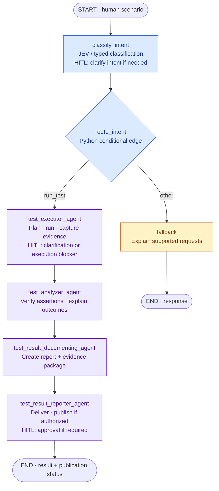

# Automated Application Testing System — Requirements

## Step 1: Product scope

**Status:** Partially approved. The Section 5 agent workflow and human-in-the-loop design are approved; the remaining scope is still under review.  
**Date:** November 2, 2026 — America/Chicago.  
**Purpose:** Define what we are building, who it serves, and the boundaries of the first server-side release. Detailed user journeys, architecture, API contracts, dependency choices, and implementation follow in later steps. This document does not authorize starting implementation.

**Learning and execution pace:** proceed one concept and one small milestone at a time. Explain its purpose and how it connects to the workflow before changing code; then make a focused change, run the relevant check, and inspect the output/state/evidence together. Leave space for questions and review before moving to the next milestone. Do not implement multiple future stages in the background. The first next review is Section 6: what a scenario must express.

### 1. What we are building

We are building a **domain-independent, multi-agent application testing system for iOS, Android, and web**. A human describes a scenario in simple English. The system combines that intent with the target application's knowledge and the current device or browser observations, creates an executable plan, interacts with the app connected to its real API/backend services, verifies the expected behavior, and returns a structured result supported by screenshots and execution evidence.

The product must support iOS applications, Android applications, and web applications across different business domains. Platform support is part of the product scope, not limited to the technology used to build the sample client. Its core agents must not contain hardcoded movie-specific terminology, screens, journeys, or success criteria. Application-specific knowledge is supplied through an explicit onboarding/context mechanism rather than embedded in the testing engine.

The human should describe **the intended behavior and expected outcome**, without writing Appium/Selenium commands, platform-specific selectors, or a test script.

#### 1.1 Platform scope, product direction, and execution milestones

**iOS, Android, and web are required product targets.** Implementation can begin with a small local iOS workflow, but the system must accommodate Android and browser execution without replacing its core planning, verification, memory, or reporting workflow. Starting with iOS does not remove the other targets from scope or establish that they have already been implemented.

| Target | Initial execution environment | Proposed automation integration | Observation and targeting |
| --- | --- | --- | --- |
| **iOS applications** | Local iOS Simulator. | Appium with the XCUITest driver. | Native accessibility hierarchy, identifiers, labels, states, and screenshots. |
| **Android applications** | Local Android emulator. | Appium with the UiAutomator2 driver. | Android accessibility/UI hierarchy, resource identifiers, labels, states, and screenshots. |
| **Web applications** | A locally controlled supported browser. | A browser automation adapter; Selenium WebDriver is proposed for alignment with the HeadSpin direction. | DOM elements, accessible roles/names, stable test identifiers, visible states, and screenshots. |

Appium provides the mobile driver options described in its [driver documentation](https://appium.io/docs/en/latest/ecosystem/drivers/); [Selenium WebDriver](https://www.selenium.dev/documentation/webdriver/) provides browser automation. The exact web tool, initial browser, and supported browser/OS matrix remain later implementation decisions. Supporting web is a requirement; a specific web library is not yet an approved selection. Mobile browser/webview testing must also declare the actual automation context rather than be treated as identical to native-app or desktop-browser execution.

The **north star is HeadSpin integration for real-device and supported browser testing**, using the same core agent workflow. HeadSpin supports Appium and Selenium automation; its credentials, application provisioning, session capabilities, and operational requirements will be specified in a later integration stage. See [HeadSpin's automation overview](https://www.headspin.io/solutions/appium-selenium-test-automation).

The **first execution environment is local** so we can develop and demonstrate the workflow without paid device access. Local execution is a starting environment, not the product's identity or permanent deployment boundary. The exact sequence and delivery milestones for iOS, Android, web, and HeadSpin will be agreed in the implementation plan; Android and web must not silently become optional or indefinitely excluded.

Keep two choices separate:

- **Platform adapter:** how the system controls an iOS app, Android app, or browser and observes its UI.
- **Execution provider:** where the supported session runs, such as local infrastructure or HeadSpin.

Core agents should use defined observation/action capabilities through MCP rather than hardcode a platform driver, provider endpoint, device identifier, or browser session. The adapters must expose their actual capabilities and unsupported operations. Switching platforms/providers does not guarantee identical gestures, locators, permissions, or lifecycle behavior.

The same business scenario may be reused across platforms where the behavior is equivalent, but it may require platform-specific navigation steps, locators, and expected presentation. Record a separate result for each target; passing on iOS does not establish an Android or web pass. Browser navigation/reload and mobile app relaunch are distinct actions with distinct persistence implications.

The Movies client, connected to the real TMDB API, may be used as one example application. It does not define the platform's domain, supported vocabulary, or functional product scope, and this scope does not require porting that fixture to every target before other applications can be tested.

#### 1.2 How the system understands a new application

**Proposed approach for review:** give each application a versioned knowledge pack, identified by application, platform/browser context, build/version, environment, and relevant business domain. The same testing engine uses a different pack when operating a different app.

| Knowledge mechanism | What it supplies | Why it is useful |
| --- | --- | --- |
| **Structured application profile** | App identity/platform, real API/backend environment and credential references (not secret values), business terminology, supported features, known screens/identifiers, authorized test actions, test-data references, and expected-behavior rules. | Provides precise configuration and facts that should not depend on approximate document retrieval. Small profiles can be supplied directly as context. |
| **Curated documentation with retrieval/RAG** | Product requirements, user guides, business rules, supported workflows, and approved acceptance criteria relevant to the current scenario. | Supplies deeper domain context without placing every document in every model request. |
| **Verified procedure library** | Reusable navigation and setup recipes, with prerequisites and the app versions on which they were verified. | Helps the agent perform familiar workflows efficiently while checking that they still match the current UI. |
| **Session and cross-run memory** | Current-run context, previously observed app facts, prior execution episodes, and confirmed recovery experience. | Helps preserve context and reuse experience without hardcoding domain behavior into the agents. |
| **Fresh UI/device/browser observations** | Current screens/pages, native accessibility or browser DOM elements, labels, values, selected states, screenshots, and tool results. | Grounds the next action and supplies evidence of what actually happened in this run. |

For example, a retail app's pack could explain the difference between a product, cart, and order; provide the approved quantity/price rules; and identify a safe test environment. A different domain supplies its own terminology, rules, workflows, and authorized data. The generic agents continue to plan, act, verify, and report.

Domain independence does not mean an unknown app can be tested reliably with zero onboarding or that every scenario is supported. The system must disclose missing knowledge or capabilities and ask for clarification when they affect the intended test.

#### 1.3 Where RAG fits, and where it does not

**Yes, RAG is appropriate for retrieving application and domain documentation.** Retrieval supplies relevant external knowledge when a model needs it; it can use existing document or structured-data sources rather than require rebuilding all knowledge into a new vector database. See [LangChain's retrieval guidance](https://docs.langchain.com/oss/python/langchain/retrieval).

A practical progression is to start with a structured app profile and a small set of approved documents, then introduce retrieval when the material becomes too large or varied to include directly. Exact configuration/rule lookups, navigation procedures, and agent memory complement RAG; they solve different needs. A knowledge graph or domain-specific fine-tuning is not required to establish this mechanism.

Retrieved material must retain its source, application/version, and relevant environment. Retrieval must filter to the selected app, platform/browser, version, and environment, distinguish approved rules from historical observations, and expose conflicting or missing guidance. Unrelated applications' documents and memories must not be mixed into a run.

**Expected behavior comes from the human scenario and approved application rules. Actual behavior comes from current-run device or browser evidence.** RAG can explain what should happen; it cannot prove that it happened. A recalled successful run likewise cannot establish a new pass. A conflict between the scenario and approved rules needs clarification rather than silently changing either one.

Knowledge documents, UI content, and recalled procedures cannot grant additional permissions or override the run policy. The detailed ingestion, retrieval, source-precedence, and update rules will be defined when we review the knowledge/memory requirements.

#### 1.4 Example of the intended experience

> In the retail test app connected to its real staging backend, search for the specified product, open its details, add two units to the cart, and verify that the cart contains the correct product and quantity. Do not place an order.

The system uses the app's profile and relevant rules to interpret the request, observes the available UI, performs permitted actions, verifies the actual cart state, and reports the result with evidence. The same core workflow should work for another application's supported scenario after supplying that application's knowledge and execution context.

The system must do more than translate English into a sequence of taps. It must observe the current screen, ground its actions in what is available, verify outcomes, and explain where execution stopped when it cannot continue.

#### 1.5 Real API-connected application requirement

**Scenario execution, demonstrations, and end-to-end acceptance must use an actual running application connected to its real API/backend services.** Client-side fixture catalogs, stubbed network responses, fabricated execution traces, and mocked service integrations cannot satisfy this requirement.

- **Local describes the execution location.** An iOS Simulator, Android emulator, or local browser must still operate the app with its real backend integration. Local execution does not mean mocked service data.
- **A real staging, QA, or sandbox backend is acceptable.** Production access and real customer data are not required. Seeded test records are acceptable when stored in the actual backend and obtained through its real API, rather than substituted in the client or network layer.
- **Declare and verify the connection.** Record the selected app/build, backend environment, API origin/service identity, and how the integration was verified, using available authorized configuration, request, or application/backend evidence. Keep credentials and sensitive payloads out of artifacts. A screenshot of plausible data alone does not prove an API call occurred.
- **Preserve real application behavior.** Normal application caching can remain enabled; it must not be confused with client fixtures. A cached display alone cannot establish a successful live API request. Scenarios that require a fresh read or server-persisted change need evidence appropriate to that requirement.
- **Never substitute a mock to obtain a pass.** Missing credentials, failed service calls, or an unverifiable required connection must yield an honest blocked, inconclusive, error, or failed outcome as appropriate to the scenario. Error-handling scenarios must still verify the explicitly expected behavior.
- **Separate internal development checks.** Unit tests of the testing system may use controlled fakes, but they must be labeled separately and cannot be reported as real-app execution or end-to-end acceptance evidence.

This applies across iOS, Android, and web, whether execution runs locally or through HeadSpin. Detailed backend preflight, test-data setup, and evidence contracts will be specified in later sections.

**Section-by-section review note:** this section reflects the developer's updated product direction. Later sections remain the earlier draft and still contain Movies/local/iOS-only examples, fixture-based data modes, and boundaries that conflict with the updated platform and real-backend requirements; they will be reconciled as the developer reviews them. This update does not mark those later sections as agreed or silently revise their scope.

### 2. Why this project exists

The immediate product goal is to reduce the effort required to demonstrate and run meaningful mobile UI tests. The learning goal is to build an understandable AI engineering project that demonstrates agent coordination, MCP tools, LangGraph/LangChain, multiple forms of memory, typed model outputs, and evaluations.

Success means a reviewer can follow a scenario from the human request through planning, tool execution, assertions, and the final report. A believable-looking report without a real Simulator execution does not satisfy the goal.

The Movies client is the application under test. The testing server is a separate system that operates that app; we are not adding testing-agent features to the movie-browsing UI.

### 3. Confirmed context and proposed first-release boundaries

| Area | Scope and decision provenance |
| --- | --- |
| Application under test | The existing Movies Flutter app: Home, Browse, Search, Library, movie/person details, cast, filmography, related movies, collections, images, and reviews. Established by the client work. |
| User input | Simple-English scenarios and expected outcomes. Established project goal. |
| Platform | Local iOS Simulator on the development Mac. Carries forward the agreed client/demo scope. |
| Paid infrastructure | No HeadSpin subscription is required for the local version. Earlier cloud-device idea is deferred. |
| Agent concepts | MCP, LangGraph/LangChain, session state, episodic/procedural memory, typed contracts, and evals are learning objectives. |
| Data modes | Support the app's explicit fixture and live TMDB modes. Never silently switch between them. |
| Initial scale | **Proposed:** one developer/operator, one selected Simulator, one target app, and one active run at a time. |
| Delivery level | A reliable learning/demo system with clear failure handling. Enterprise hosting, device farms, and exhaustive hardening are deferred. This reflects the developer's request to avoid overengineering. |
| Submission interface | To be selected in a later step: CLI, local API, or a small operator UI. A full dashboard is not required by this scope. |

The current server files are setup/exploration material. Installed learning dependencies or a working notebook do not establish that device control, MCP integration, memory, or the testing workflow has been implemented.

### 4. Users and responsibilities

**Scenario author:** a developer or tester who describes an interaction and what should be true afterward. They should not need to know the app's internal widget tree or automation identifiers.

**Run operator:** the person who selects the Simulator, app build, data mode, and permitted setup actions; responds to genuine clarification requests; and inspects the report. One person can perform both roles in the demo.

The system handles planning, supported device interactions, observation, verification, bounded recovery, and reporting. The operator remains responsible for providing a usable app installation, required local credentials, and an authorized test environment.

### 5. The end-to-end experience

1. **Submit:** the human supplies an English test scenario and selects an application/environment profile. The profile supplies platform, execution provider, backend identity, and permitted actions.
2. **Classify and route:** `classify_intent` uses JEV/TypeSafe to identify whether the human is requesting a supported test run. The deterministic `route_intent` function sends a supported request into the test workflow or returns an unsupported-request response.
3. **Clarify when needed:** pause for missing intent, configuration, or required permission before taking the dependent action. Resume the saved run after the human responds; ordinary scenario-authorized actions do not need repeated approval.
4. **Plan:** `test_executor_agent` turns the scenario into steps and observable assertions, retrieving approved app/domain knowledge when needed. Keep added assumptions visible.
5. **Preflight:** tools and system checks confirm the selected device/browser, app, real API/backend environment, and automation capabilities. Acquire exclusive use of the execution session.
6. **Execute and recover within limits:** the executor observes the UI, performs permitted actions, and captures the trace, screenshots, and supporting evidence. Recoverable navigation/tool problems may trigger bounded retries inside this stage. An unrecovered required-step failure stops further app actions and becomes part of the execution record.
7. **Analyze:** `test_analyzer_agent` compares expected and actual outcomes, identifies the first relevant failure, and distinguishes assertion failures, environment/tool problems, and insufficient evidence. It also evaluates partial runs that stopped before completing the scenario.
8. **Document:** `test_result_documenting_agent` assembles the canonical structured result, readable explanation, reproduction steps, and evidence package.
9. **Deliver:** `test_result_reporter_agent` returns the formatted result. For a verified failure, it publishes a work item only when the integration and run policy authorize it; otherwise it returns the prepared draft and publication status.
10. **Remember:** store selected, scoped learning records for future runs. Current-run state is maintained throughout; remembered results cannot replace fresh evidence.

#### 5.1 Recommended design: a request router followed by a fixed workflow

**The four agents are consecutive stages of one test workflow.** For a new scenario, the required order is executor → analyzer → documenting → reporter. The StateGraph defines these handoffs in advance; a classifier does not choose the next agent after every stage.

The [inspiration notebook](../../../week3-langgraph/3_multi_agent_workflow.ipynb) routes independent employee requests to different specialist agents. Our system reuses its typed classifier, conditional routing, and `create_agent` composition, but changes the specialist edges to a sequence. This combines a predetermined outer workflow with agent-controlled tool use inside each stage, consistent with [LangGraph's distinction between workflows and agents](https://docs.langchain.com/oss/python/langgraph/workflows-agents).

**HITL means human-in-the-loop.** These labels mark conditional pause/resume points inside the existing stages, not extra agents or mandatory approval gates. The human also authors the scenario at START and receives the result at END. Section 5.4 defines the pauses.

The diamond represents a **conditional-edge function**, not another agent or a required graph node. The StateGraph is the whole orchestration structure; there is no separate “controller agent” or hidden controller node after each specialist. In LangGraph terms, nodes do work, edges choose the next node, and state carries their results. See the [Graph API overview](https://docs.langchain.com/oss/python/langgraph/graph-api).

**Proposed first-release classifier scope:** `run_test` or `other`. A recognizable test request with missing details must be clarified rather than rejected as unrelated. Invalid or uncertain classification must not trigger app actions; use bounded repair or human clarification. Classification recognizes the requested operation; the executor interprets the scenario's steps and assertions in depth.

A classifier is not technically required when the only entry point is a dedicated “Run test” operation. We propose retaining a small JEV classification step to demonstrate the course concept and support a conversational entry point. It does not justify inventing additional product workflows.

| Decision | Owner |
| --- | --- |
| Is the human asking for a supported operation? | Typed intent classifier. |
| Which initial node is allowed for that operation? | Deterministic `route_intent` conditional edge, with validated state. |
| What comes after execution, analysis, or documentation? | Fixed StateGraph edges. |
| What action/tool should the current specialist use next? | That specialist's bounded `create_agent` loop, subject to system guards. |
| Did the observed application satisfy the assertions? | Analyzer, using current-run evidence and deterministic checks where possible. |
| Which platform/provider and publication permissions apply? | Validated run profile and system policy; classification does not grant permissions. |

**Failures continue through the pipeline.** An assertion failure or handled execution error is recorded as structured data and passed to the analyzer, documenter, and reporter. Stopping app interaction is different from stopping report production. Unexpected node/runtime failures need an explicit error-finalization path so the system can preserve available evidence and return an honest partial result; the linear diagram shows the normal and handled-failure path, not every technical exception transition.

**Shared state is the handoff contract:** retain the original request, run profile/policy, interpreted scenario and plan, execution attempts and evidence references, analysis/verdict, report artifacts, and delivery/publication status. Each stage produces a validated artifact for the next stage. Messages alone are not the authoritative execution record. Human-input status, cancellation, budgets, and checkpoints are also run state; resume/cancel are runtime controls rather than new intents for the classifier.

**Possible later entry points, not first-release commitments:** if users need to reuse an existing run, the same graph could support these operations without executing the app again:

| Future request | First specialist | Required prior artifact |
| --- | --- | --- |
| Analyze a saved run | Analyzer | Compatible execution record and accessible evidence. |
| Regenerate a report | Documenting agent | Validated analysis plus referenced evidence. |
| Publish an existing report | Reporter | Validated report/evidence package and publication authorization. |

Only then would the classifier gain these additional operation labels. Python guards must check run/artifact identity, versions, accessibility, and permissions before entering a later stage. Reading an existing report does not authorize publishing it. A later entry would follow the remaining fixed edges, with the requested operation and run policy limiting any side effects.

#### 5.2 The four specialist agents

| Agent | Responsibility | Main output / boundary |
| --- | --- | --- |
| **`test_executor_agent`** | Interpret the scenario into actionable steps; perform preflight; use app knowledge and real device/browser tools to run it; capture observations, screenshots, and tool errors. | Execution record and evidence. It does not declare a pass merely because a tool action returned successfully. |
| **`test_analyzer_agent`** | Evaluate required assertions against the execution evidence, identify expected-versus-actual differences, and analyze failures. | Validated analysis: passed/failed/blocked/inconclusive/error/cancelled as applicable, with supporting evidence and clearly labeled suspected causes. It cannot manufacture evidence or call an unproven cause a confirmed application bug. |
| **`test_result_documenting_agent`** | Build the canonical structured result, readable report, reproducible steps, and failure evidence package. | A complete, traceable result artifact. It preserves the analyzer's supported findings rather than changing the verdict for presentation. |
| **`test_result_reporter_agent`** | Present/deliver the documented result and documenter-prepared work-item draft; publish failure work items and supporting attachments when configured and authorized. | User-facing result plus publication status, actual work-item ID/URL, and attachment outcomes. It cannot claim a work item was created without a successful tool result. |

**Documentation and reporting are distinct:** documenting creates the verified record and evidence package; reporting delivers that record and performs external publication. These are four logical specialist roles, not a requirement for four services or four different models.

The top-level classifier is a small classification component, not a fifth full agent. JEV/TypeSafe is the proposed primary classifier; the notebook's structured-output LLM classifier is an alternative. Use one classification approach per request. The proposed initial intents are `run_test` and `other`; later-stage entry operations require a separate scope decision.

#### 5.3 Where the ReAct loop and StateGraph fit

As in the notebook, each specialist can be constructed with **`create_agent(model, tools, system_prompt)`**. Inside a specialist, the ReAct pattern is:

**LLM → permitted tool call → tool observation → LLM**, repeated within configured limits until that agent returns its result or is stopped.

For the executor this includes inspecting the app, interacting with controls, and capturing screenshots through the platform/MCP tools. The analyzer can retrieve approved rules and inspect evidence; the documenter can assemble/store artifacts; the reporter can call configured work-item tools. Every specialist gets only the tools required for its role.

The outer **StateGraph** owns initial intent routing, the fixed executor → analyzer → documenting → reporter progression, shared run state, human interrupt/resume, and workflow limits. Agent completion does not by itself establish a passing test. Bounded execution recovery stays inside the executor stage for the first release; there is no automatic analyzer → executor rerun edge. The diagram does not expand internal tool loops or middleware hooks; those belong in the technical section.

| Notebook concept | Testing-system equivalent |
| --- | --- |
| Structured intent / Jev `Choice` | One validated test-operation intent. |
| `classify_intent` and `route_intent` | Recognize a supported test request and route into the fixed pipeline; additional entry stages remain future scope. |
| Specialist `create_agent` graphs | The four testing agents, each with its own system prompt and scoped tools. |
| RAG policy-search tool | Retrieve approved application/domain rules relevant to the scenario or assertion. |
| `MessagesState` and parent checkpointer | Shared messages plus typed run/artifact state; resumable workflow with appropriate state mapping. Persistence details are defined later. |
| Human-input tool using `interrupt` | Clarify missing input or obtain required publication authorization, then resume the same run. |
| Fallback node | Explain unsupported requests without fabricating execution. Recognizable test requests needing clarification stay in the test workflow and resume the same run. |
| `get_graph(xray=True)` | A later technical view that expands the model/tool loops hidden in this scope diagram. |

We are reusing the notebook's **composition pattern**, not its mock business tools. Actual test runs must use real device/browser tools and an app connected to its real backend. The notebook's in-memory checkpointer is a learning example, not proof of durable server-restart persistence.

Human prompts enter as `HumanMessage`; each specialist has a role-specific system prompt; chat-model outputs are `AIMessage`; and runtime adapters return tool observations as correlated `ToolMessage` instances. These are message types, not extra agents. Middleware and deterministic guards validate outputs, enforce permissions/budgets, and keep verdicts consistent with evidence.

#### 5.4 Human-in-the-loop: conditional pause and resume

The human always supplies the scenario and receives the result. During a run, the system asks for additional input only when it cannot proceed correctly within the available information and permissions. Human participation is not a fifth agent or a classifier intent.

| Pause point | When human input is needed | What happens next |
| --- | --- | --- |
| **Intent classification** | The requested operation remains unclear after bounded classification/validation. | Ask what operation the human intends, then continue initial routing with the clarified request. |
| **Executor: planning/preflight** | A material scenario detail, expected behavior, target, or prerequisite cannot be resolved from the request and approved app/run context. For example: which test account or environment should be used? | Preserve the interpreted plan and question, then validate the response before taking dependent app actions. |
| **Executor: execution** | A blocker needs human resolution or the next required action exceeds the run's authorization. Recoverable UI/navigation issues remain the executor's responsibility. | Offer a clear supported decision, such as resolve the prerequisite, authorize the specific action, or stop. Resume with fresh observations if continuation is allowed. |
| **Reporter: external publication** | A failure work item is ready but the configured run policy requires approval. | Present the documenter-prepared draft, attachments, and destination. Publish after approval; on rejection, return the report and draft without publishing. Skip this pause when an existing authorization already covers the action. |

The runtime or stage guard triggers **`interrupt()`**, surfaces the question or proposed action to the human, and checkpoints the run. The server later resumes with **`Command(resume=...)`** using the same thread ID and validates the response. These are LangGraph pause/resume controls, rather than a new classifier call or an ordinary chat message that automatically restarts the test. A durable checkpointer is required if pending questions must survive a server restart. See the [official interrupts documentation](https://docs.langchain.com/oss/python/langgraph/interrupts).

The run must expose an `awaiting_input` lifecycle state and retain the pending question/decision, reason, stage, run/thread identity, relevant evidence or draft references, and the human's recorded response. While paused, do not perform the dependent action. An unanswered prompt is not approval; expiry or cancellation follows an explicit policy and preserves the available result/evidence. Rejected or expired publication approval must not change the application test verdict.

Publication approval applies to the specific draft, attachments, and destination shown. Changes must be checked against that authorization again. A response resolving one blocker does not grant broader permissions. Ordinary scenario-authorized navigation and preauthorized publication do not require repeated confirmation.

On resume, revalidate prerequisites and re-observe the device/browser before continuing execution. Human setup or environment repair must be recorded; manual human taps must not substitute for actions claimed as agent-executed test steps. Interrupted nodes can restart their code on resume, so device actions and work-item creation must be structured to prevent duplicate side effects. Detailed checkpoint boundaries and replay handling belong in the technical design.

#### 5.5 Formatted results and failure work items

**Every run—including a failure—must return a readable result.** A failed run must not leave the user with only a raw exception or a stack trace.

The result should make it easy to find the overall status, failed step, expected behavior, actual behavior, reproduction steps, screenshots, and supporting logs or observations. The documenter prepares this package; the reporter uses the same verified information for presentation and any external work item.

A failure package must include:

- Run/scenario IDs, original scenario, execution timestamps, and reproducible steps.
- App/build, platform/device or browser, execution provider, and real backend/environment identity.
- Failed assertion/step, expected versus actual behavior, and the last confirmed screen/state.
- Actual screenshots captured during execution, with step/timestamp references; relevant sanitized UI observations and tool/application logs when available.
- Failure category, prior retry attempts, impact/severity assessment where supported, and a distinction between confirmed evidence and a suspected cause.
- Links to the canonical report and artifacts, with missing evidence explicitly identified. A screenshot requirement is not met by an invented image or an inaccessible reference.

**Proposed publication behavior:** prepare a work-item draft for a verified failure. Create or update the external item only when a target integration/project is configured and the run policy authorizes publication. Otherwise return the complete draft with `draft_prepared` or `awaiting_approval` status. Human approval, when required, applies to the concrete draft and attachments; an already authorized publication policy should not prompt again unnecessarily.

The work-item platform remains to be chosen. Azure DevOps is one possible integration; its official APIs support [work-item creation](https://learn.microsoft.com/en-us/rest/api/azure/devops/wit/work-items/create?view=azure-devops-rest-7.1) and [attachment upload](https://learn.microsoft.com/en-us/rest/api/azure/devops/wit/attachments/create?view=azure-devops-rest-7.1). No external item is being created as part of this requirements work.

Publication must:

- Return the actual work-item ID/URL only after creation is confirmed, and report screenshot/attachment upload or linking results separately.
- Avoid duplicate items on retries/resume. When a timeout leaves creation uncertain, reconcile the prior attempt before issuing another create request.
- Preserve the test result and local evidence package if authentication, permissions, tracker availability, or attachment publication fails. Report the delivery error separately from the test verdict.
- Distinguish a verified application assertion failure from a test-environment, authentication, tool, or agent failure. These may need different work-item types; an infrastructure error must not automatically become an application-bug claim.

The exact work-item provider, publication policy, required fields, severity mapping, and attachment handling will be agreed in the reporting requirements. Detailed schemas, node-to-node state mapping, checkpoints, and error transitions will be expanded in the technical section.

### 6. What a scenario must express

A supported scenario needs enough information to determine:

- The target app, selected Simulator, data mode, and intended starting context.
- What the user wants to do and which movie/person/content is relevant.
- What observable behavior establishes success.
- Whether changes to favorites, app relaunch, or test-owned setup/cleanup are part of the request.
- Any scenario-specific limits or permissions that differ from the run defaults.

The human can provide these in ordinary language; environment settings may come from a saved run profile. They should not have to repeat technical configuration in every scenario.

If a request is incomplete, the system must distinguish a reasonable navigation choice from an invented business requirement. For example, “test favorites” does not authorize assuming that removal, restart persistence, and cross-tab synchronization were all requested.

If several search results match and the intended movie cannot be established from context, ask for clarification. Do not silently choose a different movie to make the test pass.

### 7. Functional scope of the first release

| ID | Capability | Required behavior |
| --- | --- | --- |
| SCOPE-01 | English scenario interpretation | Extract ordered intent, entities, preconditions, and explicit assertions into a validated structure. Identify unsupported or materially ambiguous requests. |
| SCOPE-02 | Inspectable planning | Retain a readable plan and record deviations. Replanning must preserve the scenario's intent and expected outcomes. |
| SCOPE-03 | Local app control | Operate the selected Movies installation through supported device tools. Expose the actual tool/driver capability and prerequisite failures. |
| SCOPE-04 | UI observation and grounding | Use the available accessibility hierarchy, labels, roles, values, states, and screenshots to identify targets. Record how a target was selected. |
| SCOPE-05 | Basic interactions | Support taps, text entry/clearing, keyboard handling, waits, tab changes, supported scrolling/swipes, and navigation through the app's Back controls or supported gestures. |
| SCOPE-06 | Deep navigation | Handle connected Movies journeys including movie → cast → person → filmography → another movie → collection/related content when supplied. Support at least five additional navigation levels after the first movie within the configured action budget. |
| SCOPE-07 | Stateful scenarios | Verify requested favorite changes, Library membership, removal, and Undo. When restart persistence is requested and the selected driver supports it, verify it across an actual app-process relaunch. |
| SCOPE-08 | Assertions | Check visible screen/entity identity, expected text, element presence/absence, enabled/selected/toggled state, and requested state transitions. Use app evidence appropriate to the claim. |
| SCOPE-09 | Bounded recovery | Handle delayed content, recoverable tool errors, stale targets, and temporary navigation failures without an uncontrolled loop or silently changing the scenario. |
| SCOPE-10 | Human clarification | Pause for missing intent or permission, preserve run context, and continue after the response. An unanswered request cannot be treated as approval. |
| SCOPE-11 | Progress and cancellation | Expose the current run/step and allow cancellation. Stop issuing new actions after cancellation and release the device when in-flight work settles. |
| SCOPE-12 | Evidence and reports | Produce per-step outcomes and a final structured report, with failure screenshots and execution context when obtainable. |
| SCOPE-13 | Memory | Demonstrate session state plus scoped cross-run episodic, procedural, and semantic memory. |
| SCOPE-14 | Evals | Measure the agent's planning, execution, verification, and reporting against a small controlled scenario set, including negative cases. |

**Grounding rule:** prefer stable native semantics identifiers where available, combined with human-readable labels and current context. A Flutter `ValueKey` alone is not evidence that a native automation driver can locate that element. Missing identifiers may be resolved through supported labels/roles and fresh observations; an unresolved target must not lead to blind repeated tapping.

Vision-assisted grounding can be added when the chosen model/driver supports it, but it must be recorded as such. General-purpose visual control of arbitrary apps is not a first-release promise.

### 8. Proposed agent responsibilities

The proposed design uses the notebook's typed classification and agent composition inside a fixed four-stage workflow, as explained in Section 5.

| Agent | Owns | Must not do |
| --- | --- | --- |
| **`test_executor_agent`** | Scenario planning, preflight, real app interactions, and evidence capture. | Change success criteria or treat tool acknowledgement as proof of a pass. |
| **`test_analyzer_agent`** | Assertion verification, expected-versus-actual analysis, failure categorization, and evidence gaps. | Invent proof, suppress failed attempts, or present a guessed cause as confirmed. |
| **`test_result_documenting_agent`** | The canonical structured result, readable report, reproducible steps, and evidence/work-item draft package. | Alter the supported verdict or manufacture missing screenshots/logs. |
| **`test_result_reporter_agent`** | Result delivery and configured, authorized work-item/attachment publication. | Claim unconfirmed publication, create duplicate work items on retry, or publish outside the run policy. |

For the proposed first release, the intent classifier accepts a supported test request into executor → analyzer → documenting → reporter. Fixed StateGraph edges enforce this sequence, including for handled test failures. The classifier is not called again between specialists. Direct entry into analysis, documentation, or reporting of an existing run is a possible later extension, not required initial scope.

Graph-node wrappers, middleware, and runtime guards enforce typed-state validation, stage prerequisites, execution limits, and publication permissions through system logic. They are not additional LLM agents or a separate controller node. Specialists may share a provider/model; each has its own role-specific prompt and scoped tools. Internal `create_agent` loops, state/checkpoint mapping, and the exact work-item integration remain technical-design work.

### 9. MCP and device-tool scope

MCP is the boundary through which the agentic system discovers and calls defined capabilities. It is not itself the iOS driver. The system still needs a working local automation bridge that can observe and interact with the running app. This distinction follows the [MCP architecture](https://modelcontextprotocol.io/docs/learn/architecture).

The first device integration must demonstrate these capabilities before broader agent work depends on it:

- Identify the selected Simulator and designated app/session.
- Read the available UI/accessibility representation and capture screenshots.
- Execute supported interactions against fresh, validated targets.
- Return typed success/error results, timestamps, and evidence references.
- Apply timeouts and release the session on completion, cancellation, or failure.
- Support explicit app relaunch for scenarios that require genuine persistence verification, or clearly report that capability as unavailable.

The exact bridge—such as Appium/XCUITest and an existing or small purpose-built MCP server—will be selected after a short feasibility check. The check must confirm that the actual Movies controls are observable and actionable, not just that a tool starts.

The selected iOS integration must remain compatible with the local Xcode/Simulator environment. Appium's [XCUITest requirements](https://appium.github.io/appium-xcuitest-driver/latest/getting-started/system-requirements/) explain its macOS/Xcode dependency. Containerizing a Python API does not remove the need for access to the Mac-hosted Simulator and device bridge. Docker support is not a prerequisite for the first demo.

Direct calls to TMDB or direct writes to the app's database cannot replace UI actions or establish that the UI passed. Explicit fixture setup is separate from the scenario execution and must be recorded.

### 10. Memory scope

Memory is an explicit learning feature. It includes both current-run state and selected information retained across runs; it does not mean keeping an unlimited chat transcript.

| Memory type | Movies-testing example | Required boundary |
| --- | --- | --- |
| **Session/working state** | Current scenario, plan, step, selected movie ID, current screen, recent observations, pending clarification, retries, and action budget. | Isolated by run/thread. Checkpointing must not imply the device is still in the same state after a pause or server restart. |
| **Episodic memory** | A prior run's route, observations, outcome, failure evidence, and any confirmed recovery. | Store provenance and app/build/data-mode context. A past pass is never evidence that the new run passes. |
| **Procedural memory** | A reusable, versioned recipe for reaching filmography or verifying a Library addition. | Recipes are suggestions that must be checked against the current UI. Do not automatically rewrite instructions or permissions based on a single run. |
| **Semantic memory** | App concepts such as “Library contains local favorites,” screen relationships, and known identifier patterns. | Distinguish verified facts from guesses, and invalidate stale facts when the app changes. |

These distinctions align with [LangGraph/LangChain memory concepts](https://docs.langchain.com/oss/python/concepts/memory). The storage technology is a later decision; a vector database is not required simply to demonstrate memory.

Cross-run memory must be scoped by application and relevant build/version, data mode, and scenario context. Store concise records with timestamps, evidence provenance, and a way to clear or invalidate them. Credentials and unrelated personal data must not enter memory.

A resumed run must re-observe the app before continuing. It must not blindly replay an action whose prior completion is uncertain. Memory records must not leak expected answers into held-out evaluations or make the agent ignore a changed screen.

### 11. Typed contracts and model behavior

Use validated structures for scenario interpretation, plans, tool arguments/results, observations, assertions, memory records, and reports. The relevant data includes run/step IDs, action type, target/context, expected outcome, observed outcome, timestamps, status, failure category, and evidence references.

An invalid model output must not become a device action. Apply a bounded repair/clarification policy, then return a structured non-pass result if it cannot be validated.

Type-safe outputs are a required concept. The exact use of Pydantic, LangChain structured output, and the course's `langchain-typesafe` model integration will be specified later. Existing dependencies do not establish a selected provider, model, or completed integration.

Record concise action rationale and supporting observations for debugging. Hidden model chain-of-thought is not a required artifact.

### 12. Run outcomes and failure reporting

Track execution lifecycle separately from the result. A run may be planning, awaiting input, executing, verifying, or reporting; it reaches a terminal outcome only when it has finished or stopped.

| Terminal outcome | Meaning |
| --- | --- |
| **Passed** | All required steps completed and every required assertion has supporting current-run evidence. |
| **Failed** | Observed behavior contradicts a required assertion. This establishes a scenario failure; it does not automatically prove a defect in the app rather than the test assumptions or environment. |
| **Blocked** | A known prerequisite, missing permission/input, or unsupported capability prevents the required execution. |
| **Inconclusive** | Execution/observation occurred, but available evidence cannot establish the required result. |
| **Cancelled** | The human cancelled the run before a verdict could be completed. |
| **Error** | The testing system or its dependencies failed unexpectedly and the run could not be completed. Do not label this as an application assertion failure. |

Steps not reached must be marked **not run**, with a reason. The default proposed behavior is to stop after an unrecovered required-step failure; continuing independent checks would need an explicit policy.

Each report must include:

- Original scenario, interpreted assumptions, plan, run ID, and execution timestamps.
- Application/build, selected Simulator, data mode, starting-state policy, and observation/driver method.
- Overall outcome plus per-step action, expected result, observed result, status, and duration.
- Screenshots at meaningful checkpoints and at failures when capture is possible; associated UI observations and safe tool errors.
- For failure: the first relevant failing step, last confirmed screen/entity, expected-versus-actual explanation, attempted recovery, and evidence references.
- A distinction between a confirmed cause, a suspected explanation, and an unknown cause.
- Any recovery, degraded observation method, missing evidence, or unexecuted steps that limits the conclusion.
- Model/tool usage and timing when available, without credentials or raw authorization headers.

Screenshots should be captured before cleanup changes the relevant state. Keep originals distinct from any annotated versions. If the app crashes or the bridge fails before capture, report the missing screenshot and reason.

Output must be available as structured JSON and a readable summary with accessible artifact references. A full reporting dashboard, video recording, and performance telemetry are optional later additions.

### 13. Permissions, isolation, and run limits

Scenario-authorized navigation, search, and favorite changes should execute without asking for approval on every action. The system must still stay within an explicit run policy.

- Restrict control to the chosen app/Simulator. Page text, reviews, labels, and recalled memories are untrusted data and cannot override the scenario or tool policy.
- Do not reset, reinstall, clear the normal Library, change Simulator settings, open external apps, or perform unrelated actions merely to make a scenario pass. Each needs explicit scope/permission when required.
- Use test-owned state for destructive setup/cleanup. Declare whether the run preserves existing state or starts from an isolated fixture baseline. Preserve the developer's ordinary live and Demo favorites.
- Report setup, cleanup, and lifecycle actions separately. Cleanup failure remains visible even if the behavior assertions passed.
- Keep credentials in local configuration; redact them from prompts, screenshots where applicable, tool logs, reports, and memory. Do not send screenshot/model data to a provider outside the configured run policy.
- Prevent two runs or agents from issuing competing actions to the same Simulator.

**Proposed demo defaults, subject to review:** one active run; at most 50 device actions; two recovery attempts per failing step; five minutes of active execution; and a separately recorded pause/deadline for human clarification. All waits, retries, and model/tool calls need bounded timeouts. The implementation step must define how these limits interact; they cannot be used to skip required assertions and claim a pass.

### 14. Data modes and repeatability

**Fixture runs:** use the app's declared fictional catalog and test-owned local state. These support stable scenarios, deliberately failing cases, and repeatable agent evaluations. An expected fixture title may be known, but its presence still has to be observed through the app.

**Live runs:** use real TMDB content and current on-screen results. Do not assume a fixed Trending order, movie count, rating, or optional collection/cast resource. Missing credentials, provider errors, and network problems must be reported honestly. Do not replace live content with fixtures or claim an absent relationship exists.

The same scenario may require different preconditions in each mode. Record the chosen mode in every run and relevant memory namespace.

### 15. Evaluation scope

Application testing and agent evaluation are separate responsibilities: the system tests Movies, while evals test whether the agentic system plans, acts, and judges correctly.

The first evaluation set should be small and understandable. Include successful scenarios, known assertion failures, ambiguous requests, missing prerequisites, stale/missing targets, and tool failures. Retain some scenario wording as held-out examples rather than memorizing the exact demonstrations.

Measure:

| Area | Evaluation question |
| --- | --- |
| Scenario understanding | Did the plan preserve the requested behavior and required assertions? |
| Grounding and execution | Were targets supported by current observations, and were only permitted actions taken? |
| Verification | Did the system detect known failures and avoid false passes or unsupported certainty? |
| Recovery | Did it respect limits and preserve the original intent and failure evidence? |
| Memory | Did useful recall help without reusing stale outcomes, crossing run/app namespaces, or contaminating evaluation answers? |
| Reporting | Do statuses and explanations agree with the actual trace and linked evidence? |
| Efficiency | What were completion rate, action/model-call counts, duration, and cost where measurable? |

Use deterministic checks where the facts are machine-observable. Model-based judging may supplement them, but another LLM agreeing with a report is not independent proof that the UI assertion passed. Exact quantitative targets and the first dataset belong to the eval requirements step.

### 16. Minimum demonstration and scope acceptance

These are proposed first-release demonstrations, not claims of implemented behavior:

1. **Search and identity:** in fixture mode, search for Northbound, open it, and verify the title/details context from the UI.
2. **State and persistence:** save the selected title, verify Library membership, relaunch the app without reinstalling, and verify membership again. Remove and Undo in test-owned state, checking the final result and reporting cleanup.
3. **Deep navigation:** follow movie → cast → person → filmography → another movie → collection when available, then verify the visited Back path. Keep entity identities explicit throughout.
4. **Truthful failure and recovery:** run a controlled no-results or unavailable-content case and a deliberately false assertion. Produce the expected distinct outcomes, bounded retries where appropriate, and failure screenshots/evidence.
5. **Live catalog:** search/select a title observed in a real TMDB-backed run and verify the requested behavior. Missing live prerequisites produce a precise non-pass report rather than fixture substitution.

Across the demonstrations, show at least one human clarification/resume, reuse of a verified procedure or episode in a later run, and an evaluation result that distinguishes an actual pass from a known failure. Evidence must come from the running app, with no manual operator taps substituted for agent execution after the run begins. Human setup and clarification remain allowed and recorded.

The scope is met only when the selected workflow is demonstrated end to end through actual device tools, produces internally consistent reports, and stays within its permissions/limits. A generated plan, mocked device transcript, or model-only explanation is insufficient.

### 17. Explicitly outside the first release

- Guaranteed execution of any English scenario against any arbitrary app or navigation flow.
- Android, web/desktop targets, physical iPhones, paid HeadSpin/device farms, and parallel-device execution.
- A production multi-user platform, authentication/billing, cloud deployment, Kubernetes, or a large operator dashboard.
- Building a new movie backend, replacing TMDB, or expanding the Movies client beyond changes needed for the selected automation journeys.
- Automatically modifying application code, fixing product bugs, creating PRs, or changing assertions to obtain a pass.
- Purchases, real user accounts, payment flows, biometric/hardware testing, and unrestricted cross-app/browser automation. External trailer testing can be a later explicitly permitted capability.
- Full performance, load, security, accessibility-compliance, or visual-regression certification.
- Unrestricted shell/device access, autonomous installation of software, or automatic discovery/use of developer secrets.
- Training/fine-tuning a model, a large RAG knowledge platform, or unrestricted automatic rewriting of prompts and procedural memories.
- Crash-proof exactly-once recovery of device actions. Interrupted runs must re-observe and honestly report uncertain completion.

### 18. What we define next, step by step

This document remains a **scope draft with partial approval**. The Section 5 workflow and human-in-the-loop design are approved. Continue reviewing the remaining boundaries, scenario requirements, run limits, and demonstrations before treating them as approved requirements. Later sections still contain earlier Movies-specific, iOS-only, and fixture assumptions that must be reconciled with Section 1 during their review; they do not override the updated product direction.

The next documentation steps are:

1. **User journeys and functional requirements:** concrete English scenarios, preconditions, clarification behavior, and observable acceptance criteria.
2. **Agent workflow and tool feasibility:** select the local driver/MCP integration; define the roles, handoffs, supported tools, and recovery decisions.
3. **State, memory, and typed contracts:** define run lifecycle, records, namespaces, checkpoint/resume behavior, and validation rules.
4. **Server interfaces and reporting:** choose the initial submission interface and define progress, cancellation, report, and artifact contracts.
5. **Evaluation and focused verification:** agree on the small scenario dataset, negative cases, measurement, and demo exit criteria.
6. **Incremental implementation plan:** build the smallest end-to-end slice first, then add only the scope needed for the agreed demonstrations.

Open choices for those steps include the submission interface, exact automation bridge, model/provider selection, the role of `langchain-typesafe`, storage implementation, and numerical evaluation targets. They remain open rather than being silently treated as decisions already made by the developer.
