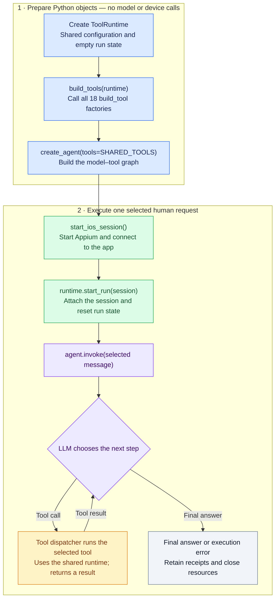
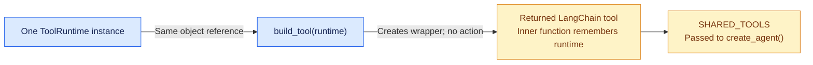

# Tools: from shared runtime to agent execution

This guide explains how [notebook 21](21_movies_automated_test.ipynb) prepares its tools and how those tools execute against the app. Follow it alongside [tools/__init__.py](tools/__init__.py), [tools/_runtime.py](tools/_runtime.py), and [tools/dismiss_keyboard.py](tools/dismiss_keyboard.py).

The central idea is: **create one shared runtime, build tools that remember it, and let the LLM choose which tool to execute.**

## 1. The overall flow

The top section prepares Python objects. The lower section starts the real session and runs the selected human request. The tool loop can repeat several times during one `agent.invoke()`.



The diagram shows the normal tool loop. An exception can also stop execution; the notebook's `finally` block handles cleanup. The session can preserve app navigation and local data from a previous run, so the agent must inspect its starting screen.

## 2. What is `ToolRuntime`?

`ToolRuntime` is a **custom Python class in this project**. An instance holds the configuration, session connection, and execution records that the tools share during a run.

```python
tool_runtime = ToolRuntime(
    bundle_id="com.example.movies",
    limits=ToolLimits(max_actions=30, timeout_seconds=180),
)
```

This creates the object. Its `session` initially equals `None`; observations, targets, and receipts start empty. Constructing it does not start Appium or call an LLM.

| Field | What it holds | Why tools need it |
| --- | --- | --- |
| `bundle_id` | The configured app identifier | Check that ordinary actions target the intended app. |
| `session` | The active managed Appium session | Access the real driver through `runtime.session.driver`. |
| `observations` | Observation IDs mapped to capture receipts | Locate saved XML/screenshots and their provenance. |
| `_targets` | Current element references mapped to native identities | Resolve an observed reference to a fresh, unique live element. |
| `last_observation_id` | The most recently registered capture ID | Reject references from older observations. |
| `receipts` | A journal of tool operations | Review actions, checks, errors, and evidence afterward. |
| `limits` and counters | Action, scroll, capture, input, and time limits | Bound the run's operations. |
| `lock` | A shared reentrant Python lock | Serialize operations using the same driver and state. |
| `uncertain` | Whether a mutation response became uncertain | Block further mutations when retrying could repeat an action. |
| Optional host configuration | TMDB token, prepared conditions, and request probe | Support tools requiring credentials or external instrumentation. |

`_targets` begins with an underscore because it is an internal implementation detail. The model supplies an `element_ref`; host code owns the mapping from that reference to native identity.

`with runtime.lock:` acquires a Python lock for that block and releases it on exit, including an early return or exception. It does not create or close an Appium session. `RLock` permits nested calls by the same thread, such as a tool calling `mutate()`, which then calls `observe()` and `record()`.

## 3. What does `build_tools(runtime)` do?

The plural function is in [tools/__init__.py](tools/__init__.py). It imports the 18 tool modules and calls each module's singular `build_tool(runtime)` factory once per call to `build_tools()`.

This actual line:

```python
return [module.build_tool(runtime) for module in modules]
```

means the same as:

```python
prepared_tools = []

for module in modules:
    prepared_tool = module.build_tool(runtime)
    prepared_tools.append(prepared_tool)

return prepared_tools
```

A **factory** is simply a function that creates and returns an object. Here, each factory returns one prepared LangChain tool.

All factories receive **the same runtime instance**. They do not create 18 independent sessions or copy the runtime. For example, after the observation tool updates `runtime._targets`, the tap tool can validate references against that same updated mapping.

Calling `build_tools()` prepares the tools. It does not execute their action bodies, read the CSV, select a scenario plan, or send a model request.

## 4. What happens inside one `build_tool(runtime)`?

Here is the structure of `dismiss_keyboard.py`, shortened to focus on construction:

```python
def build_tool(runtime):
    # The outer function receives the host-owned runtime.

    @tool
    def dismiss_keyboard() -> dict:
        """Hide the configured app's keyboard, then capture fresh UI evidence."""
        # The real implementation checks the app/keyboard, then dispatches
        # a supported action through runtime.mutate() when necessary.
        ...

    return dismiss_keyboard
```

This is an explanatory excerpt; the complete guards and action code remain in the actual file.

When `build_tool(tool_runtime)` is called:

1. Python creates the nested `dismiss_keyboard` function.
2. `@tool` wraps that function as a LangChain tool. Its name, docstring, and typed parameters describe the capability and generate its argument schema.
3. The nested function retains access to the supplied runtime through a **closure**.
4. The outer function returns the wrapped tool to `build_tools()`.

A closure means that the inner function remembers an enclosing variable after the outer function returns. It remembers a reference to the runtime object, so it can see the session attached later.



For `dismiss_keyboard`, the model supplies no arguments: its schema is empty. For `tap_element`, the model supplies `element_ref`. The runtime and its driver remain in host Python code rather than becoming model-selectable parameters. Individual tool results determine what observations are returned to the model.

## 5. How does the LLM choose and execute a tool?

The notebook gives the prepared list to `create_agent()`:

```python
SHARED_TOOLS = build_tools(tool_runtime)

test_agent = create_agent(
    model=llm,
    tools=SHARED_TOOLS,
    system_prompt=TEST_AGENT_PROMPT,
)
```

`create_agent()` creates a compiled LangGraph containing a model–tool loop. The model receives descriptions and argument schemas for the available tools. A tool call names a capability and supplies arguments; the graph's tool dispatcher invokes the corresponding Python tool and returns its result to the model as a tool message.

There is a shared tool-dispatch node. Each individual tool does not need its own StateGraph node. Execution, analysis, documentation, and reporting agents can later be connected by a separate outer StateGraph.

For an illustrative goal such as “dismiss the keyboard and inspect the screen,” the model might choose `observe_current_ui`, then `dismiss_keyboard`. The returned observations determine the next step. Every selected CSV row gets the same shared list; there is no test-ID-to-tool mapping.

## 6. When does the real session become available?

The notebook creates the session before invoking the agent:

```python
session = None
runtime_started = False

try:
    session = start_ios_session(environment, run_profile)
    tool_runtime.start_run(session)
    runtime_started = True

    result = test_agent.invoke(
        {"messages": [selected_message]},
        config={"recursion_limit": 40},
    )
finally:
    if runtime_started:
        tool_runtime.end_run()
    if session is not None:
        stop_ios_session(session)
```

`runtime_started` ensures toolkit cleanup only runs after attachment succeeds. The session is still closed if attachment fails. Notebook 21 also catches execution errors and preserves receipts before cleanup.

| Call | What happens |
| --- | --- |
| `start_ios_session(...)` | Starts the owned local Appium server and creates the managed iOS session. |
| `tool_runtime.start_run(session)` | Validates/attaches that session, starts the deadline, creates a receipt directory, and resets references, observations, receipts, and counters. |
| `test_agent.invoke(...)` | Begins model reasoning and tool execution for the one selected human message. |
| `tool_runtime.end_run()` | Clears current target references and closes toolkit access while retaining records for reporting. |
| `stop_ios_session(session)` | Closes the managed session and owned Appium process. |

When `dismiss_keyboard` is actually selected, its body acquires the lock and checks app focus. If the keyboard is already hidden, it records a no-op result. Otherwise, `runtime.mutate()` validates the run, saves intent, calls the Appium callback once, and attempts fresh after-evidence. Its result returns to the model.

A callback is an ordinary function passed to another function for later execution. Defining `dispatch()` or passing it to `mutate()` does not itself send the Appium command; `callback()` inside `mutate()` is the dispatch point.

An acknowledgment confirms SDK completion, while an assertion checks an explicit saved-state condition. The complete natural-language scenario still needs coverage review before an overall verified verdict.

## 7. Runtime state, graph state, and memory

| Concept | Role in this project |
| --- | --- |
| Custom `ToolRuntime` | Shared Python execution context: session, native targets, captures, limits, and receipts. |
| LangGraph agent state | The agent's conversation state, including human, AI, and tool messages. |
| Checkpointed conversation memory | A separate persistence mechanism for graph state; notebook 21 does not configure a checkpointer. |
| Episodic/procedural memory | Future retrieval of prior run experiences or reusable testing procedures; not implemented by creating `ToolRuntime`. |

The graph and tools interact through tool calls/results. Building a runtime object alone does not provide durable agent memory. `start_run()` resets its per-run registries, while saved evidence/report files remain on disk.

For individual tool arguments and platform/dependency limits, continue with the [tool inventory](tools/README.md).
